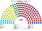
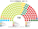

# 近期大選套新制

> 席次一覽與圖見 [`估計結果.md`](估計結果.md) §1、[`席次圖.md`](席次圖.md)。本檔講**怎麼**套。

## 計算方式

民意層＝統計局逐投票區名單票；參選方層＝`finals_for`（相鄰共同提名、地方黨鎖地盤）；單一 top-3 孔多賽、複數聖拉古。總說明見 [`選舉結果計算方式`](../../../notes/算法/選舉結果計算方式.md)。

## 1 方法

| 項目 | 來源與做法 |
|---|---|
| 第一偏好 | 統計局 volby.statistics.sk 的 `tab03f`（**逐投票區 okrsok × 政黨**）：2023 年 6,013 個、2020 年 5,998 個投票區＋海外（[`_build_nrsr.py`](_build_nrsr.py)、[`_build_nrsr2020.py`](_build_nrsr2020.py) → [`資料/nrsr-2023.csv`](資料/nrsr-2023.csv)、[`資料/nrsr-2020.csv`](資料/nrsr-2020.csv)）。政黨依官方編號對應；2020 年的州與座標沿用 2023 年同一市鎮碼 |
| 驗證 | 2020 年全國有效票 2,881,511、OĽaNO 25.03%、Smer 18.29%，和官方一致。2023 年全國有效票 2,967,896；Smer 22.95%、PS 17.96%、Hlas 14.70%、OĽaNO 8.90%、KDH 6.82%、SaS 6.32%、SNS 5.63%、Republika 4.75%、Aliancia 4.39%，和官方一致 |
| 座標 | Wikidata LAU 代碼（P782）末 6 碼＝市鎮碼（含布拉提斯拉瓦、科希策的市轄區）；2,927 個市鎮全部對上 |
| 單一 90 | 5 個國內區內依座標 Hilbert 序、按有效票連續切；top-3 孔多賽 |
| 複數 60 | 各區聖拉古、無門檻；海外 1 席 |
| 首長 | 全院 150 記名排名，須 ≥76 |

## 2 2023-09-30

實際（150）：Smer 42、PS 32、Hlas 27、OĽaNO 16、KDH 12、SaS 11、SNS 10；**Smer＋Hlas＋SNS 79 組閣**。Republika（4.75%）、Aliancia（4.39%）等約 17% 的票沒有換到席次。

| 政黨 | 得票% | 實際 150 | 單一 90 | 複數 60 | **新制 150** |
|---|--:|--:|--:|--:|--:|
| **Hlas** | 14.7 | 27 | **54** | 10 | **64** |
| Smer | 22.9 | 42 | 1 | 14 | **15** |
| SaS | 6.3 | 11 | 11 | 4 | **15** |
| Aliancia | 4.4 | 0 | 10 | 3 | **13** |
| PS | 18.0 | 32 | 0 | 12 | **12** |
| OĽaNO | 8.9 | 16 | 9 | 6 | **15** |
| KDH | 6.8 | 12 | 5 | 4 | **9** |
| SNS | 5.6 | 10 | 0 | 4 | **4** |
| Republika | 4.8 | 0 | 0 | 3 | **3** |

| 區（單一） | 結果 |
|---|---|
| 布拉提斯拉瓦（13） | SaS 11、Hlas 2 |
| 特爾納瓦－尼特拉（21） | Hlas 12、**Aliancia 7**、OĽaNO 2 |
| 特倫欽－日利納（23） | Hlas 21、Smer 1、KDH 1 |
| 班斯卡比斯特里察－科希策（21） | Hlas 13、OĽaNO 5、Aliancia 3 |
| 普雷紹夫（12） | Hlas 6、KDH 4、OĽaNO 2 |

- **Hlas 被大幅放大**：大多數新區的決選三人是 Smer、PS、Hlas；Smer 選民把 Hlas 排在 PS 前，PS 選民把 Hlas 排在 Smer 前。90 位單一當選人中 79 位不是第一偏好第一名；當選者第一偏好中位數只有 **16.3%**。
- **布拉提斯拉瓦給 SaS**：PS 第一，但 Smer、Hlas 選民把 SaS 排在 PS 前（模型位置）。
- **Aliancia 回到國會**：南部匈牙利族集中處拿 10 個單一席次，名單再 3 席（病 9）。
- **OĽaNO、KDH 在東部與中部多拿幾區**：[參選方層](../../../notes/算法/選舉結果計算方式.md)下 OĽaNO、KDH 與相鄰小黨在 Hlas 以外的對手排不進前三的選區共同提名。
- **首長 Hlas**（對 Smer、PS 都大勝，最弱一場對 KDH 86:64）；組閣 **Hlas＋KDH＋Smer＝88**（Hlas＋KDH 73 不過半）。
- **2023–24 年的執政三黨（Smer＋Hlas＋SNS）在本夾全院 90、複數 28**：改不了組織法（[`05`](05-法規位階與修憲.md)）。

## 3 2020-02-29

實際（150）：OĽaNO 53、Smer 38、Sme Rodina 17、ĽSNS 17、SaS 13、Za ľudí 12；**OĽaNO＋Sme Rodina＋SaS＋Za ľudí 95 組閣**。約 28% 的票投給門檻以下的黨（PS–Spolu 6.97% 差 0.03 點、KDH、MKS、SNS、Dobrá voľba、Vlasť、Most–Híd 等）。

| 政黨 | 得票% | 實際 150 | 單一 90 | 複數 60 | **新制 150** |
|---|--:|--:|--:|--:|--:|
| **OĽaNO** | 25.0 | 53 | 51 | 17 | **68** |
| Smer | 18.3 | 38 | 24 | 11 | **35** |
| Aliancia（MKS） | 3.9 | 0 | 10 | 3 | **13** |
| KDH | 4.7 | 0 | 5 | 3 | **8** |
| Sme Rodina | 8.2 | 17 | 0 | 5 | **5** |
| PS–Spolu | 7.0 | 0 | 0 | 5 | **5** |
| Za ľudí | 5.8 | 12 | 0 | 5 | **5** |
| ĽSNS | 8.0 | 17 | 0 | 4 | **4** |
| SaS | 6.2 | 13 | 0 | 4 | **4** |
| Most–Híd、Vlasť、SNS | 2.1、2.9、3.2 | 0 | 0 | 各 1 | **各 1** |

- **OĽaNO 是居中的孔多賽贏家**：布拉提斯拉瓦 13 區全拿，各區都第一。
- **ĽSNS（8.0%）單一 0 席**、名單只有 4 席；現行制度給它 17 席。
- **Sme Rodina 單一 0**：右側的 Smer 在新制誘因下吸收了它原本的單一席次（舊算 12）。
- **首長 OĽaNO**；組閣 **OĽaNO＋KDH＝76**。

## 4 2024 總統

民意層＝國會名單票（政黨層級），不用現實總統第一輪（受棄保、退選影響）、不用個別候選人；參選方層＝每個參選方可推人，相鄰政黨在新制誘因下可共同提名；前 3 名、6 格排序、孔多賽。（方法：[`選舉結果計算方式`](../../../notes/算法/選舉結果計算方式.md)）

| | **主版：2023-09 國民議會名單票** | 對照：現實第一輪（政黨層級） |
|---|---|---|
| 前三 | Smer 23.3%、**OĽaNO＋KDH＋Aliancia 共同提名 20.4%**、PS 18.3% | PS、Hlas、Republika 支持的候選人 |
| 勝者 | **OĽaNO 代表的中間偏右共同人選**：對 PS 72.3%、對 Smer 51.1% | Hlas（對 PS 56.8%；實際決選 Hlas 支持者 53.1%） |
| 敏感度 | 全部重地緣：Hlas（前三 Smer、PS、Hlas）；全部重體制：OĽaNO 共同人選 | — |

- **新制誘因下的整合**：OĽaNO、KDH、Aliancia 各自都進不了前三，合起來（20.4%）超過 Hlas（15%），而且三黨都偏好合併後的勝者，所以共同提名；Sme Rodina 併入 Hlas 仍不夠。
- 主版與現實不同：現實是兩極化的決選（PS 對 Hlas），新制下中間偏右的共同人選是孔多賽贏家；選民更重地緣時回到 Hlas。

## 5 敏感度（`--sweep`）

| 檢查 | 2023 單一 90 | 首長 | 2020 單一 90 | 首長 |
|---|---|---|---|---|
| 基準 | Hlas 54、SaS 11、Aliancia 10、OĽaNO 9、KDH 5、Smer 1 | Hlas | OĽaNO 51、Smer 24、Sme Rodina 12、Aliancia 10、KDH 5 | OĽaNO |
| 全部重地緣 | Hlas 54、Aliancia 10、SaS 11、OĽaNO 9、KDH 5、Smer 1 | Hlas | OĽaNO 52、Smer 24、Sme Rodina 12、Aliancia 9、KDH 5 | OĽaNO |
| 全部重體制 | Hlas 55、SaS 11、Aliancia 7、OĽaNO 11、KDH 5、Smer 1 | Hlas | OĽaNO 56、Smer 24、Sme Rodina 12、Aliancia 5、KDH 5 | OĽaNO |
| 切線位移半區 | Hlas 57、SaS 10、Aliancia 8、OĽaNO 8、Smer 3、KDH 4 | — | OĽaNO 55、Sme Rodina 13、Smer 21、Aliancia 7、KDH 6、SaS 1 | — |
| 2023：Smer −6／PS ＋6 點 | Hlas 50、SaS 10、Aliancia 10、OĽaNO 13、KDH 7 | Hlas | — | — |
| 2023：Smer ＋6／PS −6 點 | Hlas 56、Smer 12、SaS 9、Aliancia 8 … | Hlas | — | — |

**結論對假設不敏感**：Hlas 在所有情境都是單一席次與首長的贏家。

## 6 走向（推測）

| 時點 | 現實 | **新制** |
|---|---|---|
| 2020-03 | OĽaNO＋Sme Rodina＋SaS＋Za ľudí，OĽaNO 首長 | OĽaNO 首長、OĽaNO＋KDH＋Aliancia |
| 2023-05 | 總統任命 Ódor 看守政府，信任投票失敗仍執政 | 沒有看守；Heger 做到繼任者就任 |
| 2023-10 | Smer＋Hlas＋SNS，Smer 第四度執政 | Hlas 首長、Hlas＋KDH |
| 2024-02 | 縮短程序修刑法、廢特別檢察署 | 刑法與檢察機關不得走縮短程序；廢特別檢察署要兩種多數 |
| 2024 | RTVS 改組為 STVR | 公共媒體財源與理事會是組織法事項 |
| 2025-09 | 執政聯盟拉到 3/5 修憲 | 修憲要兩種多數＋公投 |

## 7 出處

| 數字 | 出處 |
|---|---|
| 2023、2020 逐投票區 | 統計局 volby.statistics.sk/nrsr/nrsr2023 `files/NRSR2023_SK_csv.zip`、/nrsr2020 `files/NRSR_2020_SK_csv.zip`（`tab03f`、`tab0a` 政黨編號） |
| 市鎮座標 | Wikidata P782 → P625 |
| 2024 總統 | 維基 2024 Slovak presidential election（引 volbysr.sk） |
| 實際席次 | 維基 2023、2020 Slovak parliamentary election；統計局 2020 `tab04` |
