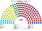
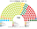
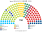
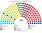
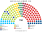
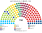
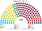

# 估計結果

> 席次**表**——§1 近期大選、§2 民調、§3 長期。圖庫見 [`席次圖.md`](席次圖.md)；算法見 [`14`](14-近期大選重算.md)、[`生態模型.py`](生態模型.py)、[`民調推估.py`](民調推估.py)。

選制：全院 **150＝單一 90（top-3 孔多賽）＋複數 60（5 國內區＋海外、聖拉古、無門檻）**；首長全院排名投票選出（棄權不計）；供給、建設性更新 ≥76；組織法全院 ≥90 且複數 ≥36。詳 [`01`](01-國會與選制.md)。

## 計算方式

| 層 | 做法 |
|---|---|
| 民意層 | 統計局逐投票區名單票（比例名單，棄保失真小） |
| 參選方層 | 席次圖產生器 的 `finals_for`：相鄰政黨共同提名；地方黨鎖地盤 |
| 單一 90 | 區內 Hilbert 切選區 → 前 3 → 空間排序兩兩對決（循環 Ranked Pairs） |
| 複數 60 | 同票聖拉古、無門檻；海外 1 席 |
| 首長／組閣 | 全院席次加權孔多賽；由近到遠加黨至 ≥76 |

細節見 [`14`](14-近期大選重算.md)、。

## 1 近期大選

統計局**逐投票區**名單票（2023 年 6,013 個、2020 年 5,998 個＋海外）。

| | 實際（150） | **本夾全院 150** | 首長 | 組閣 |
|---|---|---|---|---|
| 2023-09 | Smer 42、PS 32、Hlas 27、OĽaNO 16、KDH 12、SaS 11、SNS 10；Smer＋Hlas＋SNS | **Hlas 64**、SaS 15、OĽaNO 15、Smer 15、Aliancia 13、PS 12、KDH 9、SNS 4、Republika 3 | **Hlas** | Hlas＋KDH＋Smer＝88 |
| 2020-02 | OĽaNO 53、Smer 38、Sme Rodina 17、ĽSNS 17、SaS 13、Za ľudí 12；OĽaNO＋Sme Rodina＋SaS＋Za ľudí | **OĽaNO 68**、Smer 35、Aliancia 13、KDH 8、Sme Rodina 5、KDH 8、PS 5、Za ľudí 5、ĽSNS 4、SaS 4 … | **OĽaNO** | OĽaNO＋KDH＝76 |

| 政黨 | 單一 90 | 複數 60 | **全院** |
|---|--:|--:|--:|
| Hlas | 54 | 10 | **64** |
| Smer | 1 | 14 | **15** |
| SaS | 11 | 4 | **15** |
| Aliancia | 10 | 3 | **13** |
| PS | 0 | 12 | **12** |
| OĽaNO | 9 | 6 | **15** |
| KDH | 5 | 4 | **9** |
| SNS | 0 | 4 | **4** |
| Republika | 0 | 3 | **3** |

**組閣聯盟／多數派政府**：首長 **Hlas**；**Hlas＋KDH＋Smer＝88**。組織法：Hlas＋KDH 複數 14，改不了。

### 2024 總統（2023 名單票 × 參選方層）

**OĽaNO＋KDH＋Aliancia 共同人選**（對 PS 72.3%、對 Smer 51.1%）；選民全部重地緣時是 Hlas。現實第一輪對照是 Hlas。見 [`14`](14-近期大選重算.md) §4。

## 2 民調

**方法**：[`民調推估.py`](民調推估.py)；來源 [`資料/polls.csv`](資料/polls.csv)（維基 Opinion polling for the next Slovak parliamentary election，投票意向）。2023 年 OĽaNO 名單裡的 Slovensko、Za ľudí、基督教聯盟用 OĽaNO 的地理按比例拆開；再以 2023 逐投票區地理縮放。

| 民調 | 投票意向（前五） | **本夾全院 150** | 單一 90 | 首長 | 組閣（機械） |
|---|---|---|---|---|---|
| Ipsos（10-15..19） | PS 18.6、Smer 18.4、Republika 10.8、Slovensko 10.0、SaS 8.1 | Smer 37、Slovensko 28、SaS 24、KDH 17、Aliancia 12、PS 12、Republika 8、Hlas 7、Demokrati 4、SNS 1 | Smer 24、Slovensko 21、SaS 20、KDH 13、Aliancia 9、Hlas 3 | **Slovensko** | 6 黨＝92 |
| Focus（10-12..19） | PS 17.4、Smer 17.0、Republika 11.3、Slovensko 9.7、Hlas 8.5 | Smer 34、Hlas 26、Slovensko 24、SaS 15、Aliancia 13、KDH 12、PS 11 … | Smer 23、Hlas 21、Slovensko 17、SaS 11、Aliancia 10、KDH 8 | **KDH** | 5 黨＝79 |
| NMS（10-01..05） | PS 19.6、Smer 17.9、Republika 14.3、Slovensko 9.0、SaS 8.0 | Smer 53、Slovensko 22、SaS 19、PS 13、KDH 11、Aliancia 11、Republika 10 … | Smer 41、Slovensko 16、SaS 15、Aliancia 9、KDH 7、Hlas 2 | **KDH** | 8 黨＝127 |
| AKO（09-10..21） | PS 18.9、Smer 17.1、Republika 9.7、Hlas 8.6、Slovensko 8.1 | Smer 43、Hlas 21、SaS 20、Slovensko 14、Aliancia 13、KDH 12、PS 12 … | Smer 32、SaS 15、Hlas 15、Aliancia 10、Slovensko 10、KDH 8 | **KDH** | 6 黨＝84 |

**讀法**：Hlas 掉到 6–9% 後，單一選區分散：Smer 23–41（第一偏好最大、對手分裂）、SaS 在布拉提斯拉瓦、Slovensko 與 Aliancia 各有地盤。首長是議員之間的孔多賽贏家：三份是**居中的小黨 KDH**，Ipsos 版是 **Slovensko**（它在單一 21 席、全院 28 席，兩邊議員都把它排在對方前）。「組閣」是由首長往外依偏好距離加黨到 ≥76 的機械結果，不是預測。

## 3 長期運行（推估第 3 屆）

兩翼（PS、Republika、SNS）各讓出 1/8 第一偏好給 Hlas 與 KDH（`python 生態模型.py --projection`）。

| 政黨 | 單一 90 | 複數 60 | **全院** |
|---|--:|--:|--:|
| Hlas | 56 | 11 | **67** |
| Smer | 0 | 14 | **14** |
| KDH | 8 | 7 | **15** |
| SaS | 11 | 4 | **15** |
| Aliancia | 8 | 3 | **11** |
| PS | 0 | 10 | **10** |
| OĽaNO | 7 | 5 | **12** |
| Republika | 0 | 3 | **3** |
| SNS | 0 | 3 | **3** |

首長 **Hlas**，單獨 77；複數 11，改不了組織法。

## 4 朝野互動（各次估計）

| 民意 | 政府 | 在野 | 互動 |
|---|---|---|---|
| 2023-09 | Hlas 首長；Hlas＋KDH＋Smer 88 | SaS、OĽaNO、PS 等 | 居中的 Hlas 是 Smer 與 PS 選民共同的第二偏好，握首長；Smer 進政府但不握首長。執政三黨複數席次不到組織法門檻，廢特別檢察署、改公共媒體都要在野黨 |
| 2020-02 | OĽaNO 首長；OĽaNO＋KDH 76 | Smer 35、Aliancia 13 … | 執政多數只多 0 席餘裕（76），任何跳黨都讓建設性更新可行；但更新要具名繼任者，在野得先就一位人選達成一致 |
| 2026 民調（4 家） | 首長多為 KDH（居中小黨）；5–8 黨組閣 | Smer 是最大黨卻多半不在政府 | 碎片化時最大黨不一定執政：議員之間的孔多賽贏家是居中的小黨。Smer 要進政府，必須讓居中各黨的議員不把它排最後 |
| 第 3 屆（推估） | Hlas＋KDH 82 | 其餘 | 居中黨長期被放大，兩翼都要爭取它的選民的第二偏好 |

誘因、候選人行為與檢視見 [`12-預期政治生態.md`](12-預期政治生態.md)。
