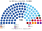

# 預期政治生態

> **席次估計**（近期大選重算、民調套本夾、長期運行假設下的席次表）見 [`估計結果.md`](估計結果.md)。本檔專注誘因、朝野互動與候選人行為；席次數字以估計結果與席次圖為準。

`0-基本/總體.md`：給長期運行下的預期政治生態，要有論據，可大膽假設。
`0-基本/要求.md` **硬性**：不得把提示詞要求直接當預期生態；不合期望就回頭改設計。

席次由 [`生態模型.py`](生態模型.py) 算出。

## 1 誘因

| 層 | 誘因 | 預期行為 |
|---|---|---|
| 單一席次（top-3 孔多賽） | 第三名支持者的第二偏好決定勝負 | **反對黨不必再避免多角戰**：現行相對多數下，反對黨私下協調「一區只派一黨」；新制下多黨同時參選也不分票 |
| 單一席次（廢集選區） | 候選人只能靠自己 | 部長不能再帶新人；新人要在自己的選區贏 |
| 複數席次（彈性名單、無門檻） | 5% 左右就有 1 席 | PSP、RDU、SDP 這類 3–5% 的政黨進入國會，不必靠非選區議員 |
| 固定選舉日、選前 12 個月定界 | 政府有完整 5 年；選區提前 1 年確定 | 施政節奏不再配合選舉時機；朝野都能長期經營選區 |
| 非議員部長 | 總理可直接延攬技術官僚 | 內閣的專業度上升，**不再需要用集選區把人送進國會** |
| 改規則 | 修憲一屆內、全院 2/3 且複數 3/5 | PAP 照現行速度修憲；只有核心條款要複決 |

## 2 假設

### 2.1 偏好的空間

| 政黨 | 體制（建制 −1 … 改革、問責 +1） | 經濟（成長、市場 −1 … 再分配 +1） |
|---|:--:|:--:|
| **PAP** | **−0.7** | **−0.3** |
| WP | +0.2 | +0.2 |
| SPP | +0.4 | +0.2 |
| PSP | +0.5 | +0.4 |
| RDU | +0.5 | +0.3 |
| SDP | +0.6 | +0.7 |
| PAR | +0.8 | +0.5 |
| 其他小黨 | +0.3 … +0.8 | +0.2 … +0.5 |

選民分三型：重體制（50%）、重經濟（20%）、均衡（30%），和前三夾相同。

★ 新加坡的競爭基本上是**一個建制黨對多個反對黨**。在單一選區裡，反對黨選民幾乎都把另一個反對黨排在 PAP 前面；所以模型的結果主要取決於 **PAP 在該區的得票是否過半**，偏好位置的細節影響很小（§5.1 敏感度）。

### 2.2 得票

各選區的**實際得票**（2025、2020 年）。集選區拆成數個單一選區時，每區加上標準差 2.5 個百分點的隨機擾動。Marine Parade–Braddell Heights 2025 年不戰而勝，假設 PAP 60%、WP 40%（2020 年 Marine Parade 集選區 PAP 57.76%）。

### 2.3 沒出戰的政黨

現行一個選區通常只有 PAP 和一個反對黨，這是相對多數制下反對黨避免分票的協調。新制下各反對黨在自己有組織的地區都有動機參選，所以模型做**反對黨陣營內校正**（[方法](../../../notes/算法/選舉結果計算方式.md)）：每區反對黨總票不動，反對黨之間的比例往該地區反對黨組成拉近 α＝0.25；只用該地區出戰過的黨（地方性政黨不補到地盤外），PAP 不動。另一種假設（反對票按全國組成分配）列在 §5.1。

## 3 席次（以 2025-05 實際得票）

| 政黨 | 單一 60 | 複數 40 | **全院 100** | 現行 97 |
|---|--:|--:|--:|--:|
| **PAP** | 51 | 27 | **78** | 87 |
| WP | 9 | 6 | 15 | 10（另 2 非選區） |
| PSP | 0 | 2 | 2 | 0 |
| RDU | 0 | 2 | 2 | 0 |
| SDP | 0 | 1 | 1 | 0 |
| PAR | 0 | 1 | 1 | 0 |
| SPP | 0 | 1 | 1 | 0 |

門檻：過半 51、3/5 60、2/3 67；複數 3/5 24、2/3 27。

- **首長**：PAP 的人選，每一場對決都是 78 比 22。
- **WP 的 9 個單一選區**：Aljunied 3、Sengkang 3、後港 1、Tampines 1、Jalan Kayu 1。Tampines 集選區 PAP 51.7%，拆成 3 區後，其中一區 PAP 和 WP 幾乎平手，前進黨（PPP）的選民第二偏好給 WP，WP 勝出。這是 2025 年兩區**第一偏好第二名當選**之一。
- **WP 得失**：集選區贏者全拿也幫過 WP（Aljunied 5 席、Sengkang 4 席）。拆成單一選區後 WP 在這兩區只有 6 區，但多拿 Tampines 1 區和複數 6 席。

## 4 PAP 得票變動（均勻擺動，2025 形狀）

| PAP 全國 | 單一 60 | 複數 40 | 全院 100 | 首長 | 單獨過組織法（60＋24） |
|:--:|---|---|---|---|:--:|
| 45% | PAP 29、WP 22、PSP 7 | PAP 19、WP 9 | PAP 48、WP 31、PSP 10 | **WP** | 否 |
| 50% | PAP 33、WP 20、PSP 5 | PAP 21、WP 8 | **PAP 54**、WP 28 | PAP | 否 |
| 55% | PAP 37、WP 20 | PAP 22、WP 8 | PAP 59、WP 28 | PAP | 否（全院 59） |
| 60% | PAP 46、WP 14 | PAP 26、WP 6 | PAP 72、WP 20 | PAP | 是 |
| 65.6%（2025） | PAP 50、WP 10 | PAP 27、WP 6 | PAP 77、WP 16 | PAP | 是 |
| 70% | PAP 53、WP 7 | PAP 29、WP 6 | PAP 82、WP 13 | PAP | 是 |

★ PAP 在 50% 以上都單獨過半、單獨組閣。掉到 45% 時，WP 是孔多賽贏家（反對黨都把 WP 排在 PAP 前面），但只有 31 席，是少數政府（§5.2 #5）。現行集選區下，PAP 在 2011 年最低點的 60.1% 拿 81／87。

## 5 檢視（硬性：不得把提示詞當預期生態）

### 5.1 敏感度

| 假設 | 2025 單一 60 | 2025 複數 40 |
|---|---|---|
| 基準 | PAP 51、WP 9 | PAP 27、WP 6、其他 7 |
| 全部重體制、全部重經濟 | 同上 | 同上 |
| 擾動 sd 0 | PAP 53、WP 7 | — |
| 擾動 sd 5 | PAP 47–49、WP 11–13 | — |
| 反對票按全國組成分配 | — | **PAP 31**、WP 7、PSP 2 |

結果對偏好位置不敏感，對**集選區內部的地理差異**（擾動）和**沒出戰政黨的票**比較敏感。

### 5.2 和期望不合之處，以及處置

使用者的期望（2026-10-28）：**不在意一黨獨大，要行政效率。** 以此檢查：

| # | 期望 | 模型 | 處置 |
|:--:|---|---|---|
| 1 | 政府穩定、決策快 | PAP 78／100，單獨過所有門檻；首長每場對決 78 比 22 | 相合。原稿為了限制 PAP 而加的跨屆修憲、選舉規則不溯及、選舉委員會並行多數，**全部撤回**（[`05`](05-法規位階與修憲.md)、[`01`](01-國會與選制.md) §5） |
| 2 | 新制不製造新的否決點 | 新設的憲法法院是唯一新否決點 | 加上 90 日期限、明顯違憲標準、可定失效期（[`07`](07-司法權與檢察.md) §2.3） |
| 3 | 公投不傷長期財政 | 強制投票下，任何上票的題目都有約 92% 投票率 | 連署提高到 5%，排除財政、稅、安全、儲備金（[`06`](06-人民修改法規範.md) §3） |
| 4 | 名單規則可以取代集選區的族群保障（計劃原案：前 3 名至少 1 位、前 6 名至少 2 位） | 原案下全國下限 2025 年 9 席、2020 年 6 席 | 改成**第 1–2 位至少 1 位，此後每 3 位至少 1 位**，下限 13、11 席；仍比集選區的 18 席低，列為承認的代價 |
| 5 | PAP 掉下來時政府仍有效率 | PAP 45%：全院 45，WP 28，首長是 WP，**WP 只有 28 席的少數政府** | 供給自動生效、建設性更新保住行政；但立法要逐案找多數，**效率會掉**。這是並立制的代價，本夾承認（[`13`](13-完善與自洽.md) §2） |

### 5.3 一黨主導的來源

**PAP 仍然長期執政，而且不是選制造成的**：它在 2025 年真的拿到約三分之二的選票。新制把它的席次從 87／97（89.7%）調到 78／100，仍遠超過修憲門檻。

## 6 朝野互動

| 項目 | 現行 | 本夾 |
|---|---|---|
| 反對黨席次 | 10（WP），另 2 非選區 | 22（WP 15、其他 7） |
| 反對黨數 | 1 | 6 |
| 修憲 | PAP 單獨、一屆內 | 同左（核心條款另要複決） |
| 內閣 | 部長須是議員 | 可延攬非議員 |
| 總統選舉 | 3 次競選、3 次不戰而勝（1993–2023） | 每次都要投票 |
| 總統 | 歷任都是前 PAP 部長或建制人士 | 多半仍是（[`14`](14-近期大選重算.md) §4） |
