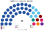

# 估計結果

> 近期大選與民調的民意套進本夾後的席次、首長、組閣與朝野互動。圖庫見 [`席次圖.md`](席次圖.md)。

選制摘要：全院 **100＝單一 60（top-3 孔多賽）＋複數 40（彈性名單、5 區各 8 席聖拉古、無法定門檻）**。詳 [`01`](01-國會與選制.md)。

## 計算方式

| 層 | 做法 |
|---|---|
| 民意層 | 各選區（含集選區）實際得票（選舉局公報，引自維基百科）。現行是相對多數制，這是能取得的最細資料 |
| 參選方層 | 每黨都可推人；地方性政黨只在本地參選；相鄰政黨在合起來能進前 3、且雙方都偏好合併後勝者時共同提名（席次圖產生器）；在新制下，現行不在某區參選的反對黨也假設會推人 |
| 單一 60 | 集選區拆成單一選區（集選區內部的地理差異沒有公開資料，以隨機擾動代替）；前 3 名、全體選民完整排序兩兩對決，循環用 Ranked Pairs |
| 複數 40 | 5 區各 8 席，聖拉古、無門檻 |
| 首長、組閣 | 全院 100 記名排名，孔多賽；組閣由首長往外依政策距離加黨到 ≥51 |
| 民調 | GE2025 後沒有可用的全國民調，跳過 |

程式：[`生態模型.py`](生態模型.py)；細節見 [`14`](14-近期大選重算.md)、共同算法 [`選舉結果計算方式`](../../../notes/算法/選舉結果計算方式.md)。

## 1 近期大選

用當時實際得票套本夾。細節與方法見 [`14-近期大選重算.md`](14-近期大選重算.md)（[`生態模型.py`](生態模型.py)）。各屆由新到舊；**完整席次見下方各小節**（圖上表下，不堆在總表上方）。

| | 實際 | **本夾全院 100** | 首長 |
|---|---|---|---|
| 2025-05 | PAP 87／97（65.57%）、WP 10（另 2 非選區） | PAP **77**、WP 16、PSP 2、RDU 2、其餘各 1 | **PAP** |
| 2020-07 | PAP 83／93（61.24%）、WP 10 | PAP **74**、WP 12、PSP 6、RDU 2、NSP 2、其餘各 1 | **PAP** |

### 2025-05

| 政黨 | 單一 60 | 複數 40 | **全院** |
|---|--:|--:|--:|
| PAP | 50 | 27 | **77** |
| WP | 10 | 6 | **16** |
| PSP | 0 | 2 | **2** |
| RDU | 0 | 2 | **2** |
| SDP | 0 | 1 | **1** |
| PAR | 0 | 1 | **1** |
| SPP | 0 | 1 | **1** |

**組閣聯盟／多數派政府**：首長 **PAP**；PAP **77** 單獨過半；複數 27≥3/5，可單獨過組織法／修憲。

**預期政治生態**：PAP 仍一黨主導，而且單獨過所有門檻，這是它真的拿到約三分之二選票的結果。差別在反對黨：WP 16 席、其他 5 個反對黨 7 席，國會裡第一次出現多黨反對；WP 在東北、東南兩區的名單層也有席次，可以在委員會與質詢上形成持續的監督。

PAP 過 3/5、2/3；複數 27 過 3/5——單獨過組織法與修憲。

### 2020-07

| 政黨 | 單一 60 | 複數 40 | **全院** |
|---|--:|--:|--:|
| PAP | 53 | 24 | **77** |
| WP | 7 | 5 | **12** |
| PSP | 0 | 4 | **4** |
| NSP | 0 | 2 | **2** |
| SDP | 0 | 1 | **1** |
| RDU | 0 | 1 | **1** |
| SDA | 0 | 1 | **1** |
| PV | 0 | 1 | **1** |
| RP | 0 | 1 | **1** |

**組閣聯盟／多數派政府**：首長 **PAP**；PAP **74** 單獨過半；複數 24 剛好過 3/5。

**預期政治生態**：PAP 複數剛好 24 席，再少 1 席就改不了組織法：反對黨（WP 12、PSP 6 等）第一次有了擋下規則改寫的實力，PAP 的修憲要先與反對黨協商。

PAP 複數 24，剛好過 3/5。總統見 [`14`](14-近期大選重算.md) §4（政黨層級：2023 PAP 背景人選第一偏好過半）。

## 2 民調

GE2025 之後**沒有**可用的全國投票意向民調（公開來源多為選舉結果回填或會前舊調，不足以另套席次）。**本節跳過。**

近期大選得票套本夾見 §1；長期運行見 §3。

## 3 長期運行假設下

生態模型示意 **推估第 3 屆**（＝2025 得票套本夾；假設見 [`12-預期政治生態.md`](12-預期政治生態.md)；數字由 [`生態模型.py`](生態模型.py) 算出）。

| 政黨 | 單一 60 | 複數 40 | 全院 100 |
|---|--:|--:|--:|
| PAP | 50 | 27 | **77** |
| WP | 10 | 6 | **16** |
| PSP | 0 | 2 | **2** |
| RDU | 0 | 2 | **2** |
| SDP | 0 | 1 | **1** |
| PAR | 0 | 1 | **1** |
| SPP | 0 | 1 | **1** |
| **計** | **60** | **40** | **100** |

首長：PAP。WP 單一 10（Aljunied 3、Sengkang 3、Tampines 2、後港 1、Jalan Kayu 1）。PAP 全國掉到 55% 時全院仍過半（59），但不到 3/5——改組織法要拉反對黨（見 [`席次圖-刀鋒-55.svg`](席次圖-刀鋒-55.svg)）。
誘因與候選人行為見 [`12-預期政治生態.md`](12-預期政治生態.md)。
