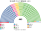
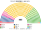
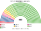
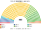

# 近期大選重算

> **這檔是什麼**：近期大選得票**怎麼**套進本夾選制（方法、假設、對照）。席次一覽與圖見 [`估計結果.md`](估計結果.md) §1、[`席次圖.md`](席次圖.md)。

2024、2021 套新制

**方法**：[`生態模型.py`](生態模型.py)。第一偏好是總務省**市區町村別比例代表得票**（[`資料/`](資料/)，約 1,900–2,000 個單位；跨選區的市區已按小選舉區拆開）；偏好排序是假設（[`12`](12-預期政治生態.md) §2）。只用當時民意。

## 1 一覽

| | 實際（289＋176） | 實際政府 | **新制全院 465** | **首長** | **組閣陣營** |
|---|---|---|---|---|---|
| 2026-02 | **自民 316**、中道 49、維新 36、國民 28、參政 15、未來 11 … | 高市（自民單獨 2/3） | **國民 247**、自民 83、維新 60、未來 17、中道 33 … | **國民民主** | 國民單獨 247 |
| 2024-10 | 自民 191、立憲 148、維新 38、國民 28、公明 24 … | 石破少數政府 | 國民 233、自民 74、維新 56、立憲 48、公明 21 … | **國民民主** | 國民單獨 233 |
| 2021-10 | 自民 259、立憲 96、維新 41、公明 32 … | 岸田（自公） | **自民 293**、維新 57、立憲 48、公明 21 … | **自民** | 自民單獨 |

## 2 2026-02

高市首相解散後的第 51 回大選。自民比例票 36.7%，現行制度下 316 席（小選舉區 249／289）。中道改革連合是立憲與公明的眾院合流；チームみらい（本夾記「未來」）首次進眾院。

| 政黨 | 單一 280 | 複數 185 | **全院** |
|---|--:|--:|--:|
| 國民 | 230 | 17 | **247** |
| 自民 | 8 | 75 | **83** |
| 維新 | 40 | 20 | **60** |
| 未來 | 2 | 15 | **17** |
| 中道 | 0 | 33 | **33** |
| 參政 | 0 | 16 | **16** |
| 共產 | 0 | 9 | **9** |

- **國民民主單一 230**（得票 9.7%）：國民在兩大一中之間，只要進到第二輪，兩邊選民都把它排第二，對自民、對中道都贏。它單獨常排第四；[參選方層](../../../notes/算法/選舉結果計算方式.md)下，國民與相鄰的維新、未來、公明在「合起來才進得了前三、雙方都偏好國民當選」的選區共同提名（約 200 區），國民因此幾乎每區都進第二輪。決選三人 218 區是「中道／國民／自民」。當選者第一偏好中位只有 **10%**。
- **自民單一只剩 8**：兵庫 3、和歌山 2、奈良、山口、德島各 1——國民與維新都進不了前三、也沒有整合的地方。
- **維新單一 40**：大阪 17／17、京都 6／6、兵庫 8、神奈川 4、東京 2、福岡 2。
- **未來單一 2**：沖繩、熊本各 1（不整合時都市區 30 席，整合後多半由國民代表）。
- **首長是國民民主**（最弱一場 382）；國民全院 247 單獨過半。
- ★ **這個結果靠兩個假設**：國民在偏好空間裡居中（[`12`](12-預期政治生態.md) §2），以及維新、未來、公明會在新制下和國民共同提名。若各黨不整合（舊算），國民單一 157、首長仍是國民、組閣國民＋維新＋未來 275。兩者的結論相同（國民民主是孔多賽贏家），差別在國民能不能單獨過半。

## 3 2024-10
| 政黨 | 得票% | 實際 | 單一 280 | 複數 185 | **新制** |
|---|--:|--:|--:|--:|--:|
| 國民 | 11.3 | 28 | 211 | 22 | **233** |
| 自民 | 26.7 | 191 | 24 | 50 | **74** |
| 維新 | 9.4 | 38 | 36 | 20 | **56** |
| 立憲 | 21.2 | 148 | 9 | 39 | **48** |
| 公明 | 10.9 | 24 | 0 | 21 | **21** |
| 令和 | 7.0 | 9 | 0 | 16 | **16** |
| 共產 | 6.2 | 8 | 0 | 14 | **14** |
| 參政 | 3.4 | 3 | 0 | 2 | **2** |
| 保守 | 2.1 | 3 | 0 | 1 | **1** |

| 地區（單一） | 結果 |
|---|---|
| 東京（28） | 國民 26、自民 2 |
| 神奈川（19） | 國民 14、自民 5 |
| 大阪（17） | 維新 17 |
| 愛知（15） | 國民 15 |
| 埼玉（14）、千葉（13） | 國民 8＋9、自民 6＋4 |
| 北海道（11） | 立憲 7、國民 3、自民 1 |
| 兵庫（11） | 維新 11 |
| 福岡（10） | 自民 8、國民 2 |
| 九州其他、中國、四國、北關東 | 自民為主 |

- 決選三人：國民／立憲／自民 125 區、公明／立憲／自民 109 區、立憲／維新／自民 28 區。在「公明／立憲／自民」那 109 區，**自民黨是孔多賽贏家**（組織宗教軸讓公明黨不是別人的第二偏好）。
- 當選者第一偏好中位數 20%。

## 4 2021-10
| 政黨 | 得票% | 實際 | 單一 280 | 複數 185 | **新制** |
|---|--:|--:|--:|--:|--:|
| 自民 | 34.7 | 259 | 228 | 65 | **293** |
| 維新 | 14.0 | 41 | 32 | 25 | **57** |
| 立憲 | 20.0 | 96 | 7 | 41 | **48** |
| 公明 | 12.4 | 32 | 0 | 21 | **21** |
| 國民 | 4.5 | 11 | 13 | 13 | **26** |
| 共產 | 7.2 | 10 | 0 | 16 | **16** |
| 令和 | 3.9 | 3 | 0 | 4 | **4** |

- 自民單一 228／280：當年國民民主只有 4.5%，進不了前三名、和相鄰政黨合起來也多半不夠；自民在「公明／立憲／自民」與「立憲／維新／自民」的三人決選裡都是孔多賽贏家。
- 維新：大阪 17、兵庫 9、京都 5。
- **自民 293 > 279（3/5）**，但複數 65 < 111：單獨執政，改不了憲法。

## 5 敏感度

見 [`12`](12-預期政治生態.md) §6。

## 6 限制

- 第一偏好用比例票；選區候選人的個人票（後援會）沒有反映。
- 2026 年 0 列、2024 年 3 列、2021 年 26 列比例單位對不上現行小選舉區，歸到前一列的選區。
- 新選區沿「現行小選舉區序 → 原列序」切；現行選區在地理上連續。

## 來源

- 總務省，第 49、50、51 回衆議院議員総選挙「市区町村別得票数」（比例代表、小選挙区），soumu.go.jp。
- 實際席次：同上結果調。
