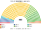
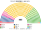
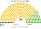
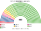
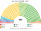
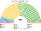

# 估計結果

> 近期大選與民調的民意套進本夾後的席次、首長、組閣與朝野互動。圖庫見 [`席次圖.md`](席次圖.md)。

選制摘要：全院 **465＝單一 280（top-3 孔多賽）＋複數 185（聖拉古、無門檻）**。詳 [`01`](01-國會與選制.md)。

## 計算方式

| 層 | 做法 |
|---|---|
| 民意層 | 總務省市區町村別比例代表得票（約 1,900–2,000 個單位，跨選區的市區已按小選舉區拆開）。比例票不受小選舉區棄保影響 |
| 參選方層 | 每黨都可推人；地方性政黨只在本地參選；相鄰政黨在合起來能進前 3、且雙方都偏好合併後勝者時共同提名（席次圖產生器） |
| 單一 280 | 依都道府縣配額（每縣至少 1），縣內依現行小選舉區順序連續切成有效票相近的選區；前 3 名、全體選民完整排序兩兩對決，循環用 Ranked Pairs。選民排序由各黨在多軸政策位置推得（候選人個人後援會不反映） |
| 複數 185 | 比例區聖拉古、無門檻 |
| 首長、組閣 | 全院 465 記名排名，孔多賽；組閣由首長往外依政策距離加黨到 ≥233 |
| 民調 | 全國比例投票意向，以選舉當時地理縮放 |

程式：[`生態模型.py`](生態模型.py)、[`民調推估.py`](民調推估.py)；細節見 [`14`](14-近期大選重算.md)、共同算法 [`選舉結果計算方式`](../../../notes/算法/選舉結果計算方式.md)。

## 1 近期大選

用當時實際得票套本夾。細節見 [`14-近期大選重算.md`](14-近期大選重算.md)。

| | 實際 | **本夾全院 465** | 首長 |
|---|---|---|---|
| 2026-02 | 自民 316、中道 49、維新 36、國民 28、參政 15、未來 11 … | 國民 **247**、自民 83、維新 60、未來 17、中道 33 … | 國民民主（國民＋維新＋未來 275） |
| 2024-10 | 自民 191、立憲 148、維新 38、國民 28 … | 國民 **233**、自民 74、維新 56、立憲 48、公明 21 … | 國民民主 |
| 2021-10 | 自民 259、立憲 96 … | **自民 293**、維新 57、立憲 48、公明 21 … | 自民 |

### 2026-02 單一／複數

| 政黨 | 單一 280 | 複數 185 | **全院** |
|---|--:|--:|--:|
| 國民 | 230 | 17 | **247** |
| 自民 | 8 | 75 | **83** |
| 維新 | 40 | 20 | **60** |
| 未來 | 2 | 15 | **17** |
| 中道 | 0 | 33 | **33** |
| 參政 | 0 | 16 | **16** |
| 共產 | 0 | 9 | **9** |

**組閣聯盟／多數派政府**：首長 **國民民主**；國民單獨 247（過半 233），機械組閣國民＋維新＋未來 275。

**預期政治生態**：現實中自民黨以 316 席壓勝，本夾卻是國民民主單獨過半：自民得票 37% 但單一只有 8 席——國民、維新與自民同進第二輪時，中道與在野選民把國民排在自民前面。自民 83 席多在名單層，成為最大反對黨。國民單獨只多 14 席，又是第一次執政，黨內新人比例高，政府穩定性取決於黨紀；改規則（複數 3/5＝111）國民只有 17 席，必須拉自民。

### 2024-10 單一／複數

| 政黨 | 單一 280 | 複數 185 | **全院** |
|---|--:|--:|--:|
| 國民 | 211 | 22 | **233** |
| 自民 | 24 | 50 | **74** |
| 維新 | 36 | 20 | **56** |
| 立憲 | 9 | 39 | **48** |
| 公明 | 0 | 21 | **21** |
| 令和 | 0 | 16 | **16** |
| 共產 | 0 | 14 | **14** |
| 參政 | 0 | 2 | **2** |
| 保守 | 0 | 1 | **1** |

**組閣聯盟／多數派政府**：首長 **國民民主**；國民 233＝過半 233，剛好單獨執政；複數 3/5＝111（國民複數 22）。

**預期政治生態**：國民民主剛好 233 席，任何一席異動就要拉維新或未來。現實中石破政府是少數政權、靠逐案協商；本夾則是國民一黨執政、自民與立憲在野。立憲 48 席、自民 74 席都以名單層為主，反對陣營左右分裂，無法共推一人換掉國民。

### 2021-10 單一／複數

| 政黨 | 單一 280 | 複數 185 | **全院** |
|---|--:|--:|--:|
| 自民 | 228 | 65 | **293** |
| 維新 | 32 | 25 | **57** |
| 立憲 | 7 | 41 | **48** |
| 公明 | 0 | 21 | **21** |
| 國民 | 13 | 13 | **26** |
| 共產 | 0 | 16 | **16** |
| 令和 | 0 | 4 | **4** |

**組閣聯盟／多數派政府**：首長 **自民**；自民 293 單獨過半；複數 3/5＝111（自民複數 65，改規則要拉公明等）。

**預期政治生態**：自民單獨執政，與現實相近（現實 259 席）。差別在改規則：自民複數 65，修憲要拉公明、維新，現實中自公兩黨在兩院的 2/3 才能發動修憲的格局在本夾仍然存在。

## 2 民調

**方法**：[`民調推估.py`](民調推估.py)，來源 [`資料/polls.csv`](資料/polls.csv)。政黨**支持率**不是投票意向（約四成「支持なし」），直接把表列政黨重新正規化會把自民放大到六成以上——舊版就是這樣算出自民 392–405 席，已改正。現在用**同一家民調相對大選前一週的變化**：每黨比例 r＝(最新＋0.5)／(基準＋0.5)，套到 2026-02 實際比例票後正規化，再以 2026 市區町村地理縮放，跑單一 280 top-3 孔多賽與複數 185 聖拉古。中道＝民調裡立憲系＋公明（2026-10 已分列）。

| 民調 | 基準 | 換算得票 % | **本夾全院 465** | 單一 280 | 首長 | 組閣 |
|---|---|---|---|---|---|---|
| NHK（2026-10-10..12） | 2026-01-30..02-01 | 自民 43.7、中道 12.2、未來 8.5、國民 8.2、維新 7.9、參政 6.9、共產 6.3 … | 自民 165、未來 19、國民 164、維新 64、中道 23、參政 16、共產 14 | 自民 83、未來 3、國民 148、維新 46 | 國民民主（對自民 233:232） | 國民＋維新＋未來＋中道＋自民（自民差 1 席過半） |
| JNN（2026-10-03..04） | 2026-01-31..02-01 | 自民 43.9、中道 13.8、維新 8.7、參政 7.7、國民 7.1、共產 5.8、未來 5.2 … | 自民 183、國民 158、維新 52、未來 16、中道 26、參政 16、共產 12、保守 1、社民 1 | 自民 101、國民 142、維新 33、未來 4 | **自民**（單獨 262） | 自民單獨 |

**讀法**：

- 兩家都顯示選後中道（立憲系＋公明）支持減半、國民與維新下滑、自民持平 → 換算後自民 44%。
- **自民單一 83–101**：自民份額上升到四成以上，但國民與相鄰的維新、未來共同提名後仍進到多數區的第二輪，國民單一 142–148。
- **首長**：兩份都是**國民民主**（自民是全院最大黨 165–183，但兩兩對決輸給國民）；組閣國民＋維新＋未來（＋中道）247–252。

**預期政治生態**：**預期政治生態**：自民支持度回到四成以上、全院 165–183 席，仍是最大黨，但首長是國民民主：中間的國民與維新、未來組成的政府只多 14–19 席。自民是強大的反對黨，只要拉到維新就有 229–247 席，接近換掉首長，維新因此成為政府存續的關鍵。

## 3 長期運行假設下

本夾生態模型以 **2024 得票** 為長期示意基準（見 [`12-預期政治生態.md`](12-預期政治生態.md) §3；[`生態模型.py`](生態模型.py)）。

| 政黨 | 單一 280 | 複數 185 | **全院 465** |
|---|--:|--:|--:|
| 國民民主 | 211 | 22 | **233** |
| 自民 | 24 | 50 | **74** |
| 維新 | 36 | 20 | **56** |
| 立憲 | 9 | 39 | **48** |
| 公明 | 0 | 21 | **21** |
| 令和 | 0 | 16 | **16** |
| 共產 | 0 | 14 | **14** |
| 參政 | 0 | 2 | **2** |
| 保守 | 0 | 1 | **1** |

**預期政治生態**：同 2024 大選。誘因與候選人行為見 [`12-預期政治生態.md`](12-預期政治生態.md)。
