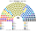
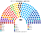
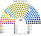

# 估計結果

> 席次**表**：§1 近期大選、§2 民調、§3 長期。國會兩夾相同，算法與逐區結果見 [`../共用/14`](../共用/14-近期大選重算.md)；圖見 [`../共用/席次圖.md`](../共用/席次圖.md)。

選制：國會 **180＝單一 108（top-3 孔多賽）＋複數 72（6 區、聖拉古、無門檻）**；法律 ≥91；組織法全院 ≥108 **且**複數 ≥44。總統：全國 top-3 孔多賽。

## 1 近期大選

### 2025-11（SERVEL 逐投票桌）

| 政黨 | 單一 108 | 複數 72 | **全院 180** |
|---|--:|--:|--:|
| PDG 人民黨 | 57 | 10 | **67** |
| RN 國家革新 | 18 | 7 | **25** |
| REP 共和黨 | 0 | 12 | **12** |
| PS | 4 | 5 | **9** |
| FRVS | 5 | 3 | **8** |
| UDI | 2 | 6 | **8** |
| FA | 2 | 6 | **8** |
| 其他 11 黨 | 20 | 23 | **43** |

**總統（同日名單票 × 參選方層；[方法](../../../notes/算法/選舉結果計算方式.md)）**：前三 Unidad por Chile 35.2%、Chile Grande y Unido 21.2%、REP 13.4%；勝者 **Chile Grande y Unido 共同人選**（UDI＋RN＋EVO＋DEM；對 Unidad por Chile 59.5、對 REP 76.8）。現實第一輪對照下是 REP。

- 總統的聯盟 42／180（RN 25、UDI 8、DEM 6、EVO 3）；國會中心仍是 PDG 67。
- PDG 在總統選舉沒進前三（12.0%）：政黨票下左右兩個正式聯盟都比它大。

### 2021-11（總統）

國會沒有逐桌資料（[`../共用/14`](../共用/14-近期大選重算.md) §1）。

**總統**：2021 沒有國會名單票資料，主版不計算。現實第一輪對照（政黨層級）下是 PDG。

### 2017-11（SERVEL 逐投票桌）

| 政黨 | 單一 108 | 複數 72 | **全院 180** |
|---|--:|--:|--:|
| PDC 基督教民主黨 | 36 | 8 | **44** |
| RN 國家革新 | 14 | 14 | **28** |
| PS 社會黨 | 15 | 8 | **23** |
| PPD 爭取民主黨 | 10 | 5 | **15** |
| FA | 7 | 5 | **12** |
| UDI | 0 | 11 | **11** |
| PR 激進黨 | 8 | 2 | **10** |
| FRVS | 7 | 2 | **9** |
| 其他 6 黨 | 11 | 17 | **28** |

**總統（同日名單票 × 參選方層）**：前三 Chile Vamos 39.3%、Fuerza de la Mayoría 24.9%、FA＋HUM＋PEV 14.0%；勝者 **Fuerza de la Mayoría 共同人選**（PS＋PPD＋PC＋PR；對 Chile Vamos 53.8、對 FA 80.9）。現實第一輪對照下是 RN（Chile Vamos）。

## 2 民調

2025 年選後沒有可用的政黨民調頁（維基未建），**本夾不做民調重算**。估計結果三來源中的這一項從缺。

## 3 長期運行（推估第 3 屆）

兩端（REP、PNL、PSC、PC、IZQ）各讓出 1/8 第一偏好給 RN、PS（各半）。

| 政黨 | 單一 108 | 複數 72 | **全院 180** |
|---|--:|--:|--:|
| PDG 人民黨 | 57 | 10 | **67** |
| RN 國家革新 | 21 | 8 | **29** |
| PS 社會黨 | 4 | 6 | **10** |
| REP 共和黨 | 0 | 10 | **10** |
| UDI | 2 | 7 | **9** |
| PPD | 5 | 4 | **9** |
| PDC | 6 | 2 | **8** |
| 其他 11 黨 | 13 | 25 | **38** |

PDG 仍是單一席次的大贏家；總統的黨無論誰都在國會少數，**預提是總統施政的主要保證**。
