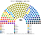
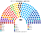

# 近期大選套新制（兩夾共用）

> 國會兩夾相同；總統（總統制夾）與首長（議會制夾）的結果各夾的 `估計結果.md` 也列。圖見 [`席次圖.md`](席次圖.md)。

## 1 方法

| 項目 | 來源與做法 |
|---|---|
| 2025 第一偏好 | SERVEL **逐投票桌**眾議員票（初步結果，28 個選區各一檔），合到投票所（local de votación）：3,496 所（[`_build_cl.py`](_build_cl.py)、[`資料/cl-2025.csv`](資料/cl-2025.csv)） |
| 2025 驗證 | 有效票 10,721,354：REP 13.26%、PDG 12.00%、UDI 8.34%、RN 8.09%、FA 7.53%、PNL 6.34%。總統第一輪逐桌加總 12,967,498：PC 26.85%、REP 23.92%、PDG 19.72%、PNL 13.93%、UDI 12.46%；與 TRICEL 確定結果（12,975,034）相差不到 0.1% |
| 2017 第一偏好 | SERVEL **逐投票桌** TRICEL 確定結果（15 個大區各一檔）：2,149 所，有效票 5,996,972（[`資料/cl-2017.csv`](資料/cl-2017.csv)）。黨名去掉「PARTIDO」字首、掛黨的獨立人士（INDEPENDIENTE＋黨名）歸該黨 |
| 2021 | SERVEL 網站上找不到 2021 年的國會逐桌檔（只有總統第一輪），**國會重算用 2017 代替**；2021 年只做總統 top-3 |
| 座標 | Wikidata 智利市鎮（Q1840161）的座標，以西文名稱對應（346 個市鎮全部對上；5 個以別名對應） |
| 單一 108 | 6 區內依座標的 Hilbert 曲線排序（經度放大 3 倍，因為智利南北狹長），按有效票連續切；top-3 孔多賽 |
| 複數 72 | 各區聖拉古、無門檻；「其他」拆成 5 份小名單 |
| 總統 | 民意層＝同日國會名單票（政黨層級），不用現實總統第一輪（受棄保、退選影響）、不用個別候選人；參選方層＝每個參選方可推人，現實中正式共推一人的聯盟先合併，其餘相鄰政黨在新制誘因下可共同提名；前 3 名、6 格排序、孔多賽。（[方法](../../../notes/算法/選舉結果計算方式.md)）。2021 沒有國會逐桌資料，只有現實第一輪對照 |
| 首長（議會制夾） | 全院 180 記名排名，須 ≥91 |
| 校準 | 三次決選：模型對決 2025 REP 對 PC 60.2（實際 58.2）、2021 FA 對 REP 52.9（55.9）、2017 RN 對 Fuerza de la Mayoría 50.4（54.6）。**勝方三次都對**。制憲三案用兩次公投校準（§4） |

## 2 2025-11-16

實際眾議院 155：REP 31、UDI 18、FA 17、PDG 14、RN 13、PS 11、PC 11、PPD 9、PDC 8、PNL 8 …；總統 REP（決選 58.2 勝 PC）。

| 政黨 | 得票% | 實際 155 | 單一 108 | 複數 72 | **新制 180** |
|---|--:|--:|--:|--:|--:|
| **PDG 人民黨** | 12.0 | 14 | 57 | 10 | **67** |
| RN 國家革新 | 8.1 | 13 | 18 | 7 | **25** |
| REP 共和黨 | 13.3 | 31 | 0 | 12 | **12** |
| PPD 爭取民主黨 | 4.0 | 9 | 3 | 4 | **7** |
| FA 廣泛陣線 | 7.5 | 17 | 2 | 6 | **8** |
| PS 社會黨 | 5.5 | 11 | 4 | 5 | **9** |
| UDI 獨立民主聯盟 | 8.3 | 18 | 2 | 6 | **8** |
| PDC 基督教民主黨 | 4.2 | 8 | 5 | 1 | **6** |
| PNL 國家自由黨 | 6.3 | 8 | 0 | 6 | **6** |
| FRVS、PC、HUM、PR、EVO、DEM、PL、PSC | 26.1 | 25 | 14 | 15 | **29** |
| PEV、IZQ、AMA、其他 | 4.6 | 1 | 3 | 0 | **3** |

| 區（單一） | 結果 |
|---|---|
| 北部（13） | PDG 8、AMA 2、PPD 2、PS 1 |
| 瓦爾帕萊索－奧希金斯（18） | PDG 12、FRVS 4、RN 2 |
| 聖地牙哥西北（20） | PDG 12、RN 5、UDI 1、PPD 1、FA 1 |
| 聖地牙哥東南（21） | PDG 10、RN 6、FRVS 1、PS 1、FA 1、PR 1、UDI 1 |
| 中南部（20） | PDG 7、DEM 5、PDC 4、RN 2、EVO 2 |
| 南部（16） | PDG 8、RN 3、PS 2、PR 1、AMA 1、PDC 1 |

- **PDG 以 12% 第一偏好拿 57／108 個單一席次**：人民黨（PDG）在經濟、價值兩軸都居中，左右兩邊的選民都把它排第二。65 區的當選者不是第一輪第一名；沒有一區的當選者第一偏好過半。
- **REP（第一大黨 13.3%）沒有單一席次**：它的選民集中在右側，在三人對決中輸給居中的 PDG、RN。
- 全院 67／180：首長、法律要再拉 24 席以上；組織法要 PDG＋整個右派（[`05`](05-法規位階與修憲.md) §2）。

## 3 2017-11-19

實際眾議院 155：RN 36、UDI 30、PS 19、PDC 14、RD 10、PPD 8、PC 8、PR 8、EVO 6 …；總統 RN（決選 54.6）。

| 政黨 | 得票% | 單一 108 | 複數 72 | **新制 180** |
|---|--:|--:|--:|--:|
| PDC 基督教民主黨 | 10.3 | 36 | 8 | **44** |
| RN 國家革新 | 17.8 | 14 | 14 | **28** |
| PS 社會黨 | 9.8 | 15 | 8 | **23** |
| PPD 爭取民主黨 | 6.1 | 10 | 5 | **15** |
| FA（RD 等） | 7.2 | 7 | 5 | **12** |
| UDI 獨立民主聯盟 | 16.0 | 0 | 11 | **11** |
| PR 激進黨 | 3.6 | 8 | 2 | **10** |
| HUM、PC、PRO、FRVS、IZQ、EVO、PEV | 23.8 | 18 | 19 | **37** |
| DEM、PL、其他 | 5.5 | 0 | 0 | **0** |

- 2017 年沒有 PDG 式的居中新黨，**PDC 是居中黨**：10.3% 拿 36 個單一席次（中南部 15／20、南部 10／16）。
- UDI（16.0%）0 個單一席次，同 2025 年的 REP。

## 4 制憲三案（2022、2023 公投）

| 對決 | 模型 | 實際 |
|---|--:|--:|
| 2022 草案 對 現行憲法 | 37.6 | 38.1 |
| 2023 草案 對 現行憲法 | 41.5 | 44.2 |
| 2022 草案 對 2023 草案 | 38.0 | — |

選民用 2025 國會得票（強制投票下的母體），三案位置：2022 草案（−0.7, −0.6）、2023 草案（0.4, 0.2）、現行憲法（0.2, 0.1），用兩次實際結果校準。**現行憲法是三案的孔多賽贏家**。

## 5 敏感度（`--sweep`）

| 檢查 | 2025 單一 | 首長 | 2017 單一 | 首長 | 總統 2025／2017 |
|---|---|---|---|---|---|
| 基準 | PDG 57、RN 18、FRVS 5、DEM 5、PDC 5 … | PDG | PDC 36、PS 15、RN 14 … | PR | UDI 聯盟／PS 聯盟 |
| 全部重經濟 | PDG 58、RN 18、PDC 6、PPD 5 … | PDG | PDC 34、PS 16、RN 11 … | PR | 同上 |
| 全部重價值 | PDG 57、RN 18、PDC 6 … | PDG | PDC 39、RN 16、PS 16、PC 9 … | PDC | UDI 聯盟／**PDC** |
| 全部均衡 | PDG 57、RN 18、FRVS 5 … | PDG | PDC 38、RN 17、PS 11 … | PDC | UDI 聯盟／**PDC** |
| 切線位移半區 | PDG 58、RN 20、PDC 8 … | — | PDC 34、RN 13、PS 13 … | — | — |
| REP −6／FA ＋6 點 | PDG 50、RN 11、FA 10 … | PDG | — | — | — |
| REP ＋6／FA −6 點 | PDG 56、RN 25、UDI 8 … | PDG | — | — | — |

**讀法**：2025 年 PDG 在所有假設下都拿 50–58 個單一席次、都是首長；總統 2025 在所有假設下都是 Chile Grande y Unido 共同人選；2017 在 Fuerza de la Mayoría 與 PDC 之間換。**比秘魯穩定得多**：智利的光譜清楚，居中的黨很明確。

## 6 出處

| 數字 | 出處 |
|---|---|
| 2025 逐投票桌 | SERVEL `PRELIMINARES_DIPUTADOS.zip`、`PRELIMINARES_PRESIDENTE_DE_LA_REPUBLICA.zip`（servel.cl 媒體庫） |
| 2017 逐投票桌 | SERVEL `NN_Resultados_Mesa_DIPUTADOS_Tricel.xlsx`（2022-12 上傳的歷史檔） |
| 總統第一輪、決選，實際席次 | 維基 2017、2021、2025 Chilean general election |
| 制憲公投 | 維基 2022、2023 Chilean constitutional referendum |
| 民調 | 2025 年選後沒有可用的政黨民調頁（維基未建），本夾不做民調重算 |
