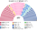
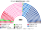
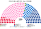
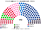
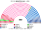

# 近期大選重算

> **這檔是什麼**：近期大選得票**怎麼**套進本夾選制（方法、假設、對照）。席次一覽與圖見 [`估計結果.md`](估計結果.md) §1、[`席次圖.md`](席次圖.md)。

## 計算方式

民意層＝2024 歐洲議會名單票拆到逐投票所、2022 國會第一輪逐市鎮再拆回政黨；參選方層＝`finalists`（withdraw），不照搬選前卡特爾；單一 top-3、複數 14 區聖拉古。總說明見 [`估計結果`](估計結果.md) 與 [`選舉結果計算方式`](../../../notes/算法/選舉結果計算方式.md)。

用**當時實際的得票**，把 2024 年與 2022 年國民議會選舉套進本夾的制度。數字由 [`近期大選推估.py`](近期大選推估.py) 與 [`政黨單位.py`](政黨單位.py) 算出。

**為什麼主算用「政黨真誠第一偏好」，不用國會第一輪的「四大陣營」原樣？**
2024 年現實法國國會第一輪是在兩輪多數決（12.5% 登記門檻）下舉行的：左翼四黨組成「新人民陣線」每區只推一人，總統派組成 Ensemble 並在部分選區與共和黨互相讓席。在本夾的 top-3 孔多賽＋無門檻聖拉古下，選前包辦讓席的誘因消失，各黨會各自參選；若直接把「新人民陣線共同候選人」當成單一選區候選人、複數層卻拆回社會黨／不屈法國／生態派，不僅行為前提失準，還會造成同一張全院表裡政黨與陣營混排。因此本夾**主算統一採用政黨層級的真誠第一偏好**（**復興系**含 Ensemble 盟友民主運動、地平線），並把「2024 國會第一輪四大陣營聯合推人原樣」留在 §1.5 作對照。

## 1 國民議會 2024-06

### 1.1 實際（現行 577，單一選區兩輪多數決）

這一節是現行兩輪多數決的實際當選人。每一席用內政部標的色彩，見 [Législatives 2024，席次按色彩](https://www.archives-resultats-elections.interieur.gouv.fr/resultats/legislatives2024/ensemble_geographique/index.php)。左翼聯盟 178 是內政部的一個色彩。§1.2 起是本夾新制的重算，單位改成各黨。

| 色彩 | 內政部代碼 | 席次 | 占比 |
|---|---|--:|--:|
| 左翼聯盟 | UG | 178 | 30.8% |
| 各類左派 | DVG | 12 | 2.1% |
| 生態 | ECO | 1 | 0.2% |
| 社會黨 | SOC | 2 | 0.3% |
| 地方派 | REG | 9 | 1.6% |
| 無黨派 | DIV | 1 | 0.2% |
| 總統多數 | ENS | 150 | 26.0% |
| 地平線 | HOR | 6 | 1.0% |
| 各類中間 | DVC | 6 | 1.0% |
| 民主人士聯盟 | UDI | 3 | 0.5% |
| 共和黨 | LR | 39 | 6.8% |
| 各類右派 | DVD | 27 | 4.7% |
| 國民聯盟 | RN | 125 | 21.7% |
| 極右聯盟 | UXD | 17 | 2.9% |
| 極右 | EXD | 1 | 0.2% |
| **合計** | | **577** | 100% |

**過半 289，沒有任何陣營接近。** 後果是 Barnier 政府在 2024-12 被不信任案推翻，Bayrou 政府在 2025-09 信任投票落敗，第一任 Lecornu 政府在 2025-10 就職隔天即辭職。

### 1.2 本夾主算（400＝單一 230＋複數 170，政黨真誠第一偏好）

| 政黨 | 全國第一偏好 | 單一 230 | 複數 170 | **全院 400** |
|---|--:|--:|--:|--:|
| **復興系**（含民運、地平線） | 14.5% | **107** | 26 | **133** |
| **國民聯盟系** | 31.6% | 56 | 59 | **115** |
| 社會黨系（PS–Place publique） | 13.8% | 24 | 25 | **49** |
| 共和黨系 | 7.2% | 37 | 14 | **51** |
| 不屈法國系 | 9.8% | 3 | 17 | **20** |
| 收復黨（Reconquête） | 5.4% | 0 | 14 | **14** |
| 生態派 | 5.4% | 0 | 13 | **13** |
| 鄉村聯盟 | 2.4% | 3 | 2 | **5** |
| **合計** |  | **230** | **170** | **400** |

**資料與方法。**
1. **政黨真誠第一偏好單位**：取三週前的 2024-06-09 歐洲議會各省逐名單得票（法國唯一的全國政黨名單選舉：國民聯盟 31.6%、復興系 Besoin d'Europe 14.5%、社會黨系 13.8%、不屈法國系 9.8%、共和黨系 7.2%、收復黨 5.4%、生態派 5.4%、共產黨系 2.4%、鄉村聯盟 2.4% 等），依 2024-06-30 國會第一輪**逐投票所**加總的 35,414 個「市鎮×選區」陣營分布拆到基層單位；若某陣營在該國會選區讓席未提名，改依相鄰盟友陣營在該單位的票數比例插補。海外法國人 11 區不計（[`01`](01-國民議會與選制.md) §2.6）。
2. **單一 230**：230 席依選舉人數分到 14 個大區（最大餘數）；區內依省、市鎮座標（Wikidata INSEE P374）Hilbert 曲線順序切成等大新區，跨界單位按比例拆分。每區取第一輪前 3 名政黨進決選，依 [`14`](14-預期政治生態.md) §2.3 二維空間模型（三型選民）算孔多賽贏家。結果：0 個循環、2 區第一偏好過半、**130 區由非第一輪最高票者逆轉勝出**。
4. **參選方層**：新人民陣線、中間陣營的單一提名是兩輪制（12.5% 門檻、避免分票）的產物，不照搬；改由 [`參選判定.py`](../../../../../shared/tools/參選判定.py) 依新制誘因判定相鄰政黨的共同提名（[方法](../../../notes/算法/選舉結果計算方式.md)）：2024 年 **47 區**共同提名——共和黨系併入復興系 27 區、鄉村聯盟併入共和黨系 17 區、生態派併入社會黨系 14 區或不屈法國系 9 區、共產黨系併入社會黨系 2 區（同一區可有兩次整合）。
3. **複數 170**：本夾 14 區、M∈[8,14]、聖拉古、無門檻；全國第 15 名以後的小名單拆成 25 張計算（0 席），共產黨系（2.4%）未過各區自然門檻（0 席）。

**各黨在單一 230 怎麼贏的？**
- **國民聯盟系（71 席）**：左翼分成社會黨系、不屈法國系、生態派各自參選時，許多鄉村與工礦選區的前三名是「國民聯盟系、復興系、社會黨系」；在國民聯盟系加收復黨與部分右派票過半的選區，國民聯盟系直接勝出。共同提名讓溫和政黨在 47 區擠進前三，國民聯盟系因此比不整合時少 11 席。
- **復興系（105 席）**：擠進前三且國民聯盟系未在保守端過半的選區，左翼選民替復興系擋國民聯盟系、右派選民替復興系擋左翼。共和黨系排第四、單獨進不了前三的 27 區，兩黨共同提名。
- **共和黨系（23 席）**：鄉村聯盟在 17 區併入共和黨系，讓共和黨系在東部與鄉村選區擠進前三並勝出。
- **社會黨系（26 席）vs. 不屈法國系（3 席）**：生態派、共產黨系在左翼排不上前三的選區併入相鄰的社會黨系或不屈法國系；社會黨系能拿到復興系選民的第二偏好，所以贏得多。

### 1.3 門檻、首長與組閣

| 事項 | 門檻 | 2024 套本夾 |
|---|---|---|
| 選出行政首長 | 全院 400 記名排名（孔多賽） | **復興系當選**（對每一個對手都贏，最弱一場 215 : 185；國民聯盟系 130 席，兩兩對決皆敗） |
| 多數派政府、供給、建設性更新、普通法律 | 全院 ≥201 | 復興系 131＋社會黨系 51＋共和黨系 37＝**219**（三溫和黨過半）；若談不攏，30 日期滿由**復興系**逕行就任少數政府，反對派無法把國民聯盟系（130）與不屈法國系（20）湊在同一位繼任者名下過 201 |
| 組織法、修憲 | 全院 ≥240 **且**複數 ≥102 | 複數扣掉國民聯盟系 59＋收復黨 14 剩 **97＜102**——沒有極右同意改不了規則 |

### 1.4 2024-12 到 2025-10 的三次倒閣，在本夾會怎樣

| 現實 | 本夾 |
|---|---|
| 2024-07 選後懸峙，Barnier 到 9 月才由總統任命 | 全院 400 記名排名選出**復興系**首長；三溫和黨（復興＋社會＋共和＝219）可組多數內閣，或 30 日期滿由復興系逕行就任 |
| 2024-12 動用 49.3 後被不信任案推翻 | 行政權供給 15 個開會日內**自動生效**；推翻政府須建設性更新提同一位繼任者並達 **≥201**，國民聯盟系與左翼湊不出共同人選 |
| 2025-09 Bayrou 自提信任投票失敗 | 本夾沒有信任投票，也沒有純否定式倒閣 |
| 2025-10 Lecornu 隔天辭職 | 首長去留只看全院是否有 ≥201 支持另一位具名準人選，不會因單一盟友揚言退出即陷入無政府空窗 |

### 1.5 對照：若直接套 2024 國會第一輪「四大陣營聯合推人」原樣

若假設各黨在本夾下仍像現實兩輪制那樣組成「新人民陣線」「中間陣營」聯合讓席（舊版算法）：單一 230 為 **中間陣營 133、國民聯盟系 53、共和黨系 26、新人民陣線 18**；配國會第一輪聯盟名單票則全院 400 為 **中間陣營 171、國民聯盟系 110、新人民陣線 73、共和黨系 46**。對比主算可見：全面的聯合推人會把國民聯盟系在單一席次從 71 壓到 53、把中間從 105 推高到 133——但那是兩輪制逼出的選前卡特爾；本制下只有「合起來才進得了前三、而且雙方都偏好合併結果」的 47 區會共同提名。

## 2 國民議會 2022-06

| 政黨 | 全國第一偏好 | 單一 230 | 複數 170 | **全院 400** |
|---|--:|--:|--:|--:|
| **復興系** | 24.6% | **164** | 44 | **208** |
| 共和黨系 | 13.7% | 52 | 27 | **79** |
| 國民聯盟系 | 18.9% | 1 | 35 | **36** |
| 社會黨系 | 12.7% | 11 | 23 | **34** |
| 不屈法國系 | 8.9% | 1 | 17 | **18** |
| 生態派 | 4.9% | 0 | 13 | **13** |
| 收復黨 | 4.0% | 0 | 7 | **7** |
| 鄉村聯盟 | 2.1% | 1 | 3 | **4** |
| 共產黨系 | 2.3% | 0 | 1 | **1** |
| **合計** |  | **230** | **170** | **400** |

2022 年沒有同年歐洲議會選舉，因此將 2022 國會第一輪逐市鎮（35,429 個單位）的各陣營得票，依各省 2024 歐洲議會陣營內政黨比例拆回政黨。當年國民聯盟系（18.9%）尚未躍居第一，共和黨系仍有 13.7% 並大量擠進前三名拿下單一 50 席；**復興系以單一 166＋複數 44＝全院 210 席單獨過半**（首長復興系，最弱一場 276；共同提名 12 區），不必像現實 Borne 政府（245／577 相對多數）反覆動用 49.3 條；但復興系在複數層僅 44／170，改組織法與修憲（複數 ≥102）仍須跨黨合作。

## 3 模型的限制

- **2024 歐洲議會與國會第一輪投票率不同**：歐洲議會投票率（51.5%）低於國會第一輪（66.7%），但它是唯一能觀察法國選民在無退選讓席壓力下對各黨真誠偏好的全國開票紀錄。
- **第二偏好由二維空間距離生成**：方向與 2024 第二輪民調轉移率一致，但非逐選區實測轉移矩陣。
- **地方派併入其他**：科西嘉與海外省的地方派在全國政黨座標中未單獨建模，海外 10 席僅供示意。
- **海外法國人 11 區不計**：占全部選舉人約 3.2%（[`01`](01-國民議會與選制.md) §2.6）。

## 4 資料來源

| 資料 | 來源 |
|---|---|
| 2024-06-30 國民議會第一輪，逐投票所 | 內政部，[Élections législatives des 30 juin et 7 juillet 2024 – Résultats définitifs du 1er tour](https://www.data.gouv.fr/fr/datasets/6682d0c255dcda5df20b1d90/)（加總為 `資料/legis-2024.csv`，35,414 個市鎮×選區單位） |
| 2024-07-07 第二輪當選人 | 內政部，[Résultats définitifs du 2nd tour](https://www.data.gouv.fr/fr/datasets/668b4092826ddcf70e9e62cd/) |
| 2024-06-09 歐洲議會，逐省逐名單 | 內政部，[Résultats des élections européennes du 9 juin 2024](https://www.data.gouv.fr/fr/datasets/666b1337471f4fe2f19f2573/) |
| 2022-06-12 國民議會第一輪，逐市鎮 | 內政部，[Élections législatives des 12 et 19 juin 2022 – Résultats définitifs du premier tour](https://www.data.gouv.fr/fr/datasets/62a8c3f92b3b572a67d307f4/)（`資料/legis-2022.csv`，35,429 個單位） |
| 2024–25 政府更迭與民調 | [Next French legislative election](https://en.wikipedia.org/wiki/Next_French_legislative_election)（`資料/polls.csv`） |
