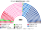
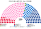
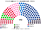
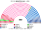
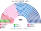
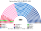
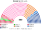

# 估計結果

> **這檔是什麼**：民意套本夾選制的席次**表**（含行政首長與組閣聯盟）——§1 近期大選、§2 民調、§3 長期推估。圖庫見 [`席次圖.md`](席次圖.md)；大選算法細節見 [`16-近期大選重算.md`](16-近期大選重算.md)。朝野互動見 [`14-預期政治生態.md`](14-預期政治生態.md)。

選制摘要：全院 **400＝單一 230（top-3 孔多賽）＋複數 170（彈性名單、14 區聖拉古、無門檻）**。詳 [`01`](01-國民議會與選制.md)。

**統一政黨口徑**：新制的表、席次圖、行政首長與組閣用同一組政黨名稱。**復興系**包含總統派聯盟（Ensemble）內的復興黨與盟友民主運動、地平線。

## 計算方式

| 層 | 做法 |
|---|---|
| 民意層 | 2024：歐洲議會各省名單票 × 國會第一輪逐投票所地理。2022：國會第一輪逐市鎮 × 各省陣營內政黨比例。不用兩輪制當選人 |
| 參選方層 | `finalists`（withdraw）：相鄰共同提名。2024 年 47 區、2022 年 12 區。不照搬新人民陣線、中間陣營的選前卡特爾 |
| 單一 230 | top-3 孔多賽 |
| 複數 170 | 14 區聖拉古、無門檻、M∈[8,14] |
| 首長／組閣 | 全院孔多賽；由近到遠至 ≥201 |

細節見 [`16`](16-近期大選重算.md)、。

## 1 近期大選

用當時實際得票拆回政黨真誠第一偏好套本夾（2024 歐洲議會各省政黨票 × 2024 國會第一輪逐投票所地理；2022 國會第一輪逐市鎮 × 各省陣營內政黨比例）。細節與「2024 四陣營聯合推人原樣」對照見 [`16-近期大選重算.md`](16-近期大選重算.md)（[`近期大選推估.py`](近期大選推估.py)、[`政黨單位.py`](政黨單位.py)）。

| | 現實（577） | **本夾全院 400** | 行政首長 | 組閣（多數派政府，≥201） |
|---|---|---|---|---|
| 2024-06 國會（現行） | 內政部色彩：左翼聯盟 178（30.8%）、總統多數 150（26.0%）、國民聯盟 125（21.7%）、共和黨 39（6.8%）、各類右派 27（4.7%）、極右聯盟 17（2.9%）、各類左派 12（2.1%）、地方派 9（1.6%）、地平線 6（1.0%）、各類中間 6（1.0%）、UDI 3（0.5%）、社會黨 2（0.3%）、生態 1（0.2%）、無黨派 1（0.2%）、極右 1（0.2%）；無多數 | **復興系 133**、國民聯盟系 115、社會黨系 49、共和黨系 51、不屈法國系 20、收復黨 14、生態派 13、鄉村聯盟 5 | **復興系** | 復興系 131＋社會黨系 51＋共和黨系 37＝**219** |
| 2022-06 國會 | Ensemble 245（相對多數）、NUPES 131、國民聯盟 89、UDC 64 | **復興系 208**、共和黨系 79、國民聯盟系 36、社會黨系 34、不屈法國系 18、生態派 13、收復黨 7、鄉村聯盟 4、共產黨系 1 | **復興系** | **復興系 210**（單獨過半） |

### 2024-06 單一／複數

| 政黨 | 第一偏好 | 單一 230 | 複數 170 | **全院 400** |
|---|--:|--:|--:|--:|
| **復興系**（含民運、地平線） | 14.5% | **107** | 26 | **133** |
| 國民聯盟系 | 31.6% | 56 | 59 | **115** |
| 社會黨系 | 13.8% | 24 | 25 | **49** |
| 共和黨系 | 7.2% | 37 | 14 | **51** |
| 不屈法國系 | 9.8% | 3 | 17 | **20** |
| 收復黨 | 5.4% | 0 | 14 | **14** |
| 生態派 | 5.4% | 0 | 13 | **13** |
| 鄉村聯盟 | 2.4% | 3 | 2 | **5** |
| **合計** |  | **230** | **170** | **400** |

**行政首長與組閣**：國民聯盟系 115 席、復興系 133 席，全院記名排名選首長時**復興系**對每一個對手都贏（最弱一場 215 : 185）。沒有任何兩黨不含國民聯盟系能過 201：復興系 131＋社會黨系 49＝182，復興系 131＋共和黨系 51＝168，**須復興系＋社會黨系＋共和黨系三黨合組（219）**，或 30 日內湊不出 ≥201 時由孔多賽第一名（復興系）逕行就任。組織法與修憲要全院 ≥240 **且**複數 ≥102：複數扣掉國民聯盟系 59＋收復黨 14 後剩 97，未達。參選方層：47 區相鄰政黨共同提名（[`16`](16-近期大選重算.md) §1.2）。

### 2022-06 單一／複數

| 政黨 | 單一 230 | 複數 170 | **全院 400** |
|---|--:|--:|--:|
| **復興系** | **164** | 44 | **208** |
| 共和黨系 | 52 | 27 | **79** |
| 國民聯盟系 | 1 | 35 | **36** |
| 社會黨系 | 11 | 23 | **34** |
| 不屈法國系 | 1 | 17 | **18** |
| 生態派 | 0 | 13 | **13** |
| 收復黨 | 0 | 7 | **7** |
| 鄉村聯盟 | 1 | 3 | **4** |
| 共產黨系 | 0 | 1 | **1** |
| **合計** | **230** | **170** | **400** |

**行政首長與組閣**：復興系全院 **210** 單獨過首長、供給與普通法律門檻（201），但不過全院 3/5（240），複數 44 更遠低於 102——改組織法與修憲仍須跨黨共識。

## 2 民調

**方法**：[`民調推估.py`](民調推估.py)；來源 [`資料/polls.csv`](資料/polls.csv)（維基「Next French legislative election」投票意向表；**2025-10 之後沒有新的國會投票意向民調**）。民調以陣營提問（國＝RN＋UDR、左＝NFP＋DVG、中＝ENS＋DVC、共＝LR＋DVD、右＝收復＋DLF、極＝極左、他＝其他），本版將 2024 政黨層級單位依各黨所屬陣營等比縮放到民調份額（陣營內各黨維持 2024 歐洲議會比例），再跑同一張 230 選區圖（top-3 孔多賽）與 14 區聖拉古（複數 170）。

| 民調 | 七群（國／左／中／共／右／極／他） | **全院 400 前四大黨** | 行政首長 | 組閣（≥201） |
|---|---|---|---|---|
| Ifop（2025-10-07..08，n＝1386） | 35／28／14／15／5／1／2 | **共和黨系 125**、國民聯盟系 107、復興系 97、社會黨系 35 | **共和黨系** | 共和黨系 122＋復興系 90＝**212** |
| OpinionWay（2025-10-06..07，n＝1012） | 34／24／16／13／5／2／6 | **共和黨系 128**、國民聯盟系 107、復興系 104、社會黨系 27 | **共和黨系** | 共和黨系 121＋鄉村聯盟 1＋復興系 104＝**218** |

### Ifop 單一／複數

| 政黨 | 第一偏好 | 單一 230 | 複數 170 | **全院 400** |
|---|--:|--:|--:|--:|
| **共和黨系** | 15.0% | **99** | 26 | **125** |
| 國民聯盟系 | 35.0% | 45 | 62 | **107** |
| 復興系 | 14.0% | 70 | 27 | **97** |
| 社會黨系 | 12.3% | 15 | 20 | **35** |
| 不屈法國系 | 8.8% | 1 | 18 | **19** |
| 生態派 | 4.8% | 0 | 13 | **13** |
| 收復黨 | 3.7% | 0 | 4 | **4** |
| **合計** |  | **230** | **170** | **400** |

### OpinionWay 單一／複數

| 政黨 | 第一偏好 | 單一 230 | 複數 170 | **全院 400** |
|---|--:|--:|--:|--:|
| **共和黨系** | 13.0% | **104** | 24 | **128** |
| 國民聯盟系 | 34.0% | 42 | 65 | **107** |
| 復興系 | 16.0% | 75 | 29 | **104** |
| 社會黨系 | 10.5% | 8 | 19 | **27** |
| 不屈法國系 | 7.5% | 1 | 17 | **18** |
| 生態派 | 4.1% | 0 | 9 | **9** |
| 收復黨 | 3.7% | 0 | 5 | **5** |
| 各類極左 | 2.0% | 0 | 1 | **1** |
| 鄉村聯盟 | 1.9% | 0 | 1 | **1** |
| **合計** |  | **230** | **170** | **400** |

**讀法**：

- **共和黨系跨過 13–15% 門檻後大量進決選**：2024 年共和黨系僅 7.2%，多數選區排第四、進不了 top-3；2025-10 民調共和黨系升至 13–15%（與復興系 14–16% 相當），在大量選區擠進前三名。一旦進決選，國民聯盟系選民把它排在復興系前，復興系與左派選民把它排在國民聯盟系前，使它拿下單一 96–97 席。
- **行政首長是共和黨系**：全院記名排名時，共和黨系對復興系（靠國民聯盟系與收復黨票）與對國民聯盟系（靠復興系與左派票）皆以約 236–238 票勝出。
- **組閣**：**共和黨系＋復興系**（OpinionWay 再加鄉村聯盟 1 席）合計 **212–230 席**，剛好跨過 201——正對應現實法國「中間＋中右共同基礎」（socle commun），但在本夾裡具備穩定的議會過半。

## 3 長期運行假設下

生態模型示意 **第 3 屆**與 **第 6 屆**（假設見 [`14-預期政治生態.md`](14-預期政治生態.md)；以 2024 實際政黨地理縮放到各屆假設份額，由 [`生態模型.py`](生態模型.py) 算出）。

| 政黨 | 第 3 屆假設得票 | 單一 230 | 複數 170 | **第 3 屆全院 400** | 第 6 屆全院 400 |
|---|--:|--:|--:|--:|--:|
| **復興系** | 18.0% | **148** | 32 | **180** | **143** |
| 國民聯盟系 | 29.0% | 17 | 53 | **70** | **82** |
| 社會黨系 | 15.0% | 22 | 26 | **48** | **54** |
| 共和黨系 | 10.0% | 41 | 15 | **56** | **77** |
| 不屈法國系 | 10.0% | 2 | 18 | **20** | **19** |
| 生態派 | 6.0% | 0 | 14 | **14** | **14** |
| 收復黨 | 4.5% | 0 | 10 | **10** | **6** |
| 鄉村聯盟 | 2.5% | 0 | 2 | **2** | **5** |
| **合計** |  | **230** | **170** | **400** | **400** |

- **第 3 屆**：行政首長 **復興系**（孔多賽最弱一場 260）；復興系 174 不單獨過半，與距離最近的溫和左翼 **社會黨系 52**（合計 **226**）或中右 **共和黨系 46**（合計 **220**）皆可二黨過半組閣。60 區相鄰政黨共同提名。複數席次復興系僅 32／170，改組織法與修憲（複數 ≥102）須跨越多個政黨。
- **第 6 屆**：復興系微降至 16%、國民聯盟系升至 31%、共和黨系 11%；首長仍為 **復興系**（最弱一場 230），復興系 143＋共和黨系 77＝**220**（或復興系 143＋社會黨系 54＝197，再加生態派過 201）。78 區相鄰政黨共同提名。

朝野互動與候選人行為見 [`14-預期政治生態.md`](14-預期政治生態.md)。

## 4 朝野互動（各次估計）

| 民意 | 政府 | 在野 | 互動 |
|---|---|---|---|
| 2024-06 | 復興系首長；復興系＋社會黨系＋共和黨系 219 | 國民聯盟系、左翼各黨 | 三分議會不再是倒閣循環：拆政府必須同時以 201 票選出繼任者，左翼與國民聯盟無法為了拆而合作；供給在 15 個開會日後自動生效，不必動用 49.3 |
| 2022-06 | 復興系單獨 210 | 共和黨系 79、國民聯盟系 36 … | 單黨過半，法律與供給單獨過；組織法要全院與複數席次各 3/5，仍須共和黨系 |
| Ifop、OpinionWay 2025-10 | 共和黨系首長；共和黨系＋復興系 212–218 | 國民聯盟系 110–111、左翼 | 國民聯盟系是第二大黨卻不在政府：在一對一裡它輸給居中右的共和黨系；它要執政，必須讓復興系或共和黨系的議員不再把它排最後 |

誘因、候選人行為與檢視見 [`14-預期政治生態.md`](14-預期政治生態.md)。
