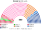
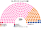
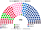

# 席次圖

`0-基本/總體.md` 要求：給仿維基百科的議會席次圖（如：單一席次、複數席次圖；有政黨／派系議員的圓點顏色為所屬政黨／派系的代表色）。本夾兩個組成都有，所以三張：全院、單一、複數。

數字來自 [`14`](14-預期政治生態.md) 第 3 屆，由 [`生態模型.py`](生態模型.py) 算出。產生器：席次圖產生器。

## 全院 400（加總）

復興系 189、民主運動 67、國民聯盟系 70、不屈法國系 25、社會黨系 20、共和黨系 15、生態派 14。過半 **201**、3/5 **240**、2/3 **267**。

中間陣營（復興＋民運）256，單獨過全院 3/5——所以組織法與修憲另要複數席次那一張過門檻。

## 單一席次 230

單一席次是向心誘因的來源；政府由全院產生（[`02`](02-政府組成與建設性更新.md)）。

復興系 164、民主運動 54、國民聯盟系 10、不屈法國系 1、社會黨系 1。

中間陣營以約 22% 的區域第一偏好拿到 218 席：它在幾乎每一區都是兩兩對決的贏家（[`14`](14-預期政治生態.md) §2.4）。

## 複數席次 170

國民聯盟系 60、不屈法國系 24、復興系 25、社會黨系 19、共和黨系 15、生態派 14、民主運動 13。3/5 **102**、2/3 **114**。

兩翼在這一張拿到接近得票的席次；中間陣營只有 38。組織法與修憲要在這一張也過 3/5（[`06`](06-法律、組織法與修憲.md) §2.5）。

## 顏色

各黨代表色。座位由左至右依政治光譜排列。
