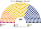
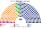
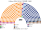
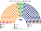
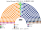
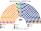
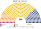

# 估計結果

> 席次**表**——§1 近期大選、§2 民調、§3 長期。圖庫見 [`席次圖.md`](席次圖.md)；算法見 [`14`](14-近期大選重算.md)、[`生態模型.py`](生態模型.py)、[`民調推估.py`](民調推估.py)。

選制：全院 **340＝單一 204（top-3 孔多賽）＋複數 136（12 國內區＋海外、聖拉古、無門檻）**；首長全院排名投票選出（棄權不計）；供給、建設性更新 ≥171。詳 [`01`](01-國會與選制.md)。

## 1 近期大選

PKW **逐投票所**名單票套本夾（2023 年 31,495 個、2019 年 27,415 個）。

| | 實際（460） | **本夾全院 340** | 首長 | 組閣 |
|---|---|---|---|---|
| 2023-10 | PiS 194、KO 157、TD 65、Lewica 26、Konf 18；KO＋TD＋Lewica 組閣 | **TD 137**、PiS 109、KO 68、Lewica 13、Konf 12 | **TD** | TD＋KO＝206 |
| 2019-10 | PiS 235、KO 134、SLD 49、PSL 30、Konf 11；PiS 單獨 | **PiS 171**、KO 119、Lewica 18、PSL 20、Konf 11、MN 1 | **PiS** | PiS 單獨 171 |

### 2023-10 單一／複數

| 政黨 | 單一 204 | 複數 136 | **全院** |
|---|--:|--:|--:|
| TD | 118 | 19 | **137** |
| PiS | 59 | 50 | **109** |
| KO | 26 | 42 | **68** |
| Lewica | 0 | 13 | **13** |
| Konf | 0 | 12 | **12** |
| MN | 1 | 0 | 1 |

**組閣聯盟／多數派政府**：首長 **TD**（對 PiS 219：121、對 KO 272：68）；**TD＋KO＝206**。組織法要全院 ≥204 且複數 ≥82：TD＋KO 複數 61，**改不了**。

### 2019-10

| 政黨 | 單一 204 | 複數 136 | **全院** |
|---|--:|--:|--:|
| PiS | 115 | 56 | **171** |
| KO | 80 | 39 | **119** |
| Lewica | 0 | 18 | **18** |
| PSL | 8 | 12 | **20** |
| Konf | 0 | 11 | **11** |
| MN | 1 | 0 | **1** |

**組閣聯盟／多數派政府**：首長 **PiS**，單獨 171＝171（剛好過半）；組織法 PiS 全院 171、複數 56，**改不了**。

### 2025 總統（2023 名單票 × 參選方層）

**TD**（對 KO 62.9%、對 PiS 56.4%）。現實第一輪對照是 PiS（對 KO 51.4%，實際決選 50.89%）。見 [`14`](14-近期大選重算.md) §4。

## 2 民調

**方法**：[`民調推估.py`](民調推估.py)；來源 [`資料/polls.csv`](資料/polls.csv)（維基 Opinion polling for the next Polish parliamentary election，投票意向，不知道不計）。2023 年後分裂或分開參選的黨，用 2023 母黨的逐投票所地理按民調比例拆開：TD → 波蘭 2050＋人民黨（PSL）；Lewica → Lewica＋Razem；Konf → Konf＋KKP；PiS → PiS＋R+（2026-07 分出）。再以 2023 地理縮放。

| 民調 | 投票意向（前五） | **本夾全院 340** | 首長 | 組閣 |
|---|---|---|---|---|
| Pollster／SE.pl（10-26..27） | KO 33.4、PiS 22.4、Konf 12.2、KKP 7.8、Lewica 7.1 | **KO 169**、PiS 112、Konf 17、Lewica 12、R+ 12、KKP 12、Razem 5、PSL 1 | **KO；對決** | KO＋PSL＋Lewica＝182 |
| IPSOS／TVP（10-21..22） | KO 34.3、PiS 26.3、Konf 10.1、KKP 8.1、Lewica 6.1 | **KO 146**、PiS 127、PSL 26、Konf 13、KKP 12、Lewica 8、R+ 4、Razem 4 | **PSL；對決** | PSL＋R+＋KO＝176 |
| United Surveys／WP（10-16..18） | KO 32.4、PiS 18.8、Konf 14.4、KKP 10.9、Lewica 8.0 | **KO 153**、PiS 122、Konf 20、KKP 13、Lewica 11、R+ 11、PSL 9、Razem 1 | **PSL；對決** | PSL＋R+＋KO＝173 |
| IBRiS／Polsat（10-14..16） | KO 29.8、PiS 20.5、Konf 13.6、KKP 12.2、Lewica 7.5 | **KO 137**、PiS 133、Konf 19、KKP 16、PSL 10、Lewica 10、R+ 10、Razem 5 | **R+；對決** | R+＋PiS＋PSL＋KKP＋Konf＝188 |

**讀法**：

- **第三條路分裂後，單一選區主要是 KO 對 PiS**；新制誘因下中間的 PSL、R+ 與相鄰政黨在部分選區共同提名後擠進前三。
- **首長看 KO 領先多少**：KO 領先 8 點以上時 KO 是議員之間的孔多賽贏家；差距縮小時，夾在中間的小黨（PSL 9–26 席、R+ 10 席）變成孔多賽贏家（[`12`](12-預期政治生態.md) §6.2）。
- 「組閣」是由首長往外依偏好距離加黨到 ≥171 的機械結果，不是預測。

## 3 長期運行（推估第 3 屆）

假設兩翼（PiS、Konf、Lewica）各讓出 1/8 第一偏好給居中政黨，以 2023 地理（`python 生態模型.py --projection`）。

| 政黨 | 單一 204 | 複數 136 | **全院** |
|---|--:|--:|--:|
| TD | 161 | 30 | **191** |
| PiS | 33 | 42 | **75** |
| KO | 10 | 44 | **54** |
| Lewica | 0 | 11 | **11** |
| Konf | 0 | 9 | **9** |

首長 **TD**，單獨 191 過半；組織法複數只有 30，**改不了規則**。朝野見 [`12`](12-預期政治生態.md)。
