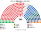

# 預期政治生態

座標與假設在 [`生態模型.py`](生態模型.py) 的 `POS`。兩軸：經濟左右、文化開放到限制。β＝0，排序只看距離。

自由黨、自由國家黨、國家黨、鄉村自由黨在組閣時可結盟，模型裡仍是不同政黨。獨立要在該區第一偏好 ≥20% 才進入前四；低於此的獨立沒有可核對的位置，放進兩大黨正中間會讓每一個小獨立都贏走兩兩。

## 2025-05 套進本夾

工黨 **152／300**，單獨過 ≥151。現行是 94／150（62.7%）。名單把綠黨放到 18 席、一國黨放到 10 席，工黨的席次占比從 62.7% 收到 50.7%。

綠黨與一國黨的單一選區都是 0。他們的席次全在複數。這是平行制要的分工：單一選區產生政府側，名單留下第一偏好。

獨立 19 席，高於現行 10 席。距離模型把達 20% 的獨立放在兩黨之間，兩大黨的選民都會把他們排在對方前面，所以兩兩對決他們會贏。現行即時決選不是這樣開的。讀 19 這個數字時要連這句假設一起讀。

## 2022-05 套進本夾

工黨 **128**，沒有單獨過半。模型的組閣順序是工黨＋獨立 12＋中間聯盟 2＋綠黨 16＝158。現行那屆工黨 77／151，同樣沒有過半。

一國黨 8 席、聯合澳洲 8 席都在名單。現行眾議院這兩黨是 0 席。

## 首長

選首長時，自由黨、自由國家黨、國家黨、鄉村自由黨是正式聯盟（Coalition），共推一人，由席次最多的成員（自由黨）出任；議員投票時各自排序，聯盟成員把聯盟人選排第一。

兩屆的全院排名都是工黨。2025 年對聯盟人選（自由黨）192：108，對綠黨 282：18；2022 年對聯盟人選 158：142（議員席次加權，不是選民票）。沒有循環。

聯盟各黨加總：2025 年自由黨 47＋自由國家黨 34＋國家黨 16＝97，不過半。2022 年 68＋36＋20＝124，仍低於 151。

## 民調

2026 年 10 月底各家最新投票意向套進本夾後，一國黨成為席次最多或次多的黨，但首長是**聯盟人選（自由黨）**：工黨、綠黨議員寧可要自由黨也不要一國黨，一國黨議員寧可要自由黨也不要工黨。政府是聯盟加一國黨的右翼多數（171–190 席），首長出自較溫和的一側。圖在 [`估計結果.md`](估計結果.md) 的民調一節。

## 朝野互動

| 民意 | 政府 | 在野 | 互動 |
|---|---|---|---|
| 2025-05 | 工黨單獨 152 | 聯盟 97、綠黨 18、一國黨 10、獨立 19 | 工黨過半只多 1 席：法律單獨過，組織法與修憲（全院 ≥180 且複數 ≥72）要聯盟或綠黨加獨立。在野不能倒閣，只能用建設性更新——聯盟要湊到 151 必須拉一國黨與一部分獨立，這在 2025 的席次下湊不出來 |
| 2022-05 | 工黨＋獨立＋中間聯盟＋綠黨 158 | 聯盟 125、一國黨 8、聯合澳洲 8 | 少數黨首長加信任與供給協議；聯盟加右翼小黨 141，差 10 席，建設性更新要拉走獨立 |
| 2026 民調 | 聯盟人選＋一國黨等右翼 171–190 | 工黨 83–99、綠黨 17–22 | 一國黨是政府多數的最大成員卻不握首長；聯盟要守住首長，就得讓一國黨覺得留在政府比和工黨合作好，同時不能讓工黨、綠黨轉而支持一國黨人選 |

