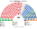
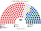
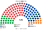
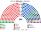
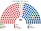
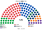

# 近期大選重算

算法：[`生態模型.py`](生態模型.py)。輸入是 AEC 眾議院選區×候選人第一偏好。

| 屆 | 檔 | 事件 |
|---|---|---|
| 2025-05-03 | `資料/raw-2025.csv` | 31496 |
| 2022-05-21 | `資料/raw-2022.csv` | 27966 |

複數席用同一批第一偏好。沒有分開的政黨票。參議院票不進主算。

第二偏好沒有逐票檔。模型用兩軸距離。獨立僅在該區第一偏好 ≥20% 時進入前四。未對上黨籍代碼的小黨票：2025 年 80,871、2022 年 159,922，不進席次。

名單區的甲乙丙依選區編號排序後按得票切段，不是街道區界。單一選區在州內把現有選區切成或併成配額席數。

**民意 × 新制下的參選策略**（）：

| 層 | 本夾做法 |
|---|---|
| 民意層 | 眾議院第一偏好**直接用**：澳洲眾議院是偏好排序投票，選民不必棄保，第一偏好本來就是真心票（和英國不同，不必校正） |
| 策略層 | ① 參選照現實（版本甲，主版）：自由黨、國家黨大多不互推，但偏好排序投票下分票本來就不會害到盟友，所以這是**聯盟協議**的選擇，不是相對多數制造成的；新制下誘因相同。三角選區（兩黨都參選）也照現實：2025 年 7 區、2022 年 4 區，都在國家黨有實力的鄉村選區。② 前四名由 [`參選判定.py`](../../../../../shared/tools/參選判定.py) 判定相鄰政黨的共同提名：兩屆都是 **0 區**（每區的孔多賽勝者本來就在前四） |
| 敏感度：版本乙 | `--乙`：聯盟協議鬆動，自由黨也進國家黨獨占的選區（2025 年 12 區、2022 年 11 區），比例＝當屆三角選區中自由黨占聯盟票的比例（2025 年 72.7%、2022 年 77.0%；這是上限，國家黨的新南威爾斯腹地實際更強）。國家黨是地方性政黨，不補進自由黨獨占的選區 |

| 版本 | 2025 單一 | 2025 全院 | 2022 全院 | 首長 |
|---|---|---|---|---|
| **甲（主版）** | 聯盟 55（自由 19、自由國家 24、國家 12） | 工黨 152 | 工黨 128 | 兩屆都是工黨 |
| 乙 | 聯盟 55（自由 27、自由國家 24、國家 4） | 工黨 151 | 工黨 129 | 兩屆都是工黨 |

乙只是把聯盟內的席次從國家黨挪到自由黨，聯盟單一總數不變（2022 年也是 79 對 79），工黨與首長不變。全院差 1 席來自名單層：國家黨的名單票被拆給自由黨，聖拉古餘數跟著變。

## 2025-05

| | 工黨 | 自由黨 | 自由國家黨 | 國家黨 | 綠黨 | 一國黨 | 獨立 | 其他 |
|---|--:|--:|--:|--:|--:|--:|--:|--:|
| 現行 150 | 94 | 18 | 16 | 9 | 1 | 0 | 10 | 中間聯盟 1、卡特 1 |
| 單一 180 | 103 | 19 | 24 | 12 | 0 | 0 | 19 | 中間聯盟 2、卡特 1 |
| 複數 120 | 49 | 28 | 10 | 4 | 18 | 10 | 0 | 合法大麻 1 |
| **全院 300** | **152** | **47** | **34** | **16** | **18** | **10** | **19** | 中間聯盟 2、卡特 1、合法大麻 1 |

循環 0。22 席的當選者不是第一偏好第一名。24 席第一偏好過半。當選者第一偏好中位數 42.6%。

首長：工黨。組閣：工黨 152，單獨過半。

## 2022-05

| | 工黨 | 自由黨 | 自由國家黨 | 國家黨 | 綠黨 | 一國黨 | 聯合澳洲 | 獨立 |
|---|--:|--:|--:|--:|--:|--:|--:|--:|
| 現行 151 | 77 | 27 | 21 | 10 | 4 | 0 | 0 | 10 |
| 單一 180 | 85 | 37 | 26 | 15 | 1 | 0 | 0 | 12 |
| 複數 120 | 43 | 31 | 10 | 5 | 15 | 8 | 8 | 0 |
| **全院 300** | **128** | **68** | **36** | **20** | **16** | **8** | **8** | **12** |

另有中間聯盟 2、卡特黨 1、鄉村自由黨 1，都在單一。循環 0。24 席不是第一偏好第一名。

首長：工黨。組閣：工黨＋獨立＋中間聯盟＋綠黨＝158。

## 和現行比

2025 年工黨席次占比 94／150＝62.7%，套進本夾是 152／300＝50.7%。綠黨從 1 席到 18 席，一國黨從 0 席到 10 席，都在名單。2022 年工黨從 77／151 的少數政府，變成 128／300，仍要其他黨的席次才過 151。
