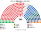
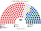
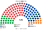
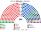
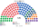
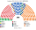
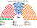
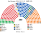
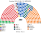

# 估計結果

來源：[`生態模型.py`](生態模型.py)，AEC 選區第一偏好，第二偏好用距離。獨立要該區 ≥20% 才進入前四。

## 計算方式

| 層 | 做法 |
|---|---|
| 民意層 | AEC 選區×候選人第一偏好。眾議院是偏好排序，不必校正棄保 |
| 參選方層 | 版本甲（主版）：聯盟協議照現實。`finalists`（withdraw）兩屆共同提名都是 0 區。版本乙只做敏感度 |
| 單一 180 | top-4 孔多賽 |
| 複數 120 | 十區聖拉古、無門檻 |
| 首長／組閣 | 全院孔多賽；≥151 |

細節見 [`14`](14-近期大選重算.md)、。

## 全院

| 屆 | 最大黨 | 席次 | 過半 151 | 首長 | 組閣 |
|---|---|--:|---|---|---|
| 2025-05 | 工黨 | 152 | 單獨過 | 工黨 | 工黨 |
| 2022-05 | 工黨 | 128 | 未過 | 工黨 | 工黨＋獨立＋中間聯盟＋綠黨＝158 |

## 2025-05

## 2025-05 對照現行

| 政黨 | 第一偏好 | 現行席次 | 本夾席次 | 本夾占比 |
|---|--:|--:|--:|--:|
| 工黨 | 34.56% | 94／150 | 152 | 50.7% |
| 自由黨 | 20.69% | 18 | 47 | 15.7% |
| 自由國家黨 | 7.10% | 16 | 34 | 11.3% |
| 國家黨 | 3.80% | 9 | 16 | 5.3% |
| 綠黨 | 12.20% | 1 | 18 | 6.0% |
| 一國黨 | 6.40% | 0 | 10 | 3.3% |
| 獨立 | 7.27% | 10 | 19 | 6.3% |

自由黨、自由國家黨、國家黨、鄉村自由黨的第一偏好合計 31.82%。本夾四黨席次 47＋34＋16＋0＝97（32.3%）。現行聯盟 43／150＝28.7%。

## 單一與複數（2025-05）

單一 180：工黨 103、自由國家黨 24、獨立 19、自由黨 19、國家黨 12、中間聯盟 2、卡特黨 1。

複數 120：工黨 49、自由黨 28、綠黨 18、一國黨 10、自由國家黨 10、國家黨 4、合法大麻 1。

## 2022-05

工黨 128，加上獨立、中間聯盟、綠黨＝158。

## 民調

各家最新一筆，來源與縮放規則和兩院相同，程式是 [`民調推估.py`](民調推估.py)。

**首長的參選方式**：自由黨、自由國家黨、國家黨、鄉村自由黨是正式聯盟（Coalition），選首長時共推一人，由席次最多的成員（自由黨）出任；其餘政黨各自推人。若四黨各自推人，居中的國家黨會以個位數到十幾席贏得全院排名——現實中聯盟不會讓這件事發生。

| 民調 | 全院 300（前四） | 首長 | 組閣席次 |
|---|---|---|---|
| YouGov（2026-10-27..11-03，n＝1500） | 一國黨 100、工黨 83、自由黨 54、綠黨 18 | 自由黨（聯盟人選） | 190 |
| Newspoll（2026-10-26..29，n＝1200） | 一國黨 114、工黨 90、自由黨 42、綠黨 20 | 自由黨（聯盟人選） | 182 |
| Essential（2026-10-21..26，n＝1087） | 一國黨 104、工黨 90、自由黨 49、綠黨 17 | 自由黨（聯盟人選） | 186 |
| Roy Morgan（2026-10-12..25，n＝2711） | 工黨 94、一國黨 67、自由黨 67、綠黨 22 | 自由黨（聯盟人選） | 173 |
| Resolve（2026-10-06..10，n＝2250） | 工黨 99、一國黨 81、自由黨 51、綠黨 18 | 自由黨（聯盟人選） | 175 |

一國黨在多數民調是單一選區的最大黨，但它在一對一裡輸給聯盟人選：工黨、綠黨議員寧可要自由黨也不要一國黨，一國黨議員寧可要自由黨也不要工黨。政府是聯盟加一國黨的右翼多數，首長出自較溫和的一側。

### YouGov（2026-10-27..11-03，n＝1500）

投票意向：工黨 25、聯盟 23、綠黨 13、一國黨 27、其他 12。

| 組成 | 席次 |
|---|---|
| 單一 | 一國黨 63、工黨 48、自由黨 33、獨立 9、自由國家黨 8、國家黨 6、中間聯盟 2、倫尼克 2、卡特黨 3、喇叭愛國者 0、鄉村自由黨 1 |
| 複數 | 一國黨 37、工黨 35、自由黨 21、綠黨 18、自由國家黨 6、國家黨 3 |
| **全院 300** | 一國黨 100、工黨 83、自由黨 54、綠黨 18、自由國家黨 14、國家黨 9、獨立 9、中間聯盟 2、倫尼克 2、卡特黨 3、喇叭愛國者 0、鄉村自由黨 1 |

首長 **自由黨**（聯盟共推）；組閣 自由黨＋自由國家黨＋鄉村自由黨＋國家黨＋倫尼克＋卡特黨＋喇叭愛國者＋中間聯盟＋一國黨＝190。

### Newspoll（2026-10-26..29，n＝1200）

投票意向：工黨 27、聯盟 21、綠黨 13、一國黨 28、其他 11。

| 組成 | 席次 |
|---|---|
| 單一 | 一國黨 77、工黨 53、自由黨 24、獨立 8、自由國家黨 6、國家黨 4、中間聯盟 2、卡特黨 2、喇叭愛國者 1、鄉村自由黨 1 |
| 複數 | 一國黨 37、工黨 37、綠黨 20、自由黨 18、自由國家黨 6、國家黨 2 |
| **全院 300** | 一國黨 114、工黨 90、自由黨 42、綠黨 20、自由國家黨 12、獨立 8、國家黨 6、中間聯盟 2、卡特黨 2、喇叭愛國者 1、鄉村自由黨 1 |

首長 **自由黨**（聯盟共推）；組閣 自由黨＋自由國家黨＋鄉村自由黨＋國家黨＋卡特黨＋喇叭愛國者＋中間聯盟＋一國黨＝182。

### Essential（2026-10-21..26，n＝1087）

投票意向：工黨 28、聯盟 23、綠黨 12、一國黨 28、其他 10。

| 組成 | 席次 |
|---|---|
| 單一 | 一國黨 67、工黨 52、自由黨 30、自由國家黨 9、國家黨 8、獨立 7、中間聯盟 2、卡特黨 1、喇叭愛國者 0、鄉村自由黨 1 |
| 複數 | 工黨 38、一國黨 37、自由黨 19、綠黨 17、自由國家黨 6、國家黨 3 |
| **全院 300** | 一國黨 104、工黨 90、自由黨 49、綠黨 17、自由國家黨 15、國家黨 11、獨立 7、中間聯盟 2、卡特黨 1、喇叭愛國者 0、鄉村自由黨 1 |

首長 **自由黨**（聯盟共推）；組閣 自由黨＋自由國家黨＋鄉村自由黨＋國家黨＋卡特黨＋喇叭愛國者＋中間聯盟＋一國黨＝186。

### Roy Morgan（2026-10-12..25，n＝2711）

投票意向：工黨 26、自由黨 21、國家黨 2.5、綠黨 15.5、一國黨 22.5、其他 12.5。

| 組成 | 席次 |
|---|---|
| 單一 | 工黨 59、自由黨 44、一國黨 36、獨立 10、自由國家黨 10、國家黨 10、中間聯盟 2、鄉村自由黨 2、倫尼克 2、卡特黨 1、喇叭愛國者 0、綠黨 1 |
| 複數 | 工黨 35、一國黨 31、自由黨 23、綠黨 21、自由國家黨 7、國家黨 2、合法大麻 1 |
| **全院 300** | 工黨 94、一國黨 67、自由黨 67、綠黨 22、自由國家黨 17、國家黨 12、獨立 10、中間聯盟 2、鄉村自由黨 2、倫尼克 2、卡特黨 1、合法大麻 1、喇叭愛國者 0 |

首長 **自由黨**（聯盟共推）；組閣 自由黨＋自由國家黨＋鄉村自由黨＋國家黨＋倫尼克＋卡特黨＋喇叭愛國者＋中間聯盟＋一國黨＝173。

### Resolve（2026-10-06..10，n＝2250）

投票意向：工黨 29、聯盟 23、綠黨 12、一國黨 25、其他 11。

| 組成 | 席次 |
|---|---|
| 單一 | 工黨 59、一國黨 47、自由黨 32、國家黨 12、自由國家黨 8、獨立 8、中間聯盟 2、鄉村自由黨 2、倫尼克 2、卡特黨 3、喇叭愛國者 0 |
| 複數 | 工黨 40、一國黨 34、自由黨 19、綠黨 18、自由國家黨 6、國家黨 3 |
| **全院 300** | 工黨 99、一國黨 81、自由黨 51、綠黨 18、自由國家黨 14、國家黨 15、獨立 8、中間聯盟 2、鄉村自由黨 2、倫尼克 2、卡特黨 3、喇叭愛國者 0 |

首長 **自由黨**（聯盟共推）；組閣 自由黨＋自由國家黨＋鄉村自由黨＋國家黨＋倫尼克＋卡特黨＋喇叭愛國者＋中間聯盟＋一國黨＝175。

