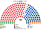
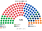
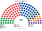

# 預期政治生態

座標與一院相同，在一院 [`生態模型.py`](../一院議會制/生態模型.py) 的 `POS`。本夾讀那一組，不另設一份。兩軸：經濟左右、文化開放到限制。β＝0。

自由黨、自由國家黨、國家黨、鄉村自由黨在組閣時可結盟，模型裡仍是不同政黨。獨立要在該區第一偏好 ≥20% 才進入前四。

組閣只加總**眾議院**。參議院席次不進 ≥91。

## 2025-05

眾議院工黨 **98／180**，單獨過 ≥91。現行是 94／150（62.7%）。一院版是 152／300（50.7%）。本夾的政府院更偏單一選區，工黨占比是 54.4%，高於一院的 50.7%，低於現行的 62.7%。

綠黨眾議院 8 席、一國黨 6 席，全部在複數 60。單一選區這兩黨是 0。他們的主要席次在參議院：綠黨 18、一國黨 10，與一院名單相同。

獨立在眾議院單一 7 席。距離模型把達 20% 的獨立放在兩黨之間，讀這個數字要連這句假設。

組織法三道門，工黨都單獨過不了：眾議院全院 98＜108，複數 24＜36，參議院 49＜72。工黨＋綠黨在參議院是 67，仍差 5 席到 72。改規則要再找自由黨，或再找其他黨。政府過半和改規則是兩件事。

## 2022-05

眾議院工黨 **83**，沒有單獨過半。模型的組閣是工黨＋獨立 8＝91，剛好到門檻。現行那屆工黨 77／151，同樣沒有過半。一院版是 128／300，要獨立、中間聯盟、綠黨才到 158。

參議院工黨 43、綠黨 15、一國黨 8、聯合澳洲 8。一國黨與聯合澳洲的席次主要在參議院，不在眾議院。

## 首長

選首長時，自由黨、自由國家黨、國家黨、鄉村自由黨是正式聯盟（Coalition），共推一人，由席次最多的成員（自由黨）出任；議員投票時各自排序，聯盟成員把聯盟人選排第一。

兩屆的眾議院排名都是工黨，沒有循環。

2025 年對聯盟人選（自由黨）、一國黨都是 114：66，對綠黨 172：8。聯盟三黨加總 30＋19＋10＝59，不過 91。

2022 年對聯盟人選 102：78，對綠黨 170：10。聯盟三黨 39＋22＋11＝72，仍低於 91。一國黨只有 3 席，不到模型的候選門檻 5，不進這輪對決。

## 民調

2026 年 10 月底五家民調套進眾議院後，工黨都沒有單獨過 91。一國黨在 YouGov、Newspoll 是眾議院最大黨。五家的首長都是**聯盟人選（自由黨）**，政府是聯盟加一國黨的右翼多數（97–113 席）。圖在 [`估計結果.md`](估計結果.md)。

## 朝野互動

| 民意 | 政府（眾議院） | 參議院 | 互動 |
|---|---|---|---|
| 2025-05 | 工黨單獨 98 | 工黨 49、綠黨 18（合計 67） | 普通法律參議院只能擱置 60 日；組織法要參議院 ≥72，工黨＋綠黨還差 5 席，要聯盟或小黨 |
| 2022-05 | 工黨＋獨立 91（剛好） | 工黨 43、綠黨 15 | 執政多數 0 席餘裕，任何一位獨立倒戈都讓建設性更新可行；參議院的延後成為在野最主要的工具 |
| 2026 民調 | 聯盟人選＋一國黨等 97–113 | 一國黨 31–37、工黨 35–40、綠黨 17–21 | 政府在參議院不過半，普通法律常被延後；一國黨同時是政府多數的最大成員與參議院最大黨，籌碼在兩院 |

