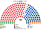
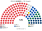
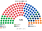
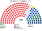
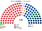
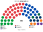
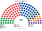

# 近期大選重算

算法：[`生態模型.py`](生態模型.py)。輸入是一院夾的 AEC 眾議院選區×候選人第一偏好，不另存一份。

| 屆 | 檔 | 事件 |
|---|---|---|
| 2025-05-03 | [`../一院議會制/資料/raw-2025.csv`](../一院議會制/資料/raw-2025.csv) | 31496 |
| 2022-05-21 | [`../一院議會制/資料/raw-2022.csv`](../一院議會制/資料/raw-2022.csv) | 27966 |

眾議院複數與參議院用同一批第一偏好。沒有分開的政黨票。參議院實際開票不進主算。

第二偏好沒有逐票檔。模型用兩軸距離，座標與一院相同。獨立僅在該區第一偏好 ≥20% 時進入前四。未對上黨籍代碼的小黨票：2025 年 80,871、2022 年 159,922，不進席次。

單一選區在州內把現有選區切成配額席數。名單區的甲乙依選區編號排序後按得票切段。

把每個州的選區順序旋轉一席再切：參議院兩屆都不變。2025 年眾議院工黨從 98 變 100，仍單獨過半。2022 年工黨維持 83，組閣仍是工黨＋獨立＝91。下面的表是沒有旋轉的主算。

**民意 × 新制下的參選策略**（）：

| 層 | 本夾做法 |
|---|---|
| 民意層 | 眾議院第一偏好**直接用**：澳洲眾議院是偏好排序投票，選民不必棄保，第一偏好本來就是真心票（和英國不同，不必校正） |
| 策略層 | ① 參選照現實（版本甲，主版）：自由黨、國家黨大多不互推，但偏好排序投票下分票本來就不會害到盟友，所以這是**聯盟協議**的選擇，不是相對多數制造成的；新制下誘因相同。三角選區（兩黨都參選）也照現實：2025 年 7 區、2022 年 4 區，都在國家黨有實力的鄉村選區。② 前四名由 [`參選判定.py`](../../../../../shared/tools/參選判定.py) 判定相鄰政黨的共同提名：兩屆都是 **0 區**（每區的孔多賽勝者本來就在前四） |
| 敏感度：版本乙 | `--乙`：聯盟協議鬆動，自由黨也進國家黨獨占的選區（2025 年 12 區、2022 年 11 區），比例＝當屆三角選區中自由黨占聯盟票的比例（2025 年 72.7%、2022 年 77.0%；這是上限，國家黨的新南威爾斯腹地實際更強）。國家黨是地方性政黨，不補進自由黨獨占的選區 |

| 版本 | 2025 單一 | 2025 眾議院 | 2022 眾議院 | 首長 |
|---|---|---|---|---|
| **甲（主版）** | 聯盟 37（自由 14、自由國家 14、國家 9） | 工黨 98 | 工黨 83（＋獨立 8＝91） | 兩屆都是工黨 |
| 乙 | 聯盟 37（自由 20、自由國家 14、國家 3） | 工黨 97 | 工黨 83（＋獨立 8＝91） | 兩屆都是工黨 |

乙在眾議院只是聯盟內部挪席次。參議院用同一批第一偏好，國家黨的名單票被拆給自由黨，**國家黨在參議院歸零**：

| 參議院 120 | 工黨 | 聯盟（自由＋自由國家＋國家） | 綠黨 | 一國黨 |
|---|--:|--:|--:|--:|
| 2025 甲 | 49 | 42（28＋10＋4） | 18 | 10 |
| 2025 乙 | 48 | 43（33＋10＋0） | 18 | 10 |
| 2022 甲 | 43 | 46（31＋10＋5） | 15 | 8 |
| 2022 乙 | 44 | 44（34＋10＋0） | 16 | 8 |

這也是聯盟協議在新制下仍有理由維持的一個原因：國家黨要靠自己的名單票保住參議院席次。

## 2025-05

| | 工黨 | 自由黨 | 自由國家黨 | 國家黨 | 綠黨 | 一國黨 | 獨立 | 其他 |
|---|--:|--:|--:|--:|--:|--:|--:|--:|
| 現行 150 | 94 | 18 | 16 | 9 | 1 | 0 | 10 | 中間聯盟 1、卡特 1 |
| 單一 120 | 74 | 14 | 14 | 9 | 0 | 0 | 7 | 中間聯盟 1、卡特 1 |
| 眾議院複數 60 | 24 | 16 | 5 | 1 | 8 | 6 | 0 | |
| **眾議院 180** | **98** | **30** | **19** | **10** | **8** | **6** | **7** | 中間聯盟 1、卡特 1 |
| 參議院 120 | 49 | 28 | 10 | 4 | 18 | 10 | 0 | 合法大麻 1 |
| 一院全院 300 | 152 | 47 | 34 | 16 | 18 | 10 | 19 | 中間聯盟 2、卡特 1、合法大麻 1 |

循環 0。8 席的當選者不是第一偏好第一名。17 席第一偏好過半。當選者第一偏好中位數 42.6%。

首長：工黨。組閣：工黨 98，單獨過 ≥91。參議院不計入。

一院名單與本夾參議院同席：工黨 49、自由黨 28、綠黨 18、一國黨 10、自由國家黨 10、國家黨 4、合法大麻 1。

## 2022-05

| | 工黨 | 自由黨 | 自由國家黨 | 國家黨 | 綠黨 | 一國黨 | 聯合澳洲 | 獨立 |
|---|--:|--:|--:|--:|--:|--:|--:|--:|
| 現行 151 | 77 | 27 | 21 | 10 | 4 | 0 | 0 | 10 |
| 單一 120 | 60 | 23 | 17 | 9 | 1 | 0 | 0 | 8 |
| 眾議院複數 60 | 23 | 16 | 5 | 2 | 9 | 3 | 2 | 0 |
| **眾議院 180** | **83** | **39** | **22** | **11** | **10** | **3** | **2** | **8** |
| 參議院 120 | 43 | 31 | 10 | 5 | 15 | 8 | 8 | 0 |

另有中間聯盟 1、卡特黨 1，都在單一。循環 0。15 席不是第一偏好第一名。21 席第一偏好過半。中位數 43.6%。

首長：工黨。組閣：工黨＋獨立＝91。

參議院與一院複數同席：工黨 43、自由黨 31、綠黨 15、自由國家黨 10、一國黨 8、聯合澳洲 8、國家黨 5。

## 和現行、和一院比

2025 年工黨席次占比：現行 94／150＝62.7%，一院 152／300＝50.7%，本夾眾議院 98／180＝54.4%。綠黨在眾議院 8 席、在參議院 18 席；一國黨在眾議院 6 席、在參議院 10 席。

2022 年工黨：現行 77／151 未過半，一院 128／300 未過半，本夾眾議院 83／180 未過半，加上獨立 8 席剛好 91。
