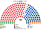
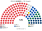
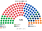
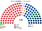
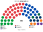
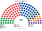
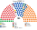
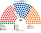
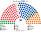

# 估計結果

來源：[`生態模型.py`](生態模型.py)。第一偏好來自一院夾的 AEC 檔。第二偏好用與一院相同的距離。組閣只算眾議院。

## 計算方式

| 層 | 做法 |
|---|---|
| 民意層 | 沿用一院夾的 AEC 選區第一偏好 |
| 參選方層 | 與一院相同：版本甲聯盟協議照現實；`finalists`（withdraw）共同提名 0 區 |
| 眾議院單一 120 | top-4 孔多賽 |
| 眾議院複數 60 | 6 區聖拉古、無門檻 |
| 參議院 120 | 同一批第一偏好、十區聖拉古，不設單一 |
| 首長／組閣 | 只算眾議院；≥91 |

細節見 [`14`](14-近期大選重算.md)、。

## 眾議院

| 屆 | 最大黨 | 席次 | 過半 91 | 首長 | 組閣 |
|---|---|--:|---|---|---|
| 2025-05 | 工黨 | 98 | 單獨過 | 工黨 | 工黨 |
| 2022-05 | 工黨 | 83 | 未過 | 工黨 | 工黨＋獨立＝91 |

## 2025-05

## 2025-05 眾議院對照

| 政黨 | 第一偏好 | 現行席次 | 眾議院 | 占比 | 參議院 | 一院全院 |
|---|--:|--:|--:|--:|--:|--:|
| 工黨 | 34.56% | 94／150 | 98 | 54.4% | 49 | 152／300 |
| 自由黨 | 20.69% | 18 | 30 | 16.7% | 28 | 47 |
| 自由國家黨 | 7.10% | 16 | 19 | 10.6% | 10 | 34 |
| 國家黨 | 3.80% | 9 | 10 | 5.6% | 4 | 16 |
| 綠黨 | 12.20% | 1 | 8 | 4.4% | 18 | 18 |
| 一國黨 | 6.40% | 0 | 6 | 3.3% | 10 | 10 |
| 獨立 | 7.27% | 10 | 7 | 3.9% | 0 | 19 |

自由黨、自由國家黨、國家黨的第一偏好是聯盟合計的主體。眾議院這三黨 30＋19＋10＝59（32.8%）。不過 91。

## 分院（2025-05）

單一 120：工黨 74、自由國家黨 14、自由黨 14、國家黨 9、獨立 7、中間聯盟 1、卡特黨 1。

眾議院複數 60：工黨 24、自由黨 16、綠黨 8、一國黨 6、自由國家黨 5、國家黨 1。

參議院 120：工黨 49、自由黨 28、綠黨 18、一國黨 10、自由國家黨 10、國家黨 4、合法大麻 1。與一院複數同席。

組織法：眾議院全院 3/5＝108，工黨 98 未到。複數 3/5＝36，工黨 24 未到。參議院 3/5＝72，工黨 49、工黨＋綠黨 67，都未到。

## 2022-05

眾議院工黨 83，加上獨立 8 席＝91。參議院工黨 43、自由黨 31、綠黨 15、自由國家黨 10、一國黨 8、聯合澳洲 8、國家黨 5。

## 民調

各家最新一筆，維基 *Opinion polling for the next Australian federal election*（2026-11-08 頁面）。以 2025 選區第一偏好縮放，[`民調推估.py`](民調推估.py)。聯盟依 2025 四黨比例拆開。國家黨不到 5 席時不進候選，贏家改成自由黨。

**首長的參選方式**：自由黨、自由國家黨、國家黨、鄉村自由黨是正式聯盟（Coalition），選首長時共推一人，由席次最多的成員（自由黨）出任；其餘政黨各自推人。若四黨各自推人，居中的國家黨會以個位數到十幾席贏得全院排名——現實中聯盟不會讓這件事發生。

| 民調 | 全院 180（前四） | 首長 | 組閣席次 |
|---|---|---|---|
| YouGov（2026-10-27..11-03，n＝1500） | 一國黨 50、工黨 50、自由黨 40、自由國家黨 10 | 自由黨（聯盟人選） | 113 |
| Newspoll（2026-10-26..29，n＝1200） | 一國黨 59、工黨 57、自由黨 32、自由國家黨 9 | 自由黨（聯盟人選） | 108 |
| Essential（2026-10-21..26，n＝1087） | 工黨 56、一國黨 53、自由黨 38、自由國家黨 11 | 自由黨（聯盟人選） | 111 |
| Roy Morgan（2026-10-12..25，n＝2711） | 工黨 63、自由黨 43、一國黨 31、綠黨 12 | 自由黨（聯盟人選） | 97 |
| Resolve（2026-10-06..10，n＝2250） | 工黨 65、一國黨 38、自由黨 36、自由國家黨 11 | 自由黨（聯盟人選） | 101 |

一國黨在多數民調是單一選區的最大黨，但它在一對一裡輸給聯盟人選：工黨、綠黨議員寧可要自由黨也不要一國黨，一國黨議員寧可要自由黨也不要工黨。政府是聯盟加一國黨的右翼多數，首長出自較溫和的一側。

### YouGov（2026-10-27..11-03，n＝1500）

投票意向：工黨 25、聯盟 23、綠黨 13、一國黨 27、其他 12。

| 組成 | 席次 |
|---|---|
| 單一 | 一國黨 31、工黨 33、自由黨 30、自由國家黨 7、獨立 7、國家黨 3、中間聯盟 1、倫尼克 1、卡特黨 3、鄉村自由黨 1 |
| 複數 | 一國黨 19、工黨 17、綠黨 10、自由黨 10、自由國家黨 3、國家黨 1 |
| **全院 180** | 一國黨 50、工黨 50、自由黨 40、自由國家黨 10、綠黨 10、獨立 7、國家黨 4、中間聯盟 1、倫尼克 1、卡特黨 3、鄉村自由黨 1 |
| 參議院 120 | 一國黨 37、工黨 35、自由黨 21、綠黨 18、自由國家黨 6、國家黨 3 |

首長 **自由黨**（聯盟共推）；組閣 自由黨＋自由國家黨＋鄉村自由黨＋國家黨＋倫尼克＋卡特黨＋中間聯盟＋一國黨＝113。

### Newspoll（2026-10-26..29，n＝1200）

投票意向：工黨 27、聯盟 21、綠黨 13、一國黨 28、其他 11。

| 組成 | 席次 |
|---|---|
| 單一 | 一國黨 40、工黨 39、自由黨 22、自由國家黨 6、獨立 6、中間聯盟 1、卡特黨 2、國家黨 2、鄉村自由黨 1 |
| 複數 | 一國黨 19、工黨 18、自由黨 10、綠黨 9、自由國家黨 3、國家黨 1 |
| **全院 180** | 一國黨 59、工黨 57、自由黨 32、自由國家黨 9、綠黨 9、獨立 6、國家黨 3、中間聯盟 1、卡特黨 2、鄉村自由黨 1 |
| 參議院 120 | 一國黨 37、工黨 37、綠黨 20、自由黨 18、自由國家黨 6、國家黨 2 |

首長 **自由黨**（聯盟共推）；組閣 自由黨＋自由國家黨＋鄉村自由黨＋國家黨＋卡特黨＋中間聯盟＋一國黨＝108。

### Essential（2026-10-21..26，n＝1087）

投票意向：工黨 28、聯盟 23、綠黨 12、一國黨 28、其他 10。

| 組成 | 席次 |
|---|---|
| 單一 | 工黨 38、一國黨 34、自由黨 27、自由國家黨 8、獨立 5、國家黨 4、中間聯盟 1、卡特黨 1、鄉村自由黨 1 |
| 複數 | 一國黨 19、工黨 18、自由黨 11、綠黨 8、自由國家黨 3、國家黨 1 |
| **全院 180** | 工黨 56、一國黨 53、自由黨 38、自由國家黨 11、綠黨 8、國家黨 5、獨立 5、中間聯盟 1、卡特黨 1、鄉村自由黨 1 |
| 參議院 120 | 工黨 38、一國黨 37、自由黨 19、綠黨 17、自由國家黨 6、國家黨 3 |

首長 **自由黨**（聯盟共推）；組閣 自由黨＋自由國家黨＋鄉村自由黨＋國家黨＋卡特黨＋中間聯盟＋一國黨＝111。

### Roy Morgan（2026-10-12..25，n＝2711）

投票意向：工黨 26、自由黨 21、國家黨 2.5、綠黨 15.5、一國黨 22.5、其他 12.5。

| 組成 | 席次 |
|---|---|
| 單一 | 工黨 44、自由黨 32、一國黨 16、自由國家黨 9、獨立 8、國家黨 4、中間聯盟 1、倫尼克 1、卡特黨 1、綠黨 1、鄉村自由黨 1 |
| 複數 | 工黨 19、一國黨 15、綠黨 11、自由黨 11、自由國家黨 3、國家黨 1 |
| **全院 180** | 工黨 63、自由黨 43、一國黨 31、綠黨 12、自由國家黨 12、獨立 8、國家黨 5、中間聯盟 1、倫尼克 1、卡特黨 1、鄉村自由黨 1 |
| 參議院 120 | 工黨 35、一國黨 31、自由黨 23、綠黨 21、自由國家黨 7、國家黨 2、合法大麻 1 |

首長 **自由黨**（聯盟共推）；組閣 自由黨＋自由國家黨＋鄉村自由黨＋國家黨＋倫尼克＋卡特黨＋中間聯盟＋一國黨＝97。

### Resolve（2026-10-06..10，n＝2250）

投票意向：工黨 29、聯盟 23、綠黨 12、一國黨 25、其他 11。

| 組成 | 席次 |
|---|---|
| 單一 | 工黨 45、自由黨 26、一國黨 20、自由國家黨 8、獨立 6、國家黨 6、中間聯盟 1、倫尼克 1、卡特黨 3、鄉村自由黨 1 |
| 複數 | 工黨 20、一國黨 18、自由黨 10、綠黨 8、自由國家黨 3、國家黨 1 |
| **全院 180** | 工黨 65、一國黨 38、自由黨 36、自由國家黨 11、綠黨 8、國家黨 7、獨立 6、中間聯盟 1、倫尼克 1、卡特黨 3、鄉村自由黨 1 |
| 參議院 120 | 工黨 40、一國黨 34、自由黨 19、綠黨 18、自由國家黨 6、國家黨 3 |

首長 **自由黨**（聯盟共推）；組閣 自由黨＋自由國家黨＋鄉村自由黨＋國家黨＋倫尼克＋卡特黨＋中間聯盟＋一國黨＝101。

