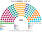
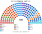

# 估計結果

> 席次**表**：§1 近期大選、§2 民調、§3 長期。國會兩夾相同，算法與逐區結果見 [`../共用/14`](../共用/14-近期大選重算.md)；圖見 [`../共用/席次圖.md`](../共用/席次圖.md)。

選制：國會 **160＝單一 96（top-3 孔多賽）＋複數 64（5 區＋海外、聖拉古、無門檻）**；法律 ≥81；組織法全院 ≥96 **且**複數 ≥39。總統：全國 top-3 孔多賽。

## 1 近期大選

### 2026-04（2021 逐投票桌地理＋2026 各省總統票推估）

| 政黨 | 單一 96 | 複數 64 | **全院 160** |
|---|--:|--:|--:|
| AN 此刻民族 | 26 | 8 | **34** |
| OBRAS | 25 | 6 | **31** |
| PPT 全民國家 | 17 | 4 | **21** |
| PBG 好政府黨 | 13 | 7 | **20** |
| FP 人民力量 | 6 | 12 | **18** |
| RP 人民革新 | 3 | 9 | **12** |
| JP 團結秘魯 | 2 | 7 | **9** |
| 其他 4 黨 | 4 | 11 | **15** |

**總統（同日名單票 × 參選方層；[方法](../../../notes/算法/選舉結果計算方式.md)）**：前三 JP＋AN 23.0%、FP 17.5%、OBRAS＋Pod＋FREPAP 15.3%；勝者 **OBRAS＋Pod＋FREPAP 共同人選**（對 FP 69.4、對 JP＋AN 69.6）。現實第一輪對照下是 FP。

- 總統的參選方 32／160（OBRAS 31、Pod 1）：法律要再拉至少兩黨（例：AN 34＋PPT 21）。
- **和現實不同**：現實兩輪制把居中的參選方擋在第一輪；政黨票下 OBRAS 與相鄰小黨共同提名後擠進前三，對兩端都大勝。

### 2021-04（ONPE 逐投票桌）

| 政黨 | 單一 96 | 複數 64 | **全院 160** |
|---|--:|--:|--:|
| AP 人民行動 | 26 | 6 | **32** |
| SP 我們是秘魯 | 24 | 4 | **28** |
| APP 進步聯盟 | 17 | 5 | **22** |
| Pod 我們能 | 15 | 4 | **19** |
| PL 自由秘魯 | 4 | 9 | **13** |
| AvP 國家前進 | 6 | 5 | **11** |
| FP 人民力量 | 0 | 8 | **8** |
| RP 人民革新 | 0 | 8 | **8** |
| 其他 5 黨 | 4 | 15 | **19** |

**總統（同日名單票 × 參選方層）**：前三 AP＋SP 15.5%、PL 13.7%、FP 11.6%；勝者 **AP＋SP 共同人選**（對 FP 71.9、對 PL 70.4）。現實第一輪對照下是 FP（實際決選 PL 50.13）。

- 總統的參選方 60／160（AP 32、SP 28）：加 APP 22 即過半。

## 2 民調

2026 年選後沒有可用的政黨或總統民調（維基未建頁），**本夾不做民調重算**。估計結果三來源中的這一項從缺，理由如上。

## 3 長期運行（推估第 3 屆）

假設兩端（RP、JP、AN、FREPAP）各讓出 1/8 第一偏好給居中政黨（PBG、APP 各半），反映 top-3 孔多賽向中間的誘因（`python ../共用/生態模型.py --projection`）。

| 政黨 | 單一 96 | 複數 64 | **全院 160** |
|---|--:|--:|--:|
| PBG 好政府黨 | 23 | 10 | **33** |
| OBRAS | 20 | 6 | **26** |
| AN 此刻民族 | 19 | 6 | **25** |
| APP 進步聯盟 | 20 | 3 | **23** |
| FP 人民力量 | 5 | 12 | **17** |
| PPT 全民國家 | 8 | 4 | **12** |
| 其他 5 黨 | 1 | 23 | **24** |

最大黨 33／160；總統的國會基礎無論誰當選都遠低於過半，**預提預算是總統能施政的主要保證**（[`03`](03-行政權預算.md)）。
