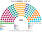
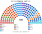
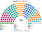

# 估計結果

> 席次**表**：§1 近期大選、§2 民調、§3 長期。國會與總統制夾相同，算法與逐區結果見 [`../共用/14`](../共用/14-近期大選重算.md)；圖見 [`../共用/席次圖.md`](../共用/席次圖.md)。

選制：國會 **160＝單一 96（top-3 孔多賽）＋複數 64（5 區＋海外、聖拉古、無門檻）**；首長全院排名投票選出（棄權不計）；供給、建設性更新 ≥81；組織法全院 ≥96 **且**複數 ≥39。

## 1 近期大選

### 2026-04（2021 逐投票桌地理＋2026 各省總統票推估）

| 政黨 | 單一 96 | 複數 64 | **全院 160** |
|---|--:|--:|--:|
| AN 此刻民族 | 26 | 8 | **34** |
| OBRAS | 25 | 6 | **31** |
| PPT 全民國家 | 17 | 4 | **21** |
| PBG 好政府黨 | 13 | 7 | **20** |
| FP 人民力量 | 6 | 12 | **18** |
| RP 人民革新 | 3 | 9 | **12** |
| JP 團結秘魯 | 2 | 7 | **9** |
| 其他 4 黨 | 4 | 11 | **15** |

**首長：OBRAS**（議員之間的孔多賽贏家）。兩兩：對 AN 88：65、對 JP 90：63、對 APP 93：60、對 PPT 95：58、對 PBG 97：56、對 FP 123：30、對 RP 123：30。

**組閣聯盟／多數派政府**（由近到遠）：OBRAS＋Pod＋PPT＋APP＋AN＝92。最大黨 AN（34）不是首長：它在經濟軸上偏左，OBRAS 居中。

元首（直選總統）：OBRAS＋Pod＋FREPAP 共同人選（同總統制夾）。

### 2021-04（ONPE 逐投票桌）

| 政黨 | 單一 96 | 複數 64 | **全院 160** |
|---|--:|--:|--:|
| AP 人民行動 | 26 | 6 | **32** |
| SP 我們是秘魯 | 24 | 4 | **28** |
| APP 進步聯盟 | 17 | 5 | **22** |
| Pod 我們能 | 15 | 4 | **19** |
| PL 自由秘魯 | 4 | 9 | **13** |
| AvP 國家前進 | 6 | 5 | **11** |
| FP 人民力量 | 0 | 8 | **8** |
| RP 人民革新 | 0 | 8 | **8** |
| 其他 5 黨 | 4 | 15 | **19** |

**首長：SP**；兩兩：對 APP 86：74、對 AP 105：55、對 Pod 119：41、對 FP 138：22、對 PL 141：19。

**組閣聯盟**：SP＋AP＋APP＝82。中間偏右三黨。

元首：AP＋SP 共同人選（模型；實際 PL 50.13，見總統制夾）。

## 2 民調

2026 年選後沒有可用的政黨民調（維基未建頁），**本夾不做民調重算**。

## 3 長期運行（推估第 3 屆）

兩端（RP、JP、AN、FREPAP）各讓出 1/8 第一偏好給居中政黨（PBG、APP 各半）。

| 政黨 | 單一 96 | 複數 64 | **全院 160** |
|---|--:|--:|--:|
| PBG 好政府黨 | 23 | 10 | **33** |
| OBRAS | 20 | 6 | **26** |
| AN 此刻民族 | 19 | 6 | **25** |
| APP 進步聯盟 | 20 | 3 | **23** |
| FP 人民力量 | 5 | 12 | **17** |
| PPT 全民國家 | 8 | 4 | **12** |
| 其他 5 黨 | 1 | 23 | **24** |

**首長：APP**（對 OBRAS 78：76，很接近）；組閣聯盟 APP＋PPT＋Pod＋OBRAS＋AN＝87（中間）。
