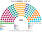
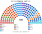

# 近期大選套新制（兩夾共用）

> 國會兩夾相同；總統（總統制夾）與首長（議會制夾）的結果各夾的 `估計結果.md` 也列。圖見 [`席次圖.md`](席次圖.md)。

## 1 方法

| 項目 | 來源與做法 |
|---|---|
| 2021 第一偏好 | ONPE 開放資料（datosabiertos.gob.pe）**逐投票桌**國會名單票與總統第一輪票：只取已計入的投票桌（CONTABILIZADA 等），去掉空白、無效、爭議票；同一區（distrito）每 25 桌合成一個單位，共 4,727 個（[`_build_eg2021.py`](_build_eg2021.py)、[`資料/eg-2021.csv`](資料/eg-2021.csv)） |
| 2021 驗證 | 國會有效票 12,858,920：PL 13.41%、FP 11.34%、RP 9.33%、AP 9.02%、APP 7.54%、AvP 7.54%；總統第一輪有效票 14,400,630：PL 18.92%、FP 13.41%、RP 11.75%、AvP 11.63%，與官方一致 |
| 2026 第一偏好 | **推估**。ONPE 結果網站對自動存取回 403，不繞過。改用維基的全國眾議院得票與 25 省＋海外的總統第一輪：各 2026 政黨沿用 2021 年「母黨」的單位分布（例：JP ← JP＋PL；PBG ← PM＋AP；OBRAS ← Pod），省級總量按 2026 總統第一輪調整，最後縮放到全國眾議院得票（[`_build_eg2026.py`](_build_eg2026.py)）。**省內分布是推估** |
| 座標 | jmcastagnetto/ubigeo-peru-aumentado 的區（distrito）中心點，以 RENIEC 的 UBIGEO 對應（1,874 區全部對上） |
| 單一 96 | 5 區內依座標的 Hilbert 曲線排序，按有效票連續切；top-3 孔多賽 |
| 複數 64 | 各區聖拉古、無門檻；「其他」拆成 5 份小名單 |
| 總統（總統制夾） | 民意層＝同日國會名單票（政黨層級），不用現實總統第一輪（受棄保、退選影響）、不用個別候選人；參選方層＝每個參選方可推人，現實中正式共推一人的聯盟先合併，其餘相鄰政黨在新制誘因下可共同提名；前 3 名、6 格排序、孔多賽。（[方法](../../../notes/算法/選舉結果計算方式.md)） |
| 首長（議會制夾） | 全院 160 記名排名，須 ≥81 |
| 校準 | FP 的體制軸位置放在 1.4（全模型最遠），使兩次決選的模型對決都接近 50：50：2021 FP 對 PL 52.5（實際 49.87）、2026 FP 對 JP 50.0（實際 50.13）。這是「反藤森主義」的量化（各夾 `12` §2） |

## 2 2026-04-12

實際：眾議院 130：FP 41、JP 32、PBG 18、RP 15、OBRAS 14、AN 10（另參議院 60）；總統 FP（決選 50.13：49.87 勝 JP）。

| 政黨 | 眾議院得票% | 實際 130 | 單一 96 | 複數 64 | **新制 160** |
|---|--:|--:|--:|--:|--:|
| AN 此刻民族 | 8.5 | 10 | 26 | 8 | **34** |
| FP 人民力量 | 14.7 | 41 | 6 | 12 | **18** |
| PBG 好政府黨 | 10.5 | 18 | 13 | 7 | **20** |
| OBRAS | 8.3 | 14 | 25 | 6 | **31** |
| RP 人民革新 | 11.0 | 15 | 3 | 9 | **12** |
| PPT 全民國家 | 5.8 | 0 | 17 | 4 | **21** |
| JP 團結秘魯 | 10.8 | 32 | 2 | 7 | **9** |
| 其他（24 黨） | 16.1 | 0 | 0 | 7 | **7** |
| APP、PLG、Pod | 8.4 | 0 | 4 | 4 | **8** |
| SP、FREPAP、APRA | 5.9 | 0 | 0 | 0 | **0** |

| 區（單一） | 結果 |
|---|---|
| 利馬北東－卡亞俄（21） | AN 7、PBG 6、FP 3、OBRAS 3、PPT 1、RP 1 |
| 利馬中南（15） | PBG 5、OBRAS 4、FP 3、RP 2、AN 1 |
| 北部（21） | PPT 8、OBRAS 5、APP 4、PBG 2、JP 2 |
| 中部與亞馬遜（20） | OBRAS 7、PPT 7、AN 6 |
| 南部（19） | AN 12、OBRAS 6、PPT 1 |

- **沒有一個單一選區的當選者第一偏好過半**；當選者第一偏好中位數 12.4%，81／96 區當選者不是第一輪第一名。
- **最大黨 34／160**：首長、法律都要至少三黨；組織法要五黨（[`05`](05-法規位階與修憲.md) §2）。
- 現行制度下 FP 以 14.7% 拿到眾議院 41／130（32%）；本夾 18／160（11%）。

## 3 2021-04-11

實際：一院 130：PL 37、FP 24、AP 16、APP 15、RP 13、AvP 7、JP 5、SP 5、Pod 5、PM 3；總統 PL（決選 50.13：49.87）。

| 政黨 | 得票% | 實際 130 | 單一 96 | 複數 64 | **新制 160** |
|---|--:|--:|--:|--:|--:|
| AP 人民行動 | 9.0 | 16 | 26 | 6 | **32** |
| AvP 國家前進 | 7.5 | 7 | 6 | 5 | **11** |
| APP 進步聯盟 | 7.5 | 15 | 17 | 5 | **22** |
| FP 人民力量 | 11.3 | 24 | 0 | 8 | **8** |
| PL 自由秘魯 | 13.4 | 37 | 4 | 9 | **13** |
| SP 我們是秘魯 | 6.1 | 5 | 24 | 4 | **28** |
| RP 人民革新 | 9.3 | 13 | 0 | 8 | **8** |
| Pod、FREPAP、JP、VN、PM、UPP | 29.5 | 13 | 18 | 19 | **37** |
| PPC、PNP、FA、其他 | 6.3 | 0 | 1 | 0 | **1** |

- 單一：利馬北東 SP 17／21；北部 APP 15／21；中部 AP 10／20；南部 AP 12／19；利馬中南 Pod 6、AvP 6。**地區強黨各拿自己的區**，沒有全國性的勝方；[參選方層](../../../notes/算法/選舉結果計算方式.md)下 SP、Pod 在利馬與相鄰小黨共同提名後擠進前三。
- PL（13.4%，第一大黨）只有 13 席：它的選民集中在南部山區，而且是最左的一端，在大多數區的兩兩對決中輸給居中的 AP、SP、APP。

## 4 敏感度（`--sweep`）

| 檢查 | 2026 單一 | 首長／總統 | 2021 單一 | 首長／總統 |
|---|---|---|---|---|
| 基準 | AN 26、OBRAS 25、PPT 17、PBG 13 … | OBRAS／OBRAS | AP 26、SP 24、APP 17、Pod 15 … | SP／AP |
| 全部重經濟 | PBG 29、OBRAS 29、AN 17、PPT 14 … | OBRAS／PBG | Pod 23、AP 22、APP 17、SP 16 … | **APP**／AP |
| 全部重體制 | AN 27、OBRAS 23、RP 18、JP 13 … | OBRAS／OBRAS | SP 28、APP 27、Pod 12、AP 12 … | SP／AP |
| 全部均衡 | AN 30、OBRAS 21、PPT 20、RP 16 … | OBRAS／OBRAS | SP 35、AP 27、APP 15、FREPAP 7 … | SP／AP |
| 切線位移半區 | OBRAS 32、AN 26、PPT 12、FP 8 … | — | AP 27、SP 23、APP 20、Pod 13 … | — |

**讀法**：2026 年單一席次的贏家在 4–5 個黨之間換，總統（政黨票 × 參選方層）多半是中間偏右的共同人選（2026 OBRAS、2021 AP），只有全部重經濟時 2026 換成 PBG。這是秘魯碎片化的真實樣子：第一輪前幾名都只有一成多，誰是中位取決於選民在經濟與體制之間怎麼取捨。**議會制首長 2026 年在所有假設下都是 OBRAS，2021 年多半是 SP（全部重經濟時換成 APP）**；總統與首長各在一個假設下換人，穩定度相近。

**FP 位置的另一種設定**（距離模型檢核）：把 FP 放回體制軸 0.7、另加「反感」懲罰 0.4，對 2021、2026 兩場決選的擬合與現行（體制軸 1.4）相近，但 2026 年國會差很多：FP 單一席次 19（現行 6）、全院 31（現行 18），總統變成 PBG（首長仍是 OBRAS；2021 年幾乎不變）。兩場決選都是 50.13：49.87，資料無法分辨兩種設定；本夾維持現行，**FP 的國會席次要當作很不確定的數字讀**。

## 5 出處

| 數字 | 出處 |
|---|---|
| 2021 逐投票桌 | datosabiertos.gob.pe「Resultados por mesa de las Elecciones Generales 2021」（國會、總統第一輪） |
| 2026 全國、各省 | 維基 2026 Peruvian general election 的 Election results 與 By department 表（引 ONPE） |
| 區座標 | github.com/jmcastagnetto/ubigeo-peru-aumentado |
| 實際席次、決選 | 維基 2021、2026 Peruvian general election |
| 民調 | 2026 年選後沒有可用的政黨民調（維基未建頁），本夾不做民調重算 |
