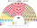

# 預期政治生態

> **席次估計**（近期大選重算、民調套本夾、長期運行假設下的席次表）見 [`估計結果.md`](估計結果.md)。本檔專注誘因、朝野互動與候選人行為；席次數字以估計結果與席次圖為準。

`0-基本/總體.md`：給長期運行下的預期政治生態（朝野互動、候選人行為、各政黨／派系席次、仿維基席次圖），要有論據（誘因、機械效應），可大膽假設。
`0-基本/要求.md` **硬性**：不得把提示詞要求直接當預期生態；不合期望就回頭改設計。

路徑：**誘因 → 得票 → 選制 → 席次 → 朝野互動與候選人行為 → 檢視**。席次由 [`生態模型.py`](生態模型.py) 算出。

## 1 誘因

| 層 | 誘因 | 預期行為 |
|---|---|---|
| 單一席次（top-3 孔多賽） | 第二輪三人，**第三名支持者的第二偏好決定勝負** | 候選人爭取對手陣營的第二偏好。**主權派候選人要贏，必須拿到 PSD 或 PNL 選民的第二偏好**，激進言論的代價變高 |
| 複數席次（彈性名單） | 個人票跨不過 Droop 25% 就白做 | 地方大老的個人票動員失去邊際報酬 |
| 組閣（30 日＋預設值） | 拖延＝把選擇交給票面算術 | 不再有「等總統下一張牌」的選項；談判集中在前 30 日 |
| 倒閣（建設性更新） | 倒閣＝當眾提出繼任者，且記名投給他 | **2026 年那種「先倒再說」的聯盟消失**：PSD 和 AUR 若要聯手，就得公開推同一個人 |
| 供給（20 日自動生效） | 拒絕預算＝換政府 | 撙節的爭議轉成換首長，不轉成停擺 |
| 地方撥款公式化 | 鎮長沒有東西可以交換 | 縣議會主席作為中間人的價值下降 |

## 2 假設

### 2.1 偏好的空間

| 政黨 | 地緣（親歐盟 −1 … 主權派 +1） | 體制（反建制 −1 … 建制恩庇 +1） | 族群 |
|---|:--:|:--:|:--:|
| USR | −0.9 | −0.4 | 0 |
| PNL | −0.5 | +0.6 | 0 |
| UDMR | −0.4 | +0.7 | 1 |
| **PSD** | **+0.3** | **+0.8** | 0 |
| AUR | +0.7 | −0.3 | 0 |
| POT | +0.9 | −0.8 | 0 |
| SOS | +1.0 | −0.6 | 0 |

選民分三型：重地緣（50%）、重體制（20%）、均衡（30%）。

★ **PSD 放在地緣 +0.3**：黨中央親歐盟，但它的選民偏農村、社會保守。這個位置是用民調校準出來的（[`14`](14-近期大選重算.md) §1.3）：PSD 若放在 +0.1，模型算出的 2024 年決選會和民調方向相反。

★ **重地緣型占一半**：2024–25 年羅馬尼亞政治的主軸是「親歐盟對主權派」。用 2025 年決選反推也是這樣：執政聯盟的共同候選人 的選民（建制派）多數投給 Dan，而不是同樣反建制的 AUR 的候選人。

### 2.2 地區

找不到 2024 年國會的分縣得票，改用 2024 年總統第一輪的分縣得票當各黨的地區形狀，再用迭代比例調整拉回國會的全國得票。單一選區在縣內另加城鄉梯度（USR 在城市強、PSD 在鄉村強）、匈牙利族集中梯度和隨機擾動。驗證見 [`14`](14-近期大選重算.md) §1.2：縣冠軍約 35／41 吻合，Iași、Ilfov 各黨誤差都在 2 個百分點內。

### 2.3 推估用的得票

| 情境 | 得票 |
|---|---|
| 2024-12 | 實際得票（[`14`](14-近期大選重算.md)） |
| **下一屆**（2028） | **2026-10 民調平均**：AUR 35.8、PSD 22.9、PNL 16.9、USR 8.2、UDMR 5.1、SOS 2.9、POT 2.3、其他 5.9 |
| 刀鋒 | INSCOP 2026-09：AUR 39.7、PSD 18.7、PNL 16.3、USR 9.0 |

## 3 席次（下一屆，以 2026-10 民調平均）

| 政黨 | 單一 180 | 複數 120 | **全院 300** |
|---|--:|--:|--:|
| PSD | 103 | 31 | **134** |
| AUR | 57 | 48 | **105** |
| PNL | 13 | 21 | 34 |
| UDMR | 7 | 6 | 13 |
| USR | 0 | 12 | 12 |
| SOS | 0 | 1 | 1 |
| POT | 0 | 1 | 1 |

門檻：過半 151、3/5 180、2/3 200；複數 3/5 72、2/3 80。

- **首長**：PSD 的人選，最弱的一場對決（對 AUR）是 190 比 110。PSD＋PNL＝165，或 PSD＋UDMR＋PNL＝178。
- **AUR 是最大的第一偏好，但不是孔多賽贏家**：PNL、USR、UDMR 的選民在 PSD 和 AUR 之間大多選 PSD。
- **規則**：沒有任何一黨單獨過複數 3/5（72）。AUR＋PSD 合計複數 79，**可以過組織法和一般修憲**，但過不了急迫修憲（80）。

## 4 朝野互動與候選人行為

| 面向 | 預期 |
|---|---|
| 政府 | **PSD 是樞紐**：它和右邊（PNL、UDMR）或左邊（AUR）都能組成多數。這給 PSD 很大的議價力，也讓它成為所有人第二偏好的爭奪對象 |
| AUR | 第一偏好最大，單一席次卻輸掉大部分領先的區。它的理性策略是**爭取 PSD 選民的第二偏好**：淡化反歐盟、強調社會保守和反撙節 |
| PNL | 單一席次只剩 11 席，主戰場在比例層 |
| USR | **單一席次 0 席**，代表全在比例層 |
| UDMR | 哈爾吉塔、科瓦斯納的單一席次全拿；穆列什、薩圖馬雷部分。在其他地方，匈牙利族選民是 PSD 和 PNL 候選人爭取的第二偏好 |
| 候選人 | 單一席次候選人比「誰更能管好地方」；**親俄或反歐盟的激進言論在單一選區被懲罰** |
| 樁腳 | 撥款公式化之後，鎮長的動員從「換錢」變成「換名聲」 |

### 4.1 為什麼這不是「把 AUR 擋在外面」

孔多賽只看兩兩對決。AUR 在單一席次輸的區，是**該區多數選民把 PSD 排在 AUR 前面**的區。當 AUR 的第一偏好升到 40% 左右（INSCOP 的數字），它在大多數區都會成為孔多賽贏家（§5.3），並單獨組閣。**制度不擋 AUR，擋的是「一個多數人排最後的候選人」。**

## 5 檢視：哪裡不合

本夾對自己的期望：**組得出政府、不空轉、預算過得了、不讓一黨改寫規則、選舉結果可信。**

### 5.1 不合一：居中政黨以兩成多的得票接近單獨過半

| PSD 第一偏好（其餘按比例） | 單一 180 | 全院 300 | 首長 |
|:--:|--:|--:|---|
| 18% | 74 | 97 | PSD |
| 22%（2024 實際） | 118 | 148 | PSD |
| 23% | 125 | **155** | PSD（單獨過半） |
| 26% | 145 | 181 | PSD |

PSD 在 2024 年以 22% 拿到 118／180 個單一席次，**23% 就能單獨過半**。而 PSD 正是病 10（地方大老）網絡最深的政黨。

**因此改過或確認的設計**：

| 原本的想法 | 改成 | 檔 |
|---|---|---|
| 首長、供給由單一席次選 | **全院 300**（計劃 D4，模型確認：只限單一席次時 PSD 以 117 席獨占） | [`02`](02-政府組成與建設性更新.md) §2.1 |
| 檢察首長由全院排名投票選出（計劃 D17） | 改由**檢察委員會**選，其政治成員來自比例層 | [`07`](07-司法權與檢察.md) §4.1 |
| 只有組織法、修憲要兩種多數 | 加上**緊急狀態第 91 日起**、**彈劾總統** | [`08`](08-緊急狀態與地方.md) §2、[`04`](04-總統.md) §6 |
| 地方撥款「減少裁量」 | 改成**公式化，裁量 ≤10%，審計院逐鎮公告** | [`08`](08-緊急狀態與地方.md) §4.1 |

### 5.2 不合二：最大黨在八十多個領先的區落敗

以 2026-10 民調平均，AUR 是約 85 個單一選區的第一偏好第一名，其中 **80 區輸給 PSD**。孔多賽的邏輯成立，但在一個 2024 年才經歷「選舉被宣告無效」的國家，這很容易被說成「又被偷了」。

**因此加的設計**：單一席次第二輪的 **6 種排序票數在每個投開票所當場唱出、張貼**（[`01`](01-國民議會與選制.md) §7.1）。任何人都能拿這 6 個數字算出 PSD 對 AUR 的兩兩對決。**這是對「被偷」說法唯一有效的回答：讓每個人自己算。**

**改完仍然剩下的**：有人不信算術。本夾不處理。

### 5.3 不合三：刀鋒

| 民調 | AUR | PSD | 單一 180 | 全院 300 | 首長 |
|---|:--:|:--:|---|---|---|
| 平均（PolitPro） | 35.8 | 22.9 | PSD 103、AUR 57 | PSD 134、AUR 105 | PSD |
| INSCOP 2026-09 | 39.7 | 18.7 | AUR 119、PSD 44 | **AUR 172** | **AUR** |

**4 個百分點的差距，政府就換邊。** 這和 `1-優化/行政立法/共用.md` 想避免的「政策左右搖擺」有張力。

測過的替代：把席次改成 150＋150，INSCOP 情境下 AUR 仍有 160 席過半。**擺盪來自民意本身（AUR 約四成、其餘分散），不是席次比例**，所以維持 180＋120。

**改完仍然剩下的**：政府可能擺盪，但**規則不擺盪**：AUR 172 席時，複數只有 53／120，改不了選制、法院、檢察和財政規則；供給自動生效，政策工具隨政府換，憲政結構不換。這個取捨寫進 [`13`](13-完善與自洽.md)。

### 5.4 對得上的

- **組得出政府**：所有情境的首長都在排名投票中直接出現，沒有循環；2024 年型的分裂局面下 PSD 要找夥伴，但它是孔多賽贏家，**30 日內必定就任**。
- **改規則要跨陣營**：所有情境裡沒有任何一黨單獨過複數 3/5。2024 年實際的執政聯盟（PSD＋PNL＋UDMR）也過不了（複數 57）。
- **匈牙利族有代表**：UDMR 2024 年重算 16 席，接近得票比例。

## 6 敏感度

| 選民類型 | 2024-12 單一 180 | 2026-10 單一 180 |
|---|---|---|
| 基準 | PSD 117、AUR 28、PNL 24、UDMR 8、USR 3 | PSD 103、AUR 57、PNL 13、UDMR 7 |
| 全部重地緣 | PSD 134、PNL 21、AUR 15、UDMR 8、USR 2 | PSD 119、AUR 47、PNL 7、UDMR 7 |
| 全部重體制 | AUR 77、PNL 81、PSD 10、USR 4、UDMR 8 | AUR 108、PNL 58、PSD 7、UDMR 7 |

| 縣內擾動 sd | 2024-12 單一 180（兩個種子） |
|:--:|---|
| 0 | PSD 133、PNL 22、AUR 13、UDMR 8、USR 4 |
| 2.5（基準） | PSD 118–126、AUR 22–29、PNL 18 |
| 5 | PSD 103–111、AUR 33–39、PNL 22–24 |

★ 結果對「選民重視哪條軸」非常敏感：如果選民主要按「反建制」投票，PSD 會從樞紐變成輸家，AUR 和 PNL 瓜分單一席次。基準用重地緣，是因為 2024 年的決選民調和 2025 年的實際決選都顯示地緣是主軸（§2.1）。

## 7 席次圖

[`席次圖.md`](席次圖.md)。
