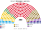
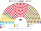
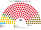

# 近期大選重算

> **這檔是什麼**：近期大選得票**怎麼**套進本夾選制（方法、假設、對照）。席次一覽與圖見 [`估計結果.md`](估計結果.md) §1、[`席次圖.md`](席次圖.md)。

拿 2024 年 11–12 月的兩場選舉，用**當時實際的民意**套本夾的規則，再一路推到 2026-10。數字由 [`生態模型.py`](生態模型.py) 算出；推演是推測，標為推測。

## 1 方法

### 1.1 資料

| 項目 | 來源 |
|---|---|
| 國會全國得票 | 2024-12-01 眾議院：PSD 21.96、AUR 18.01、PNL 13.20、USR 12.40、SOS 7.36、POT 6.46、UDMR 6.33；其他（未過門檻各黨、少數族群組織、獨立）14.28 |
| 地區形狀 | 2024-11-24 總統第一輪的分縣得票（找不到國會的分縣得票） |
| 人口 | 2021 普查（劃單一選區、分複數區席次） |
| 決選民調 | 2024-11-26 至 12-05 的 得票第一的無黨籍候選人 對 USR 的候選人 民調 6 筆；2024-06 INSCOP 的 PSD 的候選人 對 USR 的候選人 |

各黨的地區形狀對應：PSD←PSD 的候選人、AUR←AUR 的候選人、PNL←PNL 的候選人、USR←USR 的候選人、SOS 與 POT←得票第一的無黨籍候選人、UDMR←UDMR 的候選人。再用迭代比例調整，讓全國加總等於國會的實際得票。

### 1.2 驗證：地區底子

| 縣 | 實際（眾議院） | 模型 |
|---|---|---|
| Iași | PSD 21.4、AUR 16.6、PNL 14.6、USR 14.0 | PSD 23.0、AUR 17.6、PNL 13.9、USR 16.1 |
| Ilfov | PNL 20.5、AUR 17.8、USR 17.6 | PNL 18.8、AUR 17.4、USR 16.9 |

| 縣冠軍 | 實際 | 模型 |
|---|:--:|:--:|
| PSD | 25 | 27 |
| PNL | 6 | 4 |
| UDMR | 5 | 6 |
| AUR | 3 | 3 |
| USR | 2 | 1（另有布加勒斯特） |

約 35／41 吻合。錯的是幾個接戰縣：Cluj、Bihor 實際是 PNL（模型給 USR、UDMR），Brașov、Timiș 實際是 USR（模型給 PSD、AUR），Suceava、Constanța 實際是 AUR（模型給 PSD）。原因是總統第一輪的 USR 的候選人 票含有大量反 PSD 的策略票，高估了 USR 在 Cluj 的實力。

### 1.3 校準：選民類型

| 對決 | 民調 | 模型（基準） |
|---|---|---|
| 得票第一的無黨籍候選人 對 USR 的候選人 | 6 筆，得票第一的無黨籍候選人 46–63%；羅馬尼亞本地民調 58–63%，AtlasIntel 約 49%；平均約 55% | **得票第一的無黨籍候選人 52.1%** |
| PSD 的候選人 對 USR 的候選人 | 2024-06 INSCOP：PSD 的候選人 58% | **PSD 的候選人 56.8%** |
| PSD 的候選人 對 得票第一的無黨籍候選人 | 無民調 | PSD 的候選人 58.3% |

第一版用保加利亞夾的選民類型（三型各約 1/3），結果 USR 的候選人 對 得票第一的無黨籍候選人 勝出、布加勒斯特 16 個單一選區有 9 個給 AUR，兩者都和現實不合。改成**重地緣型占一半**、PSD 的地緣位置移到 +0.3 後，兩組民調的方向都對上。

## 2 總統（2024-11-24）

### 2.1 民意層 × 參選方層

民意層＝國會名單票（政黨層級），不用現實總統第一輪（受棄保、退選影響）、不用個別候選人；參選方層＝每個參選方可推人，相鄰政黨在新制誘因下可共同提名；前 3 名、6 格排序、孔多賽。（方法：[`選舉結果計算方式`](../../../notes/算法/選舉結果計算方式.md)）民意層用 2024-12 國會名單票（兩次總統選舉之間唯一的國會選舉）。

| | 2024-11 | 2025-05 |
|---|---|---|
| 參選方 | 各黨各自推人 | **PSD、PNL、UDMR 依執政聯盟協議共推一人**（現實也是） |
| 前三 | PSD 22.0%、AUR 18.0%、PNL 13.2% | **PSD＋PNL＋UDMR 41.5%**、AUR 18.0%、USR 12.4% |
| 勝者 | **PSD**：對 AUR 60.0%、對 PNL 55.3% | **執政聯盟共同人選**：對 AUR 60.0%、對 USR 62.1% |

| 敏感度（2024-11） | 勝者 |
|---|---|
| 全部重地緣 | PSD |
| 全部重體制 | AUR（對 PNL、PSD 都 51.6%） |

★ 現實 2024-11 第一輪最高票是無黨籍候選人（未申報的網路推廣把他從一成以下推到 23%）；以政黨為單位時，民意層用的是一週後的國會名單票，這股個人票不在裡面。**第 2、3 名差 2,740 票、下令重新計票的問題在新制下不重要**：前三名都進第二輪。

### 2.2 還會宣告無效嗎

依 [`07`](07-司法權與檢察.md) §3.2：

| 要件 | 2024 年的情況 | 判斷 |
|---|---|---|
| 違法足以改變結果 | 未申報的網路推廣把第一名的無黨籍候選人從民調的一成以下推到 23% | 可能改變**誰進前三**（沒有它，第三名可能是 AUR 的候選人），但**很難改變誰當選**：他在第二輪本來就輸 |
| 證據公開 | 國防最高委員會 12-04 解密了部分文件 | 符合 |
| ≥8／12 且三組各 ≥2 | 甲組由 2019 年總統選舉第二輪的三組候選人加權選出 | 要跨陣營 8 人同意；在「他反正會輸」的情況下，**推測不會達到** |

**推測**：新制下不會宣告無效。即使宣告，也只重辦第一輪，30 日內舉行，原候選人照舊（受益於違法財務的候選人若被認定明知，則除名）；**不會有 5 個月的空窗，也不會有重新登記候選人的過程**。

## 3 國會（2024-12-01）

### 3.1 席次

| 政黨 | 得票 | 現實：眾議院 331 | 現實：參議院 134 | **新制：單一 180** | **新制：複數 120** | **新制：全院 300** |
|---|--:|--:|--:|--:|--:|--:|
| PSD | 21.96 | 86 | 36 | 117 | 30 | **147** |
| AUR | 18.01 | 63 | 28 | 28 | 22 | **50** |
| PNL | 13.20 | 49 | 22 | 24 | 19 | **43** |
| USR | 12.40 | 40 | 19 | 3 | 17 | **20** |
| UDMR | 6.33 | 22 | 10 | 8 | 8 | **16** |
| SOS | 7.36 | 28 | 12 | 0 | 12 | **12** |
| POT | 6.46 | 24 | 7 | 0 | 12 | **12** |
| 少數族群保障席 | 1.40 | 19 | — | — | — | **0** |

| 陣營 | 得票 | 現實眾議院 | 新制全院 |
|---|--:|--:|--:|
| 親歐盟（PSD、PNL、USR、UDMR） | 53.9% | 197／331（59.5%） | 225／300（75.0%） |
| 主權派（AUR、SOS、POT） | 31.8% | 115／331（34.7%） | 75／300（25.0%） |

★ 新制放大了中間：主權派以 31.8% 的得票拿 25% 的席次，比現行少約 10 個百分點。原因是 AUR 在單一選區只贏 29 區；SOS、POT 在單一選區全滅，只靠比例層。

### 3.2 組閣

| 項目 | 新制 |
|---|---|
| 孔多賽贏家 | **PSD 的人選**：對每個對手都過 151，最弱對 PNL 223 比 77 |
| 單獨過半 | 否（148，差 3） |
| 可能的多數 | PSD＋UDMR 164；PSD＋PNL 185；PSD＋PNL＋UDMR 201（現實的組合） |
| 期限 | 新屆集會後 30 日內；現實花了 22 天（12-23 就職） |
| 改規則 | PSD＋PNL＋UDMR 全院 201，但複數只有 57（< 72）。**現實的執政聯盟改不了規則**，要拉進 USR |

★ 組閣在新制和現實的結果接近：都是 PSD 主導、PNL 和 UDMR 參與。差別在後面。

## 4 走向：2024-12 到 2026-10

**推測。** 每個時點用當時的民意，分兩條路：A 是全套新制（含總統 top-3），B 是只把國會換成新制、總統事件照現實。

### 4.1 A：全套新制

| 時點 | 現實 | **A** |
|---|---|---|
| 2024-12 | 總統選舉宣告無效；PSD 總理組閣 | PSD 的候選人 當選總統（推估）；PSD 另提總理，PSD＋PNL＋UDMR 組閣 |
| 2025-05 | 重選：AUR 的候選人 第一輪 41%，無黨籍候選人決選勝出；PSD 總理辭職，看守約 7 週 | **沒有這場選舉** |
| 2025 | Bolojan 撙節，綁信任案通過 | PSD 主導的政府自己撙節；供給自動生效，稅制要正常表決 |
| 2026-04 | PSD 退出，05-05 倒閣 | PSD 本身就是政府，沒有退出的對象。要換掉它，其他 6 黨合計 152 席得推出**同一個人**（從 AUR 到 USR），做不到 |
| 2026-10 | Niculescu 就任，PSD 拿 11 部 | PSD 主導的政府續任到 2028 |

**民意推測**：現實中 AUR 從 18% 升到約 36%，主要推力有三：選舉被宣告無效、得票第一的無黨籍候選人被拒參選、撙節。A 拿掉了前兩個，第三個還在，而且全算在 PSD 頭上。**推測 AUR 仍會上升，但少了「選舉被偷」這個最大的動員題材**；上升多少無法從資料推出。

### 4.2 B：只換國會

| 時點 | 現實 | **B** |
|---|---|---|
| 2024-12 | 宣告無效；Ciolacu 組閣 | 同現實（總統制度沒換） |
| 2025-05-05 | Ciolacu 辭職、PSD 退出，**看守約 7 週** | 副總理代理（**全權政府，不是看守**）；全院 30 日內選新首長 |
| 2025-06 | Bolojan 就任（PSD＋PNL＋USR＋UDMR） | PSD 若推自己的人選，模型算出它是孔多賽贏家（AUR、SOS、POT 會把 PSD 排在 PNL 前面）；PSD 若像現實一樣讓給 Bolojan，也在 30 日內完成 |
| 2026-04 | PSD 撤出部長 | **政府不倒**。Bolojan 以少數內閣續任，2026 年預算已生效 |
| 2026-05 | 不信任案 281 票通過，**看守 168 天** | PSD 要換人，得提**建設性更新**：PSD 147 席，還差 4 票，只能來自 AUR、SOS、POT，**而且是記名投給 PSD 的人選** |
| 之後 | 總統提 3 人未過；10-20 Niculescu 就任 | 兩種結果：(1) AUR 投票支持 → **數日內換成 PSD 主導的政府**，但 PSD 公開靠 AUR 上台；(2) PSD 不願被看到和 AUR 合作 → Bolojan 做到 2028 |

★ B 的關鍵：**現實中 PSD 和 AUR 能合作倒閣，是因為倒閣不必說「然後誰來」**。新制把「然後誰來」和倒閣綁在一起，而且記名。PSD 在 2026 年面對的選擇，從「先倒再談」變成「當眾和 AUR 一起推一個人，或者不倒」。

## 5 對照

| 指標（2024-06 到 2026-10） | 現實 | A | B |
|---|---|---|---|
| 全國投票次數 | 5 次（另有 1 次決選被取消） | **4 次** | 5 次 |
| 選舉被宣告無效 | 1 次 | 推測 0 次 | 1 次 |
| 看守政府天數 | 約 49＋168＝**約 217 天** | **0** | **0** |
| 總理人數 | Ciolacu、Bolojan、Niculescu（另有代理） | 1–2 人 | 2–3 人 |
| 國會席次 | 465 | 300 | 300 |
| 預算靠綁信任案通過 | 是 | 否（供給自動生效） | 否 |

## 6 限制

- **地區形狀是借來的**：用總統第一輪代替國會的分縣得票，約 6 個接戰縣的冠軍不對（§1.2）。
- **選民類型是校準的，不是量出來的**：只用兩組民調校準。若選民主要按「反建制」投票，PSD 會從樞紐變成輸家（[`12`](12-預期政治生態.md) §6）。
- **2025 年總統的模型不可信**：模型只算第一輪選民，算出 AUR 的候選人 是孔多賽贏家；但現實的決選比第一輪多了約 200 萬票，無黨籍候選人以 53.6% 勝出。所以 §4 不用模型推 2025 年，只用現實。
- **策略行為沒有建模**：政黨會因新制改變提名、結盟和訊息，選民也會。
- **不論轉型可行性**（`0-基本/總體.md` 硬性）。

## 7 數字的出處

| 數字 | 出處 |
|---|---|
| 2024 國會、總統得票 | Wikipedia 2024 Romanian parliamentary / presidential election（引 AEP） |
| 分縣總統得票、普查人口 | 同上；Wikipedia Counties of Romania（引 INS 2021 普查） |
| Iași、Ilfov 國會得票；縣冠軍 | bzi.ro、bursa.ro、alba24.ro |
| 決選民調 | Wikipedia Opinion polling for the 2024 Romanian presidential election |
| 2026 年倒閣與組閣 | AP、Reuters、BIRN、Euronews、Romania Journal |
| 2026-10 民調 | PolitPro（10-27 加權平均、INSCOP 2026-09-07） |
