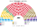
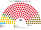
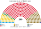
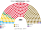
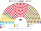

# 估計結果

> 近期大選與民調的民意套進本夾後的席次、首長、組閣與朝野互動。圖庫見 [`席次圖.md`](席次圖.md)。

選制摘要：全院 **300＝單一 180（top-3 孔多賽）＋複數 120（彈性名單、國內 10 區＋海外 1 區、無法定門檻）**。詳 [`01`](01-國民議會與選制.md)。

## 計算方式

| 層 | 做法 |
|---|---|
| 民意層 | 各縣（含海外）眾議院名單票（2024-12）。現行是比例名單，棄保失真小；沒有用到投票所層級的資料 |
| 參選方層 | 每黨都可推人；地方性政黨只在本地參選；相鄰政黨在合起來能進前 3、且雙方都偏好合併後勝者時共同提名（席次圖產生器）；UDMR（匈牙利族）只在匈牙利族聚居縣有實力 |
| 單一 180 | 依縣配額；縣內各選區的得票由縣得票加上城鄉梯度、匈牙利族集中梯度與隨機擾動合成（不是真實的投票所分布）；前 3 名、全體選民完整排序兩兩對決，循環用 Ranked Pairs。選民排序由各黨在地緣、體制兩軸的位置推得 |
| 複數 120 | 國內 10 區＋海外 1 區聖拉古、無法定門檻 |
| 首長、組閣 | 全院 300 記名排名，孔多賽；組閣由首長往外依政策距離加黨到 ≥151 |
| 總統 | 2024-12 國會名單票、政黨層級，前 3 名孔多賽 |
| 民調 | 全國投票意向，以 2024-12 縣地理縮放 |

程式：[`生態模型.py`](生態模型.py)；細節見 [`14`](14-近期大選重算.md)、共同算法 [`選舉結果計算方式`](../../../notes/算法/選舉結果計算方式.md)。

## 1 近期大選

用當時實際得票套本夾。細節與方法見 [`14-近期大選重算.md`](14-近期大選重算.md)（[`生態模型.py`](生態模型.py)）。

| | 現實 | **本夾全院 300** |
|---|---|---|
| 2024-12 國會 | 眾議院 331：PSD 86、AUR 63、PNL 49、USR 40、SOS 28、POT 24、UDMR 22、少數族群保障 19；參議院 134 | **PSD 147**、AUR 50、PNL 43、USR 20、UDMR 16、SOS 12、POT 12 |

### 2024-12 單一／複數

| 政黨 | 單一 180 | 複數 120 | **全院** |
|---|--:|--:|--:|
| PSD | 117 | 30 | **147** |
| AUR | 28 | 22 | **50** |
| PNL | 24 | 19 | **43** |
| USR | 3 | 17 | **20** |
| UDMR | 8 | 8 | **16** |
| SOS | 0 | 12 | **12** |
| POT | 0 | 12 | **12** |

**組閣聯盟／多數派政府**：首長 **PSD**；執政多數 PSD＋PNL＝**165**（過半 151；＋UDMR＝201）；複數 57＜72，改規則要拉 USR。

**預期政治生態**：PSD 得票 22% 拿下單一 117 席：親歐的 PNL、UDMR、USR 選民都把 PSD 排在 AUR 前面。政府是 PSD＋PNL，與現實的親歐大聯合相近，但 PSD 份量重得多。AUR、SOS、POT 三個主權派政黨合計 74 席、多在名單層，是反對的主力；它們無法用建設性更新換人，但會把「選制壓縮主權派」當成動員議題。

PSD 全院 147，差 4 過半（≥151）。PSD＋PNL＋UDMR＝206，複數 57＜72——改組織法／修憲要拉 USR。總統 top-3 見 [`14`](14-近期大選重算.md) §2。

## 2 民調

公開全國投票意向（CURS；另列生態檔 2026-10 彙整平均）。

方法：民調得票率當全國第一偏好，套本夾生態模型——**單一 180** top-3 孔多賽、**複數 120** 聖拉古（不是全國比例拆單一）。SENS／ACT 併入「其他」。刀鋒 INSCOP 見 [`席次圖-刀鋒-INSCOP.svg`](席次圖-刀鋒-INSCOP.svg)。

### CURS（2026-10-22..27，n＝1068）

首長 **PSD**，單獨 182 席（過半，全院 ≥180；但複數只有 37，不到 72）。AUR 第一偏好多 8 點，但在多數選區的兩兩對決輸給 PSD：PNL、UDMR 選民把 PSD 排在 AUR 前面。

**預期政治生態**：AUR 第一偏好最多卻只有 60 席，反對陣營集中在 AUR 一黨。PSD 單獨執政，不必再與 PNL 分權；但改規則仍要拉 AUR 或兩個以上的親歐小黨。

| 政黨 | 得票推估% | 單一 180 | 複數 120 | 本夾全院 |
|---|--:|--:|--:|--:|
| PSD | 26% | 145 | 37 | **182** |
| AUR | 34% | 14 | 46 | **60** |
| PNL | 16% | 14 | 20 | **34** |
| UDMR | 5% | 7 | 5 | **12** |
| USR | 8% | 0 | 11 | **11** |
| SOS | 2% | 0 | 1 | **1** |
| 其他 | 9% | 0 | 0 | **0** |

### 2026-10 彙整平均（生態檔採用；PolitPro 等）

首長 **PSD**。

**預期政治生態**：PSD 134 席需要 PNL（合計 168）；AUR 105 席是強大的反對黨，單一 57 席表示它在部分縣已能贏得兩兩對決。PNL 是唯一的關鍵夥伴，要價空間大；AUR 若再成長幾點，PSD 就要面對「與 AUR 合作或拉更多小黨」的選擇。

| 政黨 | 得票推估% | 單一 180 | 複數 120 | 本夾全院 |
|---|--:|--:|--:|--:|
| PSD | 22.9% | 103 | 31 | **134** |
| AUR | 35.8% | 57 | 48 | **105** |
| PNL | 16.9% | 13 | 21 | **34** |
| UDMR | 5.1% | 7 | 6 | **13** |
| USR | 8.2% | 0 | 12 | **12** |
| POT | 2.3% | 0 | 1 | **1** |
| SOS | 2.9% | 0 | 1 | **1** |
| 其他 | 5.9% | 0 | 0 | **0** |

## 3 長期運行假設下

生態模型示意 **下一屆（2028）**，得票取 2026-10 民調平均（假設見 [`12-預期政治生態.md`](12-預期政治生態.md)；數字由 [`生態模型.py`](生態模型.py) 算出）。

| 政黨 | 單一 180 | 複數 120 | 全院 300 |
|---|--:|--:|--:|
| PSD | 103 | 31 | **134** |
| AUR | 57 | 48 | **105** |
| PNL | 13 | 21 | **34** |
| UDMR | 7 | 6 | **13** |
| USR | 0 | 12 | **12** |
| SOS | 0 | 1 | **1** |
| POT | 0 | 1 | **1** |
| **計** | **180** | **120** | **300** |

首長：PSD（最弱一場對決 193:107）。PSD＋PNL＝168 過半。無一黨單獨過複數 3/5（72）。刀鋒（INSCOP）見 [`席次圖-刀鋒-INSCOP.svg`](席次圖-刀鋒-INSCOP.svg)。
**預期政治生態**：同 §2 的 2026-10 彙整平均。誘因與候選人行為見 [`12-預期政治生態.md`](12-預期政治生態.md)。
