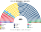
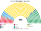

# 近期大選重算

> **這檔是什麼**：近期大選得票**怎麼**套進本夾選制（方法、假設、對照）。席次一覽與圖見 [`估計結果.md`](估計結果.md) §1、[`席次圖.md`](席次圖.md)。

2022、2018 套新制

**方法**：[`生態模型.py`](生態模型.py)。第一偏好是內政部**逐市鎮×現行單一選區**的眾議院名單得票（[`資料/`](資料/)）；偏好排序是假設（[`12`](12-預期政治生態.md) §2）。選區固定用 2022 有效票切。

## 計算方式

民意層＝內政部逐市鎮×選區眾議院**名單票**；參選方層＝`finals_for`；單一 240 top-3、複數 160 聖拉古。民調見 [`民調推估.py`](民調推估.py)。總說明見 [`選舉結果計算方式`](../../../notes/算法/選舉結果計算方式.md)。

## 1 一覽

| | 實際（Rosatellum） | 實際政府 | **新制全院 400** | **首長** | **組閣陣營** |
|---|---|---|---|---|---|
| 2022-09 | 中右 237（FdI 119、Lega 66、FI 45、溫和派 7）、中左 85、M5S 52、第三極 21 | FdI 主導的中右政府 | FdI 194、M5S 87、PD 52、Lega 16、第三極 17、FI 14 … | **FdI** | FdI＋Lega 211 |
| 2018-03 | 中右 265、M5S 227、中左 122、LeU 14（630 席） | 88 天組閣；Conte I → Conte II → Draghi | M5S **222**、Lega 89、PD 41、FI 30 … | **M5S**（單獨過半） | M5S |

## 2 2022-09
| 政黨 | 得票% | 單一 240 | 複數 160 | **新制** |
|---|--:|--:|--:|--:|
| FdI | 26.2 | 150 | 44 | **194** |
| M5S | 15.4 | 60 | 27 | **87** |
| PD | 18.9 | 21 | 31 | **52** |
| Lega | 8.8 | 0 | 16 | **16** |
| 第三極 | 7.6 | 5 | 12 | **17** |
| FI | 8.2 | 1 | 13 | **14** |
| 主權派 | 3.9 | 0 | 8 | **8** |
| AVS | 3.6 | 0 | 6 | **6** |
| SVP | 0.4 | 3 | 1 | **4** |
| +Europa | 2.8 | 0 | 2 | **2** |

| 大區（單一） | 結果 |
|---|---|
| 倫巴底 41 | FdI 37、第三極 3、PD 1 |
| 拉齊奧 22 | FdI 18、M5S 2、FI 1、第三極 1 |
| 威尼托 21 | FdI 21 |
| 坎帕尼亞 19 | M5S 19 |
| 艾米利亞–羅馬涅 19 | PD 12、FdI 7 |
| 皮埃蒙特 17 | FdI 15、M5S 1、PD 1 |
| 西西里 17 | M5S 15、FdI 2 |
| 托斯卡尼 16 | FdI 9、PD 6、M5S 1 |
| 普利亞 15 | M5S 9、FdI 6 |
| 其他 | 卡拉布里亞 M5S 4／FdI 3；薩丁尼亞 M5S 5／FdI 1；特倫蒂諾 SVP 3／FdI 2；馬爾凱、翁布里亞、阿布魯佐、弗留利 FdI 全拿 |

- **決選三人**：FdI／M5S／PD 127 區、FdI／Lega／PD 80 區。
- **對照現行**：2022 年中右在 147 個單一選區贏了約八成；新制下 FdI 一黨單一 150／240（63%）。**南部從中右轉到 M5S**：在三人決選裡 PD 選民的第二偏好讓 M5S 勝過 FdI。
- **對照 2026 新法**：中右聯盟得票 43.8%，過 42% 門檻 → 多數獎勵，眾議院約 220 席（新法上限）。新制下 FdI＋Lega 211，相近；差別是新制下**它們改不了選舉法**（複數 60／160）。

## 3 2018-03
| 政黨 | 得票% | 單一 240 | 複數 160 | **新制** |
|---|--:|--:|--:|--:|
| M5S | 32.4 | 165 | 57 | **222** |
| Lega | 17.7 | 56 | 33 | **89** |
| PD | 18.6 | 9 | 32 | **41** |
| FI | 14.2 | 6 | 24 | **30** |
| FdI | 4.4 | 1 | 6 | **7** |
| AVS（LeU） | 3.3 | 0 | 4 | **4** |
| +Europa | 2.5 | 0 | 3 | **3** |
| SVP | 0.4 | 3 | 1 | **4** |

- M5S 在南部、中部幾乎全拿；Lega 拿下倫巴底 26、威尼托 17。
- **M5S 單獨過半（222）**：現實中 88 天組閣、一屆三個政府；新制下首長在第一輪排名投票就產生，屆期 5 年不換。
- M5S 複數 57（要 96）：**單獨過半但改不了憲法**。

## 4 敏感度

見 [`12`](12-預期政治生態.md) §6。最關鍵的是五星在建制軸上的位置：2022 年 M5S 與 FdI 的兩兩對決落在假設範圍內。

## 5 限制

- 第一偏好是名單票；2022 年中右、中左聯盟在現行單一選區推共同候選人，**名單票是黨的強度，不是候選人的強度**。
- 海外選區、2022 年瓦萊達奧斯塔（另檔）不計；瓦萊達奧斯塔併入皮埃蒙特。
- 新選區沿現行單一選區序切；大城市跨多個現行選區者每個現行選區一個單位。
- 2018 年用 2022 年的選區切法（選舉人數變動小）。

## 來源

- 內政部選舉與地方事務司（DAIT），開放資料 `camera-20220925.zip`、`camera-20180304.zip`（dait.interno.gov.it）。
- 2026 新選舉法：[ANSA 2026-10-08](https://www.ansa.it/sito/notizie/politica/2026/10/08/legge-elettorale-dal-premio-alle-preferenze-come-funziona-la-riforma_cb7f408a-5993-4ad9-b5ee-66c83b7a13a7.html)；[Sky TG24](https://tg24.sky.it/politica/2026/10/08/nuova-legge-elettorale-meloni-camera-voto-diretta)。
- 實際席次：Wikipedia 2018、2022 義大利大選條目（陣營層級）。
