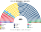
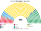
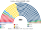

# 估計結果

> **這檔是什麼**：民意套本夾選制的席次**表**（如組閣聯盟／多數派政府）——§1 近期大選、§2 民調（若有）、§3 長期。圖庫見 [`席次圖.md`](席次圖.md)；大選算法細節見本夾重算檔。朝野互動見「預期政治生態」。

選制摘要：全院 **400＝單一 240（top-3 孔多賽）＋複數 160（彈性名單、13 區聖拉古、無法定門檻、無多數獎勵）**。詳 [`01`](01-國會與選制.md)。

## 計算方式

| 層 | 做法 |
|---|---|
| 民意層 | 內政部逐市鎮×選區眾議院**名單票**（不用 FPTP 當選人） |
| 參選方層 | `finals_for`：相鄰政黨共同提名 |
| 單一 240 | top-3 孔多賽 |
| 複數 160 | 13 區聖拉古、無門檻、無多數獎勵 |
| 首長／組閣 | 全院孔多賽；由近到遠至 ≥201 |
| 民調 | [`民調推估.py`](民調推估.py)：2022 地理 × [`資料/polls.csv`](資料/polls.csv) 權重縮放後重跑 |

細節見 [`14`](14-近期大選重算.md)、。

## 1 近期大選

用當時實際得票套本夾。細節與方法見 [`14-近期大選重算.md`](14-近期大選重算.md)（[`生態模型.py`](生態模型.py)）。

| | 實際（Rosatellum） | **本夾全院 400** | 首長 |
|---|---|---|---|
| 2022-09 | 中右 237（FdI 119、Lega 66、FI 45 …）、中左 85、M5S 52 | FdI **194**、M5S 87、PD 52、Lega 16、第三極 17、FI 14 … | **FdI**（組閣 FdI＋Lega 211） |
| 2018-03 | 中右 265、M5S 227、中左 122（630 席） | M5S **222**、Lega 89、PD 41、FI 30 … | **M5S**（單獨過半） |

### 2022-09 單一／複數

| 政黨 | 單一 240 | 複數 160 | **全院** |
|---|--:|--:|--:|
| FdI | 150 | 44 | **194** |
| M5S | 60 | 27 | **87** |
| PD | 21 | 31 | **52** |
| Lega | 0 | 16 | **16** |
| 第三極 | 5 | 12 | **17** |
| FI | 1 | 13 | **14** |
| 主權派 | 0 | 8 | **8** |
| AVS | 0 | 6 | **6** |
| SVP | 3 | 1 | **4** |
| +Europa | 0 | 2 | **2** |

**組閣聯盟／多數派政府**：首長 **FdI**；執政多數 FdI＋Lega＝**211**（過半 201；或 FdI＋FI＝209）；複數 60＜96，改規則要拉 PD／M5S。

FdI＋Lega 全院 211、複數 60——過半，但複數不到 96，改選舉法／修憲要拉 PD 或 M5S。

### 2018-03

**組閣聯盟／多數派政府**：首長 **M5S**；M5S **222** 單獨過半；複數 57＜修憲門檻，改憲法要拉人。

M5S **222** 單獨過半；複數 57 仍改不了憲法。

## 2 民調

公開全國投票意向（維基「Opinion polling for the next Italian general election」／PolitPro 等彙整）。方法：[`民調推估.py`](民調推估.py)＋[`資料/polls.csv`](資料/polls.csv)；以 **2022-09 逐市鎮** 為地理基底，按民調得票率縮放後跑本夾——**單一 240** top-3 孔多賽、**複數 160** 聖拉古（不是全國比例拆單一）。FN＝Futuro Nazionale→模型「主權派」；Azione＋IV→「第三極」；NM→「溫和派」。

### PolitPro 彙整（截至 2026-10-25）

首長 **FdI**（單獨過半）。

| 政黨 | 得票推估% | 單一 240 | 複數 160 | 全院 400 |
|---|--:|--:|--:|--:|
| FdI | 28.1% | 160 | 46 | **206** |
| M5S | 12.5% | 58 | 23 | **81** |
| PD | 20.8% | 22 | 34 | **56** |
| FI | 7.2% | 0 | 13 | **13** |
| FN／主權派 | 7.1% | 0 | 13 | **13** |
| AVS | 6.2% | 0 | 11 | **11** |
| Lega | 5.7% | 0 | 10 | **10** |
| Azione＋IV／第三極 | 5.4% | 0 | 10 | **10** |

## 3 長期運行假設下

生態模型示意 **推估第 3 屆**（＝2022 得票套本夾；假設見 [`12-預期政治生態.md`](12-預期政治生態.md)；數字由 [`生態模型.py`](生態模型.py) 算出）。

| 政黨 | 單一 240 | 複數 160 | 全院 400 |
|---|--:|--:|--:|
| FdI | 150 | 44 | **194** |
| M5S | 60 | 27 | **87** |
| PD | 21 | 31 | **52** |
| Lega | 0 | 16 | **16** |
| 第三極 | 5 | 12 | **17** |
| FI | 1 | 13 | **14** |
| 主權派 | 0 | 8 | **8** |
| AVS | 0 | 6 | **6** |
| SVP | 3 | 1 | **4** |
| +Europa | 0 | 2 | **2** |
| **計** | **240** | **160** | **400** |

首長：FdI；組閣陣營 FdI＋Lega 211（或 FdI＋FI 209）。北部單一幾乎全為 FdI，南部與島嶼以 M5S 為主。
朝野互動與候選人行為見 [`12-預期政治生態.md`](12-預期政治生態.md)。

## 4 朝野互動（各次估計）

| 民意 | 政府 | 在野 | 互動 |
|---|---|---|---|
| 2022-09 | FdI 首長；FdI＋Lega 211 | M5S 87、PD 52 | FdI 單一選區大勝但複數席次不到組織法門檻：改選制、司法、地方自治要在野黨。M5S 與 PD 分開時，在野湊不出建設性更新的 201 |
| 2018-03 | M5S 單獨過半 222 | Lega 89、PD 41、FI 30 | M5S 是左右選民共同的第二偏好，單獨組閣；但改規則仍要第二大黨 |
| PolitPro 2026-10 | FdI 單獨過半 206 | M5S 81、PD 56 | 單一席高度集中於 FdI；複數 46＜96，改組織法仍要在野。在野 M5S＋PD＝137＜201 |

誘因、候選人行為與檢視見 [`12-預期政治生態.md`](12-預期政治生態.md) §4–§5。
