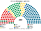
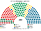
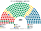
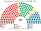
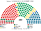

# 估計結果

> 席次**表**——§1 近期大選、§2 民調、§3 長期。圖庫見 [`席次圖.md`](席次圖.md)；算法見 [`14`](14-近期大選重算.md)、[`生態模型.py`](生態模型.py)、[`民調推估.py`](民調推估.py)。

選制：全院 **200＝單一 120（本土 119＋奧蘭 1，top-3 孔多賽）＋複數 80（八區聖拉古、無門檻）**；首長全院排名投票選出（棄權不計）；供給、建設性更新 ≥101；組織法全院 ≥120 且複數 ≥48。詳 [`01`](01-國會與選制.md)。

## 1 近期大選

正義部 tulospalvelu 市鎮×黨得票（[`資料/`](資料/README.md)）。

| | 實際（200） | **本夾全院 200** | 首長 | 組閣 |
|---|---|---|---|---|
| 2023-04 | 聯合 48、芬人 46、社民 43、中間 23…；Orpo 中右 | **聯合 83、社民 39、中間 38、芬人 17、瑞典人民 7、綠 7、左翼 5、基民 3、奧蘭 1** | **中間黨** | 中間＋聯合＝121 |
| 2019-04 | 社民 40、芬人 39、聯合 38、中間 31…；Rinne／Marin 五黨 | **聯合 57、中間 53、社民 45、芬人 15、綠 12、瑞典人民 8、左翼 6、基民 3、奧蘭 1** | **中間黨** | 中間＋聯合＝110 |
| 2015-04 | 中間 49、芬人 38、聯合 37、社民 34…；Sipilä 中間＋芬人＋聯合＝124 | **中間 80、聯合 51、社民 28、芬人 15、瑞典人民 9、綠 8、左翼 5、基民 3、奧蘭 1** | **中間黨** | 中間＋聯合＝131 |

| 政黨 | 單一 120 | 複數 80 | **全院** |
|---|--:|--:|--:|
| 聯合黨 | 62 | 18 | **80** |
| 社民黨 | 20 | 18 | **38** |
| 中間黨 | 33 | 9 | **42** |
| 芬人黨 | 0 | 17 | **17** |
| 瑞典人民黨 | 4 | 3 | **7** |
| 綠黨 | 0 | 7 | **7** |
| 左翼聯盟 | 0 | 5 | **5** |
| 基民黨 | 0 | 3 | **3** |
| 奧蘭 | 1 | 0 | **1** |

**組閣聯盟／多數派政府**：首長 **中間黨**；**中間＋聯合＝121**。組織法：組閣複數 27（就算再加社民黨也僅 45＜48），改不了。

| 政黨 | 單一 120 | 複數 80 | **全院** |
|---|--:|--:|--:|
| 聯合黨 | 45 | 14 | **59** |
| 中間黨 | 40 | 11 | **51** |
| 社民黨 | 30 | 15 | **45** |
| 芬人黨 | 0 | 15 | **15** |
| 綠黨 | 0 | 12 | **12** |
| 瑞典人民黨 | 4 | 4 | **8** |
| 左翼聯盟 | 0 | 6 | **6** |
| 基民黨 | 0 | 3 | **3** |
| 奧蘭 | 1 | 0 | **1** |

**組閣聯盟／多數派政府**：首長 **中間黨**；**中間＋聯合＝110**。組織法：組閣複數 25，改不了。

| 政黨 | 單一 120 | 複數 80 | **全院** |
|---|--:|--:|--:|
| 中間黨 | 63 | 17 | **80** |
| 聯合黨 | 35 | 16 | **51** |
| 社民黨 | 16 | 12 | **28** |
| 芬人黨 | 0 | 15 | **15** |
| 瑞典人民黨 | 5 | 4 | **9** |
| 綠黨 | 0 | 8 | **8** |
| 左翼聯盟 | 0 | 5 | **5** |
| 基民黨 | 0 | 3 | **3** |
| 奧蘭 | 1 | 0 | **1** |

**組閣聯盟／多數派政府**：首長 **中間黨**；**中間＋聯合＝131**。芬人黨 15 席全在名單，不在這屆組閣。組織法：組閣複數 33＜48，改不了。現實 Sipilä 內閣是中間＋芬人＋聯合＝124。

## 2 民調

**方法**：[`民調推估.py`](民調推估.py)；來源 [`資料/polls.csv`](資料/polls.csv)（維基 Opinion polling for the 2027 Finnish parliamentary election；Yle／Taloustutkimus、HS／Verian 各取最新一筆；以 2023 市鎮地理縮放，奧蘭單位原樣保留）。

| 民調 | 投票意向（前五） | **本夾全院 200** | 單一 120 | 首長 | 組閣（機械） |
|---|---|---|---|---|---|
| Taloustutkimus／Yle（2026-10-12..11-03） | 社民 22.9、芬人 16.7、聯合 15.4、左翼 12.6、中間 12.2 | **社民 70**、中間 48、聯合 39、芬人 15、左翼 12、綠 8、瑞典人民 5、基民 2、奧蘭 1 | 社民 51、中間 39、聯合 26、瑞典人民 3、奧蘭 1 | **中間黨** | 中間＋聯合＋基民＋奧蘭＋社民＝160 |
| Verian／HS（2026-09-15..10-19） | 社民 23.3、聯合 16.2、芬人 15.3、中間 13.8、左翼 11.6 | **社民 64**、中間 55、聯合 41、芬人 13、左翼 11、綠 8、瑞典人民 5、基民 2、奧蘭 1 | 中間 45、社民 45、聯合 26、瑞典人民 3、奧蘭 1 | **中間黨** | 中間＋聯合＋基民＋奧蘭＋社民＝163 |

**讀法**：「組閣」是由首長往外依偏好距離加黨到 ≥101 的機械結果，不是預測。各民調下首長都是**中間黨**：參選方層讓中間黨與相鄰政黨在更多選區擠進第二輪，社民黨的單一席次（Taloustutkimus 51）比舊算（58）少，中左＋RKP＋奧蘭（Taloustutkimus 96）不再跨過 101。

## 3 第 3 屆（誘因略調）

| 政黨 | 單一 120 | 複數 80 | **全院** |
|---|--:|--:|--:|
| 聯合黨 | 63 | 19 | **82** |
| 社民黨 | 20 | 19 | **39** |
| 中間黨 | 32 | 9 | **41** |
| 芬人黨 | 0 | 15 | **15** |
| 瑞典人民黨 | 4 | 4 | **8** |
| 綠黨 | 0 | 6 | **6** |
| 左翼聯盟 | 0 | 5 | **5** |
| 基民黨 | 0 | 3 | **3** |
| 奧蘭 | 1 | 0 | **1** |

首長 **中間黨**；組閣 **中間＋聯合＝123**。複數合計（28）仍遠低於 48。
