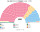

# 近期大選重算

> **這檔是什麼**：近期大選得票**怎麼**套進本夾選制（方法、假設、對照）。席次一覽與圖見 [`估計結果.md`](估計結果.md) §1、[`席次圖.md`](席次圖.md)。

2024、2019、2017 套新制

**定義**（）：重算＝**當時大選的民意** × **新制下各方可能的參選方式（含整合）**。選民不變，政黨換成新制下會採取的策略。**只用當時民意**，不用其後民調。

**方法**：[`生態模型.py`](生態模型.py)。

| 層 | 本夾做法 |
|---|---|
| 民意層 | 650 個選區的實際得票（[`資料/`](資料/)）＋**陣營內校正戰略投票**：相對多數制下的棄保主要發生在陣營內（工黨、自民、綠黨互投擋保守黨；保守黨與 Reform 互搶）。每區陣營總票不動，陣營內各黨比例往該國（英格蘭、蘇格蘭、威爾斯）的陣營內比例拉近 α＝0.25（假設；§5 敏感度 0–0.75）。北愛不調。跨陣營的移動不是棄保，保留 |
| 策略層 | [席次圖產生器](../../../../../shared/tools/參選判定.py)：兩個**全國空間上相鄰**的政黨都在前三之外、合起來進得去，且兩黨都偏好合併後的勝者時，**共同提名**。兩兩對決下，這只在「全體的孔多賽勝者第一輪沒進前三」時才會發生 |
| 制度層 | 新選區（希爾伯特曲線合併相鄰選區）、前三名、兩兩對決（循環時 Ranked Pairs）；名單層 15 區聖拉古 |

偏好排序是假設（[`12`](12-預期政治生態.md) §2）。另有 `--raw`（用現實得票，不校正戰略投票）對照。

**資料補齊**：2024 原缺 Chorley（議長選區）與 North Norfolk（表格解析失敗），由 [`_fix_ge2024.py`](_fix_ge2024.py) 補上，共 650 區。議長選區依慣例大黨不推人——這是議會慣例，新制下議長不再有自己的選區，所以議長票按西北區工黨、保守黨、Reform、自民黨的得票比例分回。

## 1 一覽

| | 實際（FPTP 650） | **新制全院 400** | **首長** | **組閣陣營** |
|---|---|---|---|---|
| 2024-07 | 工黨 411、保守 121、自民 72、SNP 9、Reform 5 … | 工黨 243、保守 79、自民 24、Reform 24、綠黨 13 … | **工黨** | 工黨單獨（243） |
| 2019-12 | 保守 365、工黨 202、SNP 48、自民 11 … | 保守 197、工黨 148、自民 31、SNP 8 … | **保守黨**（對 UUP 200:200，平手規則） | 保守 197＋UUP 4＝201 |
| 2017-06 | 保守 317、工黨 262、SNP 35、自民 12、DUP 10 … | 工黨 183、保守 182、自民 18 … | **自民黨**（對工黨 201:199） | 自民 18＋工黨 183＝201 |
| **2019-05 歐洲議會名單票** | （歐洲議會 2019：脫歐黨 29、自民 16、工黨 10、綠黨 7、保守 4 …／英國 73 席） | **Reform 132**、工黨 95、自民 89、保守 33、綠黨 29 … | **工黨** | 工黨 95＋綠黨 29＋自民 89＝213 |
| 對照：2024 現實得票（`--raw`） | — | 工黨 235、保守 80、自民 33、Reform 23、綠黨 12 … | 工黨 | 工黨單獨 |
| 對照：2019 現實得票（`--raw`） | — | 保守 196、工黨 146、自民 33、SNP 8 … | 保守黨 | 保守 196＋UUP 4＋DUP 2＝202 |

**策略層的作用**：三次國會大選都是 **0 區**共同提名——每區的孔多賽勝者（多半是工黨或保守黨）本來就在前三名裡，整合改變不了結果，所以不會發生。歐洲議會名單票版有 **14 區**（綠黨→工黨 6、工黨→自民 3、工黨→綠黨 2、其他 3）：那一年第一偏好四分五裂，中間偏左的孔多賽勝者常落在第四。

## 2 2024-07
| 政黨 | 得票% | 實際 | 單一 240 | 複數 160 | **新制** |
|---|--:|--:|--:|--:|--:|
| 工黨 | 33.7 | 411 | 191 | 52 | **243** |
| 保守黨 | 23.7 | 121 | 39 | 40 | **79** |
| 自民黨 | 12.2 | 72 | 3 | 21 | **24** |
| Reform | 14.3 | 5 | 0 | 24 | **24** |
| 綠黨 | 6.7 | 4 | 0 | 13 | **13** |
| SDLP | 0.3 | 2 | 4 | 1 | **5** |
| SNP | 2.5 | 9 | 0 | 4 | **4** |
| 聯盟 | 0.4 | 1 | 1 | 1 | **2** |
| DUP | 0.6 | 5 | 1 | 1 | **2** |
| UUP | 0.3 | 1 | 1 | 1 | **2** |
| 威爾斯黨 | 0.7 | 4 | 0 | 1 | **1** |
| 新芬 | 0.7 | 7 | 0 | 1 | **1** |

| 區（單一） | 結果 |
|---|---|
| 東南（35） | 工黨 27、保守 7、自民 1 |
| 倫敦（27） | 工黨 25、保守 2 |
| 西北（26） | 工黨 26 |
| 東英格蘭（24） | 工黨 14、保守 10 |
| 西南（23） | 工黨 20、保守 2、自民 1 |
| 西密德蘭（20） | 工黨 13、保守 7 |
| 蘇格蘭（20） | 工黨 19、自民 1 |
| 約克郡（19） | 工黨 16、保守 3 |
| 東密德蘭（18） | 工黨 10、保守 8 |
| 威爾斯（11） | 工黨 11 |
| 東北（10） | 工黨 10 |
| 北愛（7） | SDLP 4、聯盟 1、DUP 1、UUP 1 |

- 決選三人：保守／工黨／Reform 126 區、保守／自民／工黨 63 區、綠黨／自民／工黨 9 區。
- 當選者第一偏好中位數 36%。
- **自民黨單一從 12（現實得票）降到 3**：2024 年自民黨的選區勝利大量靠工黨選民的戰略投票；校正後工黨在那些區的第一偏好回升，自民黨常掉出前三，或在三人對決裡輸給工黨。自民黨的席次轉到名單層（21）。

## 3 2019-12
| 政黨 | 得票% | 實際 | 單一 240 | 複數 160 | **新制** |
|---|--:|--:|--:|--:|--:|
| 保守黨 | 43.6 | 365 | 126 | 71 | **197** |
| 工黨 | 32.1 | 202 | 94 | 54 | **148** |
| 自民黨 | 11.5 | 11 | 11 | 20 | **31** |
| SNP | 3.9 | 48 | 2 | 6 | **8** |
| SDLP | 0.4 | 2 | 3 | 1 | **4** |
| UUP | 0.3 | 0 | 3 | 1 | **4** |
| DUP | 0.8 | 8 | 1 | 1 | **2** |
| 綠黨 | 2.7 | 1 | 0 | 2 | **2** |
| 聯盟 | 0.4 | 1 | 0 | 1 | **1** |
| 威爾斯黨 | 0.5 | 4 | 0 | 1 | **1** |
| Reform | 2.0 | 0 | 0 | 1 | **1** |
| 新芬 | 0.6 | 7 | 0 | 1 | **1** |

| 區（單一） | 結果 |
|---|---|
| 東南（35） | 保守 31、工黨 3、自民 1 |
| 倫敦（27） | 工黨 19、保守 5、自民 3 |
| 西北（26） | 工黨 18、保守 8 |
| 東英格蘭（24） | 保守 20、自民 2、工黨 2 |
| 西南（23） | 保守 17、工黨 4、自民 2 |
| 西密德蘭（20） | 保守 14、工黨 6 |
| 蘇格蘭（20） | **工黨 15、自民 3、SNP 2**（SNP 得 45% 但是聯合派選民一致把它排後） |
| 約克郡（19） | 保守 11、工黨 8 |
| 東密德蘭（18） | 保守 16、工黨 2 |
| 威爾斯（11） | 工黨 11 |
| 東北（10） | 工黨 6、保守 4 |

- 保守黨 197，**差 4 席過半**；首長投票保守黨對 UUP 200:200，平手規則（排第一者多）讓保守黨就任。
- 現實是保守黨 80 席多數、脫歐協議一個月內通過。新制下要拉北愛聯合派，**而北愛聯合派正是反對那份協議（北愛海關邊界）的一方**。

## 4 2017-06

| 政黨 | 單一 240 | 複數 160 | **新制** |
|---|--:|--:|--:|
| 工黨 | 119 | 64 | **183** |
| 保守黨 | 110 | 72 | **182** |
| 自民黨 | 4 | 14 | **18** |
| DUP | 3 | 2 | **5** |
| SNP | 0 | 5 | **5** |
| SDLP | 2 | 1 | **3** |
| 新芬 | 1 | 1 | **2** |
| UUP | 1 | 0 | **1** |
| 威爾斯黨 | 0 | 1 | **1** |

- **兩大黨幾乎打平**：工黨單一 119、保守 110。兩黨合計 82%，240 區裡有 167 區的當選者第一偏好就過半，**中位黨幾乎放大不了**（自民單一只有 4）。
- **SNP 單一 0**：蘇格蘭 20 區全是工黨——聯合派選民（保守、自民）一致把工黨排在 SNP 前。SNP 的 5 席全在名單層。
- **首長是自民黨**（全院 18 席）：工黨 183、保守 182 都不過 201，兩大黨議員都把自民黨排第二；自民對工黨 201:199、對保守 212:188。組閣陣營自民＋工黨＝201。現實中梅伊靠 DUP 10 席的信任與供給協議執政。

## 4a 2019-05 歐洲議會名單票（政黨票當第一偏好）

英國國會選舉只有單一選區票，裡面有大量策略投票。**英國唯一的全國比例代表政黨票是歐洲議會選舉**：2019-05 大不列顛 11 區、封閉名單、頓特法。把它當第一偏好，是「如果選民投的是政黨票」的對照版（不再做陣營內校正）。

- 資料：維基「Results of the 2019 European Parliament election in the United Kingdom by Westminster constituency」把計票區得票估計到 632 個國會選區（2010–19 年界線）；北愛爾蘭沿用 2019 國會選舉得票。[`_build_ep2019.py`](_build_ep2019.py) → [`資料/ep-2019.csv`](資料/ep-2019.csv)。英國選舉委員會網站對自動存取回 403，未繞過。
- 政黨對應：脫歐黨→Reform（同一黨，2021 年改名）；Change UK、UKIP、其他→其他。
- **限制**：投票率只有約 37%，議題幾乎只有脫歐；它代表「政黨票」，但不代表國會選舉的選民結構。

| 政黨 | 歐洲議會得票% | 單一 240 | 複數 160 | **新制** |
|---|--:|--:|--:|--:|
| Reform | 30.0 | 78 | 54 | **132** |
| 工黨 | 13.6 | 72 | 23 | **95** |
| 自民黨 | 19.4 | 56 | 33 | **89** |
| 保守黨 | 8.8 | 16 | 17 | **33** |
| 綠黨 | 11.3 | 10 | 19 | **29** |
| SNP | 3.4 | 1 | 5 | **6** |
| SDLP | 0.7 | 3 | 1 | **4** |
| UUP | 0.5 | 3 | 1 | **4** |
| DUP | 1.4 | 1 | 2 | **3** |
| 威爾斯黨 | 0.9 | 0 | 2 | **2** |
| 新芬 | 1.1 | 0 | 2 | **2** |
| 聯盟 | 0.8 | 0 | 1 | **1** |

（得票% 為全英，含北愛的國會選舉得票；歐洲議會大不列顛官方：脫歐黨 31.6%、自民 20.3%、工黨 14.1%、綠黨 12.1%、保守 9.1%。）

- **Reform 最大但當不了首長**：30% 第一偏好拿單一 78、全院 132，但在議員之間的排名投票輸給工黨（對 Reform 228:172）。
- **14 區共同提名**：第一偏好四分五裂，中間偏左的孔多賽勝者常排第四；相鄰的綠黨、工黨、自民黨在這些區合推一人。綠黨單一因此從 7 升到 10。
- **首長工黨**，組閣工黨＋綠黨＋自民＝213（過半 201）。和 2019-12 國會選舉的「保守黨首長」完全不同：英國的重算**對第一偏好用哪一種票非常敏感**。

## 5 敏感度

| 情境 | 2024 單一 | 2024 首長 | 2019 首長 |
|---|---|---|---|
| **主版**（α＝0.25＋策略層） | 工黨 191、保守 39、自民 3 | 工黨 | 保守黨 |
| α＝0（現實得票） | 工黨 182、保守 39、自民 12 | 工黨 | 保守黨 |
| α＝0.5 | 工黨 194、保守 39、自民 0 | 工黨 | 保守黨 |
| α＝0.75 | 工黨 194、保守 39、自民 0 | 工黨 | **UUP**（保守 197、工黨 160） |
| 選民全部重經濟 | 工黨 141、**自民 53**、保守 39 | 工黨 | 保守黨 |
| 切點平移半區 | 工黨 190、保守 42、自民 1 | 工黨 | 保守黨 |
| 兩輪多數決（前 2 名） | 工黨 182、保守 39、自民 12 | 工黨 | 保守黨 |

★ 2024 年首長在每個情境都是工黨。2019 年保守黨差 4 席過半，首長靠平手規則；陣營內校正拉到 0.75 時，工黨回升、保守黨與 UUP 的對決翻轉。

詳細討論見 [`12`](12-預期政治生態.md) §6。

## 6 限制

- 陣營內校正的 α 是假設，陣營劃分（左：工黨、自民、綠黨；右：保守、Reform）也是。
- 「其他」（無黨籍、小黨）不參與排序。
- 威爾斯黨在名單區與西密德蘭合併，名單席次少。
- Chorley 的議長票分回四黨是推估。

## 來源

- 逐選區得票：Wikipedia「Results of the 2024／2019 United Kingdom general election」（引選舉委員會、北愛選舉辦公室），2026-10-28 擷取；Chorley、North Norfolk 取自各選區條目（2026-11-10）。
- 選區中心座標：ONS Open Geography Portal（Westminster Parliamentary Constituencies July 2024、Dec 2021 Boundaries）。
- 實際席次：同上條目。
