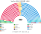

# 估計結果

> 近期大選與民調的民意套進本夾後的席次、首長、組閣與朝野互動。圖庫見 [`席次圖.md`](席次圖.md)。

選制摘要：全院 **400＝單一 240（top-3 孔多賽）＋複數 160（彈性名單、15 區聖拉古、無法定門檻）**。詳 [`01`](01-國會與選制.md)。

## 計算方式

| 層 | 做法 |
|---|---|
| 民意層 | 國會大選：650 選區的實際得票，再校正陣營內的戰略投票（工黨、自民、綠黨互投擋保守黨等，α＝0.25），盡量還原第一偏好。另附 2019-05 歐洲議會選舉的名單票版本（比例制，不必校正） |
| 參選方層 | 每黨都可推人；地方性政黨只在本地參選；相鄰政黨在合起來能進前 3、且雙方都偏好合併後勝者時共同提名（席次圖產生器）；北愛爾蘭政黨只在北愛、SNP 只在蘇格蘭、威爾斯黨只在威爾斯 |
| 單一 240 | 依地區配額，區內依選區座標的 Hilbert 曲線合併相鄰選區；前 3 名、全體選民完整排序兩兩對決，循環用 Ranked Pairs。選民排序由大不列顛政黨的經濟、文化位置與北愛的統獨軸推得 |
| 複數 160 | 15 區聖拉古、無門檻 |
| 首長、組閣 | 全院 400 記名排名，孔多賽；組閣由首長往外依政策距離加黨到 ≥201 |
| 民調 | 大不列顛投票意向，以 2024 選區地理縮放；北愛照 2024 |

程式：[`生態模型.py`](生態模型.py)、[`民調推估.py`](民調推估.py)；細節見 [`14`](14-近期大選重算.md)、共同算法 [`選舉結果計算方式`](../../../notes/算法/選舉結果計算方式.md)。

## 1 近期大選

用當時實際得票套本夾。細節與方法見 [`14-近期大選重算.md`](14-近期大選重算.md)（[`生態模型.py`](生態模型.py)）。

| | 實際（FPTP 650） | **本夾全院 400** | 首長 |
|---|---|---|---|
| 2024-07 | 工黨 411、保守 121、自民 72、SNP 9、Reform 5 … | 工黨 **243**、保守 79、自民 24、Reform 24、綠黨 13 … | **工黨**（單獨 243） |
| 2019-12 | 保守 365、工黨 202、SNP 48、自民 11 … | 保守 **197**、工黨 148、自民 31、SNP 8 … | **保守黨**（對 UUP 200:200，平手規則） |
| 2017-06 | 保守 317、工黨 262、SNP 35、自民 12 … | 工黨 **183**、保守 182、自民 18 … | **自民黨**（自民＋工黨 201） |
| 2019-05 歐洲議會名單票（政黨票當第一偏好） | （歐洲議會選舉，非國會） | Reform **132**、工黨 95、自民 89、保守 33、綠黨 29 … | **工黨**（工黨＋綠黨＋自民 213） |

民意層：650 選區實際得票＋陣營內校正戰略投票（α＝0.25）；策略層：相鄰政黨在新制誘因下的共同提名（國會大選 0 區、歐洲議會版 14 區）。見 [`14`](14-近期大選重算.md) 開頭。

### 2024-07 單一／複數

| 政黨 | 單一 240 | 複數 160 | **全院** |
|---|--:|--:|--:|
| 工黨 | 191 | 52 | **243** |
| 保守黨 | 39 | 40 | **79** |
| 自民黨 | 3 | 21 | **24** |
| Reform | 0 | 24 | **24** |
| 綠黨 | 0 | 13 | **13** |
| SDLP | 4 | 1 | **5** |
| SNP | 0 | 4 | **4** |
| 聯盟 | 1 | 1 | **2** |
| DUP | 1 | 1 | **2** |
| UUP | 1 | 1 | **2** |
| 威爾斯黨 | 0 | 1 | **1** |
| 新芬 | 0 | 1 | **1** |

**組閣聯盟／多數派政府**：首長 **工黨**；工黨全院單獨過半（243）；改選制／修憲要複數 ≥96（工黨複數 52，須拉自民等）。

**預期政治生態**：工黨單獨執政，但幅度比現實（411／650）小得多：243／400。Reform 14% 只有 24 席、全在名單層，它與保守黨合計 103 席，是分裂的右派反對黨；兩黨要用建設性更新換掉工黨，連同所有其他黨也不夠。改選制、修憲要拉自民或保守黨。

### 2019-12 單一／複數

| 政黨 | 單一 240 | 複數 160 | **全院** |
|---|--:|--:|--:|
| 保守黨 | 126 | 71 | **197** |
| 工黨 | 94 | 54 | **148** |
| 自民黨 | 11 | 20 | **31** |
| SNP | 2 | 6 | **8** |
| SDLP | 3 | 1 | **4** |
| UUP | 3 | 1 | **4** |
| DUP | 1 | 1 | **2** |
| 綠黨 | 0 | 2 | **2** |
| 聯盟 | 0 | 1 | **1** |
| 威爾斯黨 | 0 | 1 | **1** |
| Reform | 0 | 1 | **1** |
| 新芬 | 0 | 1 | **1** |

**組閣聯盟／多數派政府**：首長 **保守黨**（平手規則）；保守 197 差 4 過半（≥201），組閣需北愛聯合派（保守＋UUP＝201）。

**預期政治生態**：保守黨差 4 席，北愛聯合派（UUP、DUP）成為關鍵少數，要價集中在北愛議題，類似 2017–19 年 DUP 支持保守黨少數政府的格局。工黨 148 席加自民、SNP 也只有 187，換不掉保守黨。

### 2019-05 歐洲議會名單票 單一／複數

英國唯一的全國政黨名單票，估計到國會選區（方法與限制見 [`14`](14-近期大選重算.md) §4a）。

| 政黨 | 單一 240 | 複數 160 | **全院** |
|---|--:|--:|--:|
| Reform | 78 | 54 | **132** |
| 工黨 | 72 | 23 | **95** |
| 自民黨 | 56 | 33 | **89** |
| 保守黨 | 16 | 17 | **33** |
| 綠黨 | 10 | 19 | **29** |
| SNP | 1 | 5 | **6** |
| SDLP | 3 | 1 | **4** |
| UUP | 3 | 1 | **4** |
| DUP | 1 | 2 | **3** |
| 威爾斯黨 | 0 | 2 | **2** |
| 新芬 | 0 | 2 | **2** |
| 聯盟 | 0 | 1 | **1** |

**組閣聯盟／多數派政府**：首長 **工黨**（對 Reform 228:172）；工黨＋綠黨＋自民＝213（過半 ≥201）。

**預期政治生態**：以歐洲議會名單票當民意，Reform 132 席是最大黨，但首長是工黨：保守、自民、綠黨的選民都把工黨排在 Reform 前面。最大黨在野、四黨分立，政府要靠工黨、綠黨、自民三黨協商，Reform 領導反對。

2024 年工黨全院 243、複數 52——單獨過半，改選制／修憲（複數 96）要拉自民或保守。2019 年保守黨 197，差 4 席過半；組閣需北愛聯合派。現實得票（未校正）對照與敏感度見 [`14`](14-近期大選重算.md)。

**預期政治生態**：2017-06 是最接近的一屆：工黨 183、保守 182，首長是自民黨（18 席）——兩大黨的選民都把自民排在對方前面，第三黨以關鍵位置當首長，政府內部由工黨撐場。

## 2 民調

> 2026-11-04：本節數字改由 [`民調推估.py`](民調推估.py) 重算（輸入 [`資料/polls.csv`](資料/polls.csv)）。原數字沒有留下可重跑的程式；新黨沿用母黨的政策位置與地理（見程式開頭）。

公開全國投票意向（維基「Opinion polling for the next United Kingdom general election」）。大不列顛（GB）民調；北愛政黨未分列時保留 2024 地理得票。方法：以 **2024-07 逐選區**（陣營內校正後）為地理基底，按民調得票率縮放後跑本夾——**單一 240** top-3 孔多賽、**複數 160** 聖拉古（不是全國比例拆單一）。RB＝Restore Britain（地理以 Reform 為種）。

### YouGov／The Times·Sky News（2026-10-25..26，n＝2271，GB）

首長 **工黨**；組閣工黨＋自民＋綠黨＋聯盟＋UUP＋SDLP＝203。

**預期政治生態**：工黨與保守黨只差 2 席（158：156），工黨靠自民、綠黨與北愛小黨湊到 203，只多 2 席，政府很脆弱。Reform 20% 只有 30 席、全在名單層；保守黨要換掉工黨，得拉 Reform 與北愛聯合派，合計約 190，仍差一截。

| 政黨 | 得票推估% | 單一 240 | 複數 160 | 本夾全院 |
|---|--:|--:|--:|--:|
| 工黨 | 27% | 113 | 45 | **158** |
| 保守黨 | 22% | 119 | 37 | **156** |
| Reform | 20% | 0 | 30 | **30** |
| 自民黨 | 11% | 1 | 19 | **20** |
| 綠黨 | 10% | 0 | 16 | **16** |
| SDLP | — | 4 | 1 | **5** |
| Restore Britain | 4% | 0 | 4 | **4** |
| SNP | 2% | 0 | 3 | **3** |
| 聯盟 | — | 1 | 1 | **2** |
| DUP | — | 1 | 1 | **2** |
| UUP | — | 1 | 1 | **2** |
| 威爾斯黨 | 1% | 0 | 1 | **1** |
| 新芬 | — | 0 | 1 | **1** |
| 其他 | 2% | 0 | 0 | **0** |

### BMG／The i Paper（2026-10-28..29，n＝1529，GB）

首長 **保守黨**；組閣保守＋UUP＋DUP＋Reform＝210。

**預期政治生態**：保守黨得票 21% 卻是單一席次最大黨（140），工黨得票 31% 只拿 93 個單一席：右派選民把保守黨排在工黨前、Reform 選民也是。政府要 Reform 的 33 席才過半，Reform 第一次成為執政夥伴，要價會集中在移民與脫歐後議題。

| 政黨 | 得票推估% | 單一 240 | 複數 160 | 本夾全院 |
|---|--:|--:|--:|--:|
| 保守黨 | 21% | 140 | 33 | **173** |
| 工黨 | 31% | 93 | 49 | **142** |
| Reform | 22% | 0 | 33 | **33** |
| 綠黨 | 8% | 0 | 14 | **14** |
| 自民黨 | 8% | 0 | 13 | **13** |
| Restore Britain | 5% | 0 | 9 | **9** |
| SDLP | — | 4 | 1 | **5** |
| SNP | 2% | 0 | 3 | **3** |
| 聯盟 | — | 1 | 1 | **2** |
| DUP | — | 1 | 1 | **2** |
| UUP | — | 1 | 1 | **2** |
| 威爾斯黨 | 1% | 0 | 1 | **1** |
| 新芬 | — | 0 | 1 | **1** |
| 其他 | 2% | 0 | 0 | **0** |

## 3 長期運行假設下

生態模型示意 **推估第 3 屆**（＝2024 得票套本夾；假設見 [`12-預期政治生態.md`](12-預期政治生態.md)；數字由 [`生態模型.py`](生態模型.py) 算出）。

| 政黨 | 單一 240 | 複數 160 | 全院 400 |
|---|--:|--:|--:|
| 工黨 | 191 | 52 | **243** |
| 保守黨 | 39 | 40 | **79** |
| 自民黨 | 3 | 21 | **24** |
| Reform | 0 | 24 | **24** |
| 綠黨 | 0 | 13 | **13** |
| SDLP | 4 | 1 | **5** |
| SNP | 0 | 4 | **4** |
| 聯盟 | 1 | 1 | **2** |
| DUP | 1 | 1 | **2** |
| UUP | 1 | 1 | **2** |
| 威爾斯黨 | 0 | 1 | **1** |
| 新芬 | 0 | 1 | **1** |
| **計** | **240** | **160** | **400** |

首長：工黨。Reform、綠黨席次幾乎全在複數層；SNP 單一 0（聯合派選民一致排後）。

**預期政治生態**：同 2024 大選：工黨單獨執政，右派分裂成保守黨與名單層的 Reform。
誘因與候選人行為見 [`12-預期政治生態.md`](12-預期政治生態.md)。
