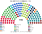
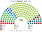
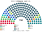

# 近期大選重算

> **這檔是什麼**：近期大選得票**怎麼**套進本夾選制（方法、假設、對照）。席次一覽與圖見 [`估計結果.md`](估計結果.md) §1、[`席次圖.md`](席次圖.md)。

2025、2023 套新制

**問題**：2025-10 與 2023-11 的選民照原本的偏好投票，在本夾的制度下會選出什麼樣的國會和政府？

**方法**：[`生態模型.py`](生態模型.py)。第一偏好是選舉委員會**逐投票所**實際得票（[`資料/`](資料/)，約 3,200 個「市鎮 × 郵遞區」單位）；偏好排序是假設（[`12`](12-預期政治生態.md) §2）。選區固定用 2025 有效票切。參選方層用 `finals_for`（withdraw）：相鄰共同提名與高票讓低票，不把全國政黨重組成新黨。

## 1 一覽

| | 實際（150，全國一區） | 實際組閣 | **新制全院 150** | **新制首長** | **新制組閣陣營** |
|---|---|---|---|---|---|
| 2025-10 | D66 26、PVV 26、VVD 22、GL-PvdA 20、CDA 18 … | 117 天；D66＋VVD＋CDA **66 席少數政府** | VVD 10、D66 23、CDA 81、PVV 10、GL-PvdA 9 … | **CDA**（最弱 96） | **CDA＋VVD＝82** |
| 2023-11 | PVV 37、GL-PvdA 25、VVD 24、NSC 20 … | 223 天；PVV＋VVD＋NSC＋BBB 88 席，首相無黨籍；2025-06 PVV 退出即倒 | NSC 89、VVD 12、PVV 16、GL-PvdA 12 … | **NSC**（最弱 83） | **NSC＋VVD＝87**（或 NSC＋PVV＝84） |

## 2 2025-10
| 政黨 | 得票% | 實際 | 單一 90 | 複數 60 | **新制** |
|---|--:|--:|--:|--:|--:|
| D66 | 16.9 | 26 | 12 | 11 | **23** |
| PVV | 16.7 | 26 | 0 | 10 | **10** |
| VVD | 14.3 | 22 | 1 | 9 | **10** |
| GL-PvdA | 12.7 | 20 | 0 | 9 | **9** |
| CDA | 11.8 | 18 | 73 | 8 | **81** |
| JA21 | 6.0 | 9 | 0 | 5 | **5** |
| FvD | 4.6 | 7 | 0 | 4 | **4** |
| BBB | 2.7 | 4 | 0 | 1 | **1** |
| DENK | 2.4 | 3 | 4 | 1 | **5** |
| SGP | 2.3 | 3 | 0 | 2 | **2** |
| PvdD、CU、SP、50PLUS、Volt | 8.4 | 12 | 0 | 0 | **0** |

| 省（單一） | 單一席次 |
|---|---|
| 南荷蘭（16） | VVD 8、D66 6、CDA 2 |
| 北荷蘭（13） | VVD 7、D66 5、DENK 1 |
| 北布拉班特（13） | VVD 10、CDA 2、D66 1 |
| 海爾德蘭（11） | VVD 5、CDA 3、D66 3 |
| 烏特勒支（7） | D66 3、VVD 3、CDA 1 |
| 上艾瑟爾（7） | CDA 5、VVD 2 |
| 林堡（6） | CDA 3、D66 1、PVV 1、VVD 1 |
| 格羅寧根（4） | D66 2、CDA 1、VVD 1 |
| 弗里斯蘭（4） | CDA 3、D66 1 |
| 德倫特、弗萊福蘭、澤蘭（各 3） | VVD 2、CDA 1；CDA、D66、VVD 各 1；CDA 3 |

- **組閣 117 天 → 30 日內**：CDA 是孔多賽贏家；CDA＋VVD 82 席即過半，不必拉第三黨。
- **少數政府消失**：現實的 D66–VVD–CDA 只有 66 席；新制下這三黨合計 116 席。
- **PVV 26 → 11**：決選三人裡 PVV 出現在大部分選區，但它幾乎不是任何人的第二偏好。

## 3 2023-11
| 政黨 | 得票% | 實際 | 單一 90 | 複數 60 | **新制** |
|---|--:|--:|--:|--:|--:|
| PVV | 23.6 | 37 | 0 | 16 | **16** |
| GL-PvdA | 15.7 | 25 | 0 | 12 | **12** |
| VVD | 15.2 | 24 | 3 | 9 | **12** |
| NSC | 12.9 | 20 | 80 | 9 | **89** |
| D66 | 6.3 | 9 | 3 | 5 | **8** |
| BBB | 4.7 | 7 | 0 | 3 | **3** |
| PvdD | — | — | 1 | 0 | 1 |
| 其他 |  |  | DENK 3 | CDA 2、SGP 2、DENK 1、SP 1 | CDA 2、SGP 2、DENK 4、SP 1 |

- **NSC（Omtzigt）單一 62 席**：它在文化軸上居中（0.3），是 PVV 選民與 VVD 選民共同能接受的第二偏好。[參選方層](../../../notes/算法/選舉結果計算方式.md)下 NSC 與相鄰的 CDA、BBB 在 NSC 單獨進不了前三的選區共同提名，北部、林堡、上艾瑟爾、海爾德蘭幾乎全拿。
- **PVV 單一 3 席**：只剩阿爾梅勒等最強的地方；現實的第一大黨在新制下是第三（全院 19）。
- **首長 NSC**（最弱一場 101）；組閣陣營 NSC＋CDA＋BBB 76 或 NSC＋VVD 96。**現實的 223 天與一年後的倒閣都不會發生**。

## 4 敏感度與穩健性

| 檢查 | 2025 | 2023 |
|---|---|---|
| 選民全部重經濟 | 單一 CDA 45、D66 42；首長 CDA | 單一 NSC 62、PVV 21；首長 NSC |
| 選民全部重文化 | 單一 VVD 32、CDA 47、D66 11；首長 CDA | 單一 NSC 62、VVD 19；首長 NSC |
| 切點平移半區 | 單一 VVD 17、D66 20、CDA 49；首長 CDA | 首長 NSC |
| 兩輪多數決（前 2 名對決） | 單一 D66 18、VVD 40、CDA 31、PVV 0；首長 CDA | 單一 **PVV 49**、NSC 19、VVD 15；全院 PVV 65 |

★ 2023 的兩輪多數決那一格說明 top-3 的作用：**二選一決選下 PVV 拿 49 個單一席次**；三人決選讓 NSC 進得去，而它一進去就是孔多賽贏家。

## 5 限制

- 海外選民與加勒比荷蘭（2025 年約 9 萬票，0.9%）不計入。
- 選區依 4 位數郵遞區號切，假設號碼在地理上連續；少數市鎮的投票所沒有郵遞區號，用市中心的號碼或 2025 年的主要號碼代替。
- 2023 年的偏好位置沿用同一張表；NSC 的位置是 2023 年的形象。
- 全部選民都完整排序（top-3 的票面本來就是完整排序）；若有選民只投第一名，兩端政黨的處境會稍好。

## 來源

- Kiesraad，《Verkiezingsuitslag Tweede Kamer 2025／2023（CSV formaat）》（data.overheid.nl），逐投票所、逐名單得票。
- 實際席次：同上（`TK2025_uitslag.csv`、`TK2023_uitslag.csv`）；[NL Times 2025-11-07](https://nltimes.nl/2025/11/07/official-election-results-confirm-26-seats-d66-pvv-change-final-exit-polls)。
- Jetten 內閣：[government.nl 2026-02-23](https://www.government.nl/latest/news/2026/02/23/jetten-government-sworn-in)。
