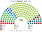
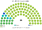
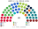
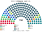
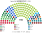
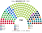
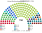
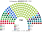

# 估計結果

> **這檔是什麼**：民意套本夾選制的席次**表**（如組閣聯盟／多數派政府）——§1 近期大選、§2 民調（若有）、§3 長期。圖庫見 [`席次圖.md`](席次圖.md)；大選算法細節見本夾重算檔。朝野互動見「預期政治生態」。

選制摘要：全院 **150＝單一 90（top-3 孔多賽）＋複數 60（聖拉古、無法定門檻）**。詳 [`01`](01-國會與選制.md)。

## 計算方式

| 層 | 做法 |
|---|---|
| 民意層 | Kiesraad 逐投票所，約 3,200 個市鎮×郵遞區 |
| 參選方層 | `finals_for`（withdraw）：相鄰共同提名、高票讓低票。不把全國政黨重組成新黨 |
| 單一 90 | 不跨省；top-3 孔多賽；選區用 2025 有效票切 |
| 複數 60 | 5 區聖拉古、無門檻、M∈[8,16] |
| 首長／組閣 | 全院孔多賽；≥76 |

細節見 [`14`](14-近期大選重算.md)、。

## 1 近期大選

用逐投票所得票套本夾。細節見 [`14-近期大選重算.md`](14-近期大選重算.md)。

| | 實際（全國一區 150） | **本夾全院 150** | 首長 |
|---|---|---|---|
| 2025-10 | D66 26、PVV 26、VVD 22、GL-PvdA 20、CDA 18 … | VVD **10**、D66 23、CDA 81、PVV 10、GL-PvdA 9 … | CDA |
| 2023-11 | PVV 37、GL-PvdA 25、VVD 24、NSC 20 … | NSC **89**、VVD 12、PVV 16、GL-PvdA 12 … | NSC |

### 2025-10 單一／複數

| 政黨 | 單一 90 | 複數 60 | **全院** |
|---|--:|--:|--:|
| VVD | 1 | 9 | **10** |
| D66 | 12 | 11 | **23** |
| CDA | 73 | 8 | **81** |
| PVV | 0 | 10 | **10** |
| GL-PvdA | 0 | 9 | **9** |
| JA21 | 0 | 5 | **5** |
| FvD | 0 | 4 | **4** |
| DENK | 4 | 1 | **5** |
| SGP | 0 | 2 | **2** |
| BBB | 0 | 1 | **1** |

**組閣聯盟／多數派政府**：首長 **CDA**；執政多數 CDA＋VVD＝**82**（過半 76）；改規則要複數 ≥36（中間三黨 28，須再拉）。

### 2023-11 單一／複數

| 政黨 | 單一 90 | 複數 60 | **全院** |
|---|--:|--:|--:|
| NSC | 80 | 9 | **89** |
| VVD | 3 | 9 | **12** |
| PVV | 0 | 16 | **16** |
| GL-PvdA | 0 | 12 | **12** |
| D66 | 3 | 5 | **8** |
| BBB | 0 | 3 | **3** |
| DENK | 3 | 1 | **4** |
| SGP | 0 | 2 | **2** |
| CDA | 0 | 2 | **2** |
| SP | 0 | 1 | **1** |
| PvdD | 1 | 0 | 1 |

**組閣聯盟／多數派政府**：首長 **NSC**；執政多數 NSC＋CDA＋BBB＝**76**（過半 76）或 NSC＋VVD＝96；NSC 單獨 71 不過半。

## 2 民調

> 2026-11-04：本節數字改由 [`民調推估.py`](民調推估.py) 重算（輸入 [`資料/polls.csv`](資料/polls.csv)）。原數字沒有留下可重跑的程式；新黨沿用母黨的政策位置與地理（見程式開頭）。

**民調＝現行比例代表制**（全國一區席次推估），不是本夾並立。資料：`netherlands/data/polls.csv`。

方法：以 **2025-10 逐投票所彙整** 為地理基底（民調欄 **PRO** 對應左翼進步陣營，地理上以當時 **GL-PvdA** 得票塊縮放），按民調席次當全國得票權重縮放後跑本夾——**單一 90** top-3 孔多賽、**複數 60** 聖拉古（與 §1 同一套生態模型，不是比例拆單一）。

### Ipsos I&O（2026-10-12..14，n＝1697）

首長 **CDA**。

| 政黨 | 現行比例制席次 | 單一 90 | 複數 60 | 本夾全院 |
|---|--:|--:|--:|--:|
| JA21 | 18 | 0 | 8 | **8** |
| D66 | 15 | 6 | 5 | **11** |
| VVD | 15 | 9 | 6 | **15** |
| CDA | 13 | 64 | 5 | **69** |
| PRO | 28 | 0 | 11 | **11** |
| PVV | 18 | 0 | 9 | **9** |
| PvdD | 6 | 8 | 3 | **11** |
| SGP | 4 | 1 | 2 | **3** |
| FvD | 11 | 0 | 5 | **5** |
| CU | 5 | 1 | 3 | **4** |
| SP | 5 | 0 | 2 | **2** |
| 50PLUS | 5 | 0 | 1 | **1** |
| BBB | 2 | 0 | 0 | **0** |
| DENK | 2 | 1 | 0 | **1** |
| Volt | 3 | 0 | 0 | **0** |

### Peil.nl（2026-10-02）

首長 **CDA**（舊算為 SGP；參選方層下 CDA 進到更多選區的第二輪）。

| 政黨 | 現行比例制席次 | 單一 90 | 複數 60 | 本夾全院 |
|---|--:|--:|--:|--:|
| JA21 | 20 | 4 | 9 | **13** |
| D66 | 18 | 9 | 8 | **17** |
| PRO | 29 | 0 | 15 | **15** |
| PVV | 19 | 0 | 10 | **10** |
| CDA | 12 | 62 | 5 | **67** |
| FvD | 13 | 0 | 5 | **5** |
| VVD | 12 | 7 | 5 | **12** |
| 50PLUS | 5 | 0 | 2 | **2** |
| DENK | 3 | 4 | 0 | **4** |
| PvdD | 4 | 2 | 0 | **2** |
| SGP | 3 | 2 | 1 | **3** |
| BBB | 2 | 0 | 0 | **0** |
| CU | 3 | 0 | 0 | **0** |
| SP | 4 | 0 | 0 | **0** |
| Volt | 3 | 0 | 0 | **0** |

### Verian/EenVandaag（2026-09-25..28，n＝1255）

首長 **CDA**。

| 政黨 | 現行比例制席次 | 單一 90 | 複數 60 | 本夾全院 |
|---|--:|--:|--:|--:|
| VVD | 18 | 5 | 8 | **13** |
| D66 | 17 | 10 | 8 | **18** |
| CDA | 14 | 68 | 6 | **74** |
| PRO | 28 | 0 | 12 | **12** |
| JA21 | 15 | 1 | 7 | **8** |
| PVV | 20 | 0 | 9 | **9** |
| SGP | 4 | 0 | 2 | **2** |
| FvD | 10 | 0 | 5 | **5** |
| CU | 4 | 0 | 2 | **2** |
| 50PLUS | 5 | 0 | 1 | **1** |
| DENK | 3 | 4 | 0 | **4** |
| PvdD | 4 | 2 | 0 | **2** |
| BBB | 1 | 0 | 0 | **0** |
| SP | 4 | 0 | 0 | **0** |
| Volt | 3 | 0 | 0 | **0** |

### Peilingwijzer (range midpoint)（2026-10-16）

首長 **CDA**。

| 政黨 | 現行比例制席次 | 單一 90 | 複數 60 | 本夾全院 |
|---|--:|--:|--:|--:|
| VVD | 17 | 7 | 8 | **15** |
| JA21 | 17 | 1 | 8 | **9** |
| CDA | 14 | 68 | 6 | **74** |
| D66 | 15 | 5 | 5 | **10** |
| PRO | 27.5 | 0 | 11 | **11** |
| PVV | 18 | 0 | 9 | **9** |
| FvD | 11 | 0 | 5 | **5** |
| PvdD | 5 | 7 | 3 | **10** |
| 50PLUS | 5 | 0 | 2 | **2** |
| CU | 4 | 0 | 2 | **2** |
| DENK | 3 | 2 | 0 | **2** |
| SP | 5 | 0 | 1 | **1** |
| BBB | 2 | 0 | 0 | **0** |
| SGP | 3 | 0 | 0 | **0** |
| Volt | 3 | 0 | 0 | **0** |

## 3 長期運行假設下

生態以 **2025-10 得票套新制** 為示意基準（[`12-預期政治生態.md`](12-預期政治生態.md) §3）。

| 政黨 | 單一 90 | 複數 60 | **全院 150** |
|---|--:|--:|--:|
| VVD | 1 | 9 | **10** |
| D66 | 12 | 11 | **23** |
| CDA | 73 | 8 | **81** |
| PVV | 0 | 10 | **10** |
| GL-PvdA | 0 | 9 | **9** |
| JA21 | 0 | 5 | **5** |
| FvD | 0 | 4 | **4** |
| DENK | 4 | 1 | **5** |
| SGP | 0 | 2 | **2** |
| BBB | 0 | 1 | **1** |

## 4 朝野互動（各次估計）

| 民意 | 首長 | 互動 |
|---|---|---|
| 2025-10 | CDA | 居中的 CDA 是左右兩翼議員共同的第二偏好，握首長；組閣有硬期限、首長 30 日內必定產生，不會出現現實中數月的組閣談判 |
| 2023-11 | NSC | NSC 以單一選區大勝成為首長；PVV 是第一偏好最大黨卻在一對一裡輸給 NSC，留在政府外。改選制、法院要全院與複數席次各 3/5，NSC 必須和在野談 |

誘因、候選人行為與檢視見 [`12-預期政治生態.md`](12-預期政治生態.md)。
