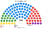

# 估計結果

> 虛構國家的近期大選、民調與長期推估套本夾。國會沿用一院議會制版本的席次（[`../一院議會制/生態模型.py`](../一院議會制/生態模型.py)）；總統由 [`../共用模型.py`](../共用模型.py) 以政黨得票算全國 top-3 孔多賽（每黨推一人，前 3 名進決選；不用個別候選人）。

## 計算方式

| 層 | 做法 |
|---|---|
| 國會 | 沿用一院版情境表 |
| 總統 | `共用模型.president`：全國得票、`finalists`（withdraw）、top-3 孔多賽 |

| 民意 | 得票（甲／乙／丙／丁／戊） | 總統（兩兩對決 %） | 單一 60 | 複數 40 | **國會 100** |
|---|---|---|---|---|---|
| 2026-04 | 32／27／17／14／10 | **甲**（甲對乙 63.0、甲對丙 69.0） | 甲 38、乙 14、丙 8 | 甲 12、乙 11、丙 7、丁 6、戊 4 | 甲 50、乙 25、丙 15、丁 6、戊 4 |
| 2022-04 | 28／26／21／15／10 | **甲**（甲對乙 64.0、甲對丙 64.0） | 甲 31、乙 16、丙 13 | 甲 11、乙 10、丙 9、丁 7、戊 3 | 甲 42、乙 26、丙 22、丁 7、戊 3 |
| 民調 甲公司 2026-10 | 34／26／17／13／10 | **甲**（甲對乙 64.0、甲對丙 70.0） | 甲 36、乙 16、丙 8 | 甲 10、乙 13、丙 8、丁 6、戊 3 | 甲 46、乙 29、丙 16、丁 6、戊 3 |
| 推估第 3 屆 | 35／25.5／16.5／13／10 | **甲**（甲對乙 64.5、甲對丙 70.5） | 甲 41、乙 12、丙 7 | 甲 13、乙 10、丙 8、丁 6、戊 3 | 甲 54、乙 22、丙 15、丁 6、戊 3 |

決選三人都是甲、乙、丙。居中的甲一對一勝過乙、丙，四個情境都沒有循環。

其餘情境的圖見 [`席次圖.md`](席次圖.md)。

## 府會互動

| 民意 | 總統 | 國會 | 互動 |
|---|---|---|---|
| 2026-04 | 甲 | 甲 50 | 差 1 席過半：預算與法律要丙（65）；丙的籌碼是預算的刪減，但刪不掉法定義務、也增不了項目 |
| 2022-04 | 甲 | 甲 42 | 少數總統；甲＋丙 64。國會不能倒閣，總統不能解散：雙方只能逐案談 |
| 民調 甲公司 | 甲 | 甲 46 | 同上（甲＋丙 62） |
| 推估第 3 屆 | 甲 | 甲 54 | 一致政府；組織法仍要乙或丙（全院 60 且複數 24） |
