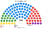
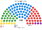
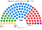
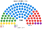

# 席次圖

虛構數字，由 [`../共用模型.py`](../共用模型.py) `--charts` 畫出。

## 2026-04

<!-- 席次表 -->

| 政黨 | 席次 | 占比 |
|---|--:|--:|
| 丁 | 6 | 6.0% |
| 丙 | 15 | 15.0% |
| 甲 | 50 | 50.0% |
| 乙 | 25 | 25.0% |
| 戊 | 4 | 4.0% |
| **合計** | **100** | 100% |

<!-- /席次表 -->

## 2022-04

<!-- 席次表 -->

| 政黨 | 席次 | 占比 |
|---|--:|--:|
| 丁 | 7 | 7.0% |
| 丙 | 22 | 22.0% |
| 甲 | 42 | 42.0% |
| 乙 | 26 | 26.0% |
| 戊 | 3 | 3.0% |
| **合計** | **100** | 100% |

<!-- /席次表 -->

## 民調-甲公司

<!-- 席次表 -->

| 政黨 | 席次 | 占比 |
|---|--:|--:|
| 丁 | 6 | 6.0% |
| 丙 | 16 | 16.0% |
| 甲 | 46 | 46.0% |
| 乙 | 29 | 29.0% |
| 戊 | 3 | 3.0% |
| **合計** | **100** | 100% |

<!-- /席次表 -->

## 推估第3屆

<!-- 席次表 -->

| 政黨 | 席次 | 占比 |
|---|--:|--:|
| 丁 | 6 | 6.0% |
| 丙 | 15 | 15.0% |
| 甲 | 54 | 54.0% |
| 乙 | 22 | 22.0% |
| 戊 | 3 | 3.0% |
| **合計** | **100** | 100% |

<!-- /席次表 -->
