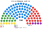
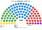

# 近期大選套新制

> 席次一覽與圖見 [`估計結果.md`](估計結果.md) §1、[`席次圖.md`](席次圖.md)。本檔講**怎麼**套（範本示範格式，數字由 [`生態模型.py`](生態模型.py) 產出）。

## 1 方法

| 項目 | 來源與做法 |
|---|---|
| 第一偏好 | 選委會逐投票所名單票（檔名、筆數、`_build_*.py` → `資料/*.csv`；範本內建於 [`生態模型.py`](生態模型.py)） |
| 驗證 | 全國有效票與各黨得票%和官方一致（列數字） |
| 座標 | Wikidata 市鎮代碼 → P625 |
| 單一 60 | 區內依座標 Hilbert 序、按有效票連續切；top-3 孔多賽 |
| 複數 40 | 各區聖拉古、無門檻（北區 16、中區 14、南區 9、海外 1） |
| 首長 | 全院 100 記名排名，須 ≥51 |

## 2 2026-04-05

實際（100）：甲 41、乙 33、丙 18、丁 8；**甲＋丙 59 組閣**。戊（10.0%）等因門檻或選區制未獲席次，約 10%–15% 的票沒有換到席次。

| 政黨 | 得票% | 實際 100 | 單一 60 | 複數 40 | **新制 100** |
|---|--:|--:|--:|--:|--:|
| **甲** | 32.0 | 41 | 38 | 12 | **50** |
| 乙 | 27.0 | 33 | 14 | 11 | **25** |
| 丙 | 17.0 | 18 | 8 | 7 | **15** |
| 丁 | 14.0 | 8 | 0 | 6 | **6** |
| 戊 | 10.0 | 0 | 0 | 4 | **4** |

| 區（單一） | 結果 |
|---|---|
| 北區（24） | 甲 16、乙 6、丙 2 |
| 中區（21） | 甲 14、乙 5、丙 2 |
| 南區（15） | 甲 8、乙 3、丙 4 |

- 60 位單一當選人中 **14 位**不是第一偏好第一名；當選者第一偏好中位數 **33.4%**。
- **首長 甲**（孔多賽全勝：對乙 71∶29、對丙 79∶21）；組閣 **甲＋丙＝65**；複數 19（<24），改不了組織法（[`05`](05-法規位階與修憲.md)）。

## 3 2022-04-03

實際（100）：甲 36、乙 31、丙 24、丁 9；**甲＋丙 60 組閣**。戊（10.0%）未跨過門檻。

| 政黨 | 得票% | 實際 100 | 單一 60 | 複數 40 | **新制 100** |
|---|--:|--:|--:|--:|--:|
| **甲** | 28.0 | 36 | 31 | 11 | **42** |
| 乙 | 26.0 | 31 | 16 | 10 | **26** |
| 丙 | 21.0 | 24 | 13 | 9 | **22** |
| 丁 | 15.0 | 9 | 0 | 7 | **7** |
| 戊 | 10.0 | 0 | 0 | 3 | **3** |

| 區（單一） | 結果 |
|---|---|
| 北區（24） | 甲 13、乙 7、丙 4 |
| 中區（21） | 甲 12、乙 6、丙 3 |
| 南區（15） | 甲 6、乙 3、丙 6 |

- 60 位單一當選人中 **16 位**不是第一偏好第一名；當選者第一偏好中位數 **30.8%**。
- **首長 甲**（對乙、丙皆 71∶29）；組閣 **甲＋丙＝64**；複數 11＋9＝20（<24），同樣改不了組織法。

## 4 民調

見 [`估計結果.md`](估計結果.md) §2。

## 5 敏感度（`--sweep`）

| 檢查 | 2026-04 單一 60 | 首長 | 2022-04 單一 60 | 首長 |
|---|---|---|---|---|
| 基準 | 甲 38、乙 14、丙 8 | 甲 | 甲 31、乙 16、丙 13 | 甲 |
| 全部重軸一 | 甲 39、乙 13、丙 8 | 甲 | 甲 32、乙 15、丙 13 | 甲 |
| 全部重軸二 | 甲 36、乙 15、丙 9 | 甲 | 甲 30、乙 17、丙 13 | 甲 |
| 切線位移半區 | 甲 37、乙 15、丙 8 | 甲 | 甲 31、乙 15、丙 14 | 甲 |
| 甲 −6／乙 ＋6 點 | 甲 28、乙 24、丙 8 | 甲 | 甲 22、乙 25、丙 13 | 甲 |

## 6 走向（推測）

| 時點 | 現實 | **新制** |
|---|---|---|
| 2022-04 | 甲＋丙 60 組閣，戊無席次 | 甲首長、甲＋丙＝64（複數 20，改不了組織法） |
| 2026-04 | 甲＋丙 59 組閣，選後協商數月 | 甲首長（30 日預設值壓縮協商）、甲＋丙＝65（複數 19，改不了組織法） |
| 2026-10 民調 | — | 甲首長、甲＋丙＝62（複數 18） |

## 7 出處

| 數字 | 出處 |
|---|---|
| 逐投票所 | 選委會開放資料網址、檔名（範本為內建合成數據） |
| 座標 | Wikidata P625 |
| 民調 | 維基百科 Opinion polling for the next election |
| 實際席次 | 維基百科 2022 / 2026 general election 條目 |
