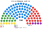
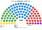

# 估計結果

> 席次**表**——§1 近期大選、§2 民調、§3 長期。圖庫見 [`席次圖.md`](席次圖.md)；算法見 [`14`](14-近期大選重算.md)、[`生態模型.py`](生態模型.py)。

選制：全院 **100＝單一 60（top-3 孔多賽）＋複數 40（聖拉古、無門檻）**；首長、供給 ≥51；組織法全院 ≥60 且複數 ≥24。詳 [`01`](01-國會與選制.md)。

## 計算方式

| 層 | 做法 |
|---|---|
| 民意層 | 範本內建合成得票，不是某一國的投票所 |
| 參選方層 | 席次寫在 [`生態模型.py`](生態模型.py) 的情境表。這一夾沒有呼叫 `finalists` |
| 單一 60 | top-3 孔多賽（表內已算好） |
| 複數 40 | 北 16、中 14、南 9、海外 1；聖拉古、無門檻 |
| 首長／組閣 | 全院孔多賽；≥51 |

總統與參議院的參選方層在 [`../共用模型.py`](../共用模型.py)，不在這一夾。

## 1 近期大選

（範本虛構數字，示範兩屆國會大選套用新制之標準排版。）

| | 實際（100） | **本夾全院 100** | 首長 | 組閣 |
|---|---|---|---|---|
| 2026-04 | 甲 41、乙 33、丙 18、丁 8；甲＋丙 59 | **甲 50**、乙 25、丙 15、丁 6、戊 4 | **甲** | 甲＋丙＝65 |
| 2022-04 | 甲 36、乙 31、丙 24、丁 9；甲＋丙 60 | **甲 42**、乙 26、丙 22、丁 7、戊 3 | **甲** | 甲＋丙＝64 |

### 2026-04

| 政黨 | 單一 60 | 複數 40 | **全院** |
|---|--:|--:|--:|
| 甲 | 38 | 12 | **50** |
| 乙 | 14 | 11 | **25** |
| 丙 | 8 | 7 | **15** |
| 丁 | 0 | 6 | **6** |
| 戊 | 0 | 4 | **4** |

**組閣聯盟／多數派政府**：首長 **甲**；**甲＋丙＝65**。組織法：甲＋丙 複數 19（<24），改不了。

### 2022-04

| 政黨 | 單一 60 | 複數 40 | **全院** |
|---|--:|--:|--:|
| 甲 | 31 | 11 | **42** |
| 乙 | 16 | 10 | **26** |
| 丙 | 13 | 9 | **22** |
| 丁 | 0 | 7 | **7** |
| 戊 | 0 | 3 | **3** |

**組閣聯盟／多數派政府**：首長 **甲**；**甲＋丙＝64**。組織法：甲＋丙 複數 20（<24），改不了。

## 2 民調

**方法**：`生態模型.py`（真實國家可拆 `民調推估.py`＋`資料/polls.csv`）；以最近一次大選的逐投票所地理縮放。

| 民調 | 投票意向（前五） | **本夾全院 100** | 單一 60 | 首長 | 組閣（機械） |
|---|---|---|---|---|---|
| 甲公司（10-01..07） | 甲 34、乙 26、丙 17、丁 13、戊 10 | 甲 46、乙 29、丙 16、丁 6、戊 3 | 甲 36、乙 16、丙 8 | **甲** | 甲＋丙＝62 |

**讀法**：「組閣」是由首長往外依偏好距離加黨到 ≥51 的機械結果，不是預測。

## 3 長期運行（推估第 3 屆）

兩翼各讓出 1/8 第一偏好給居中政黨（`python 生態模型.py --projection`）。

| 政黨 | 單一 60 | 複數 40 | **全院** |
|---|--:|--:|--:|
| 甲 | 41 | 13 | **54** |
| 乙 | 12 | 10 | **22** |
| 丙 | 7 | 8 | **15** |
| 丁 | 0 | 6 | **6** |
| 戊 | 0 | 3 | **3** |

首長 **甲**，單獨 54；複數 13，改不了組織法。
