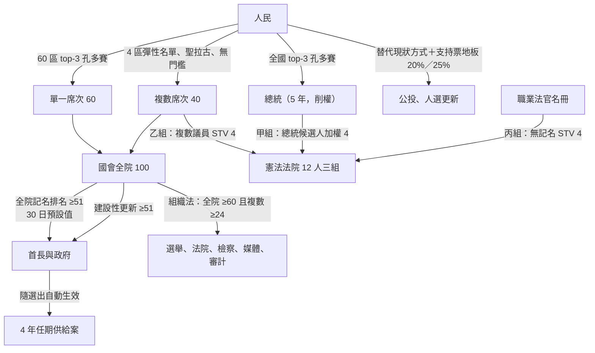
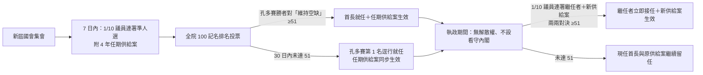

# 憲政架構圖

`0-基本/總體.md` 要求：給**多張**憲政設計架構圖，方便讀者理解。

## 1 選舉與權力來源（全景）



## 2 組閣、建設性更新與任期供給案



## 3 三層法規位階、兩種多數與憲法法院三組審查

```mermaid
flowchart TB
    subgraph 法規位階與修改門檻
        L1[一般法律：全院 ≥51<br/>總統擱置否決可由全院 ≥51 推翻]
        L2[組織法：全院 ≥60 且複數 ≥24<br/>涵蓋選制、法院、檢察、媒體、審計]
        L3[憲法：一般軌跨屆雙 2/3＋公投 25%<br/>急迫軌雙 3/4＋公投 30%]
    end
    subgraph 憲法法院 12 人三組（反杯葛：棄權票歸零不重分配）
        G1[甲組 4 人：總統候選人依得票加權]
        G2[乙組 4 人：複數席次議員 STV]
        G3[丙組 4 人：職業法官名冊無記名 STV]
        G1 --> Court[違憲判決：須 ≥8 票且三組各 ≥2 票]
        G2 --> Court
        G3 --> Court
    end
    L1 --> Court
    L2 --> Court
```
