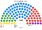
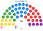

# 估計結果

> 虛構國家的近期大選、民調與長期推估套本夾：國民院沿用一院版的席次（[`../一院議會制/生態模型.py`](../一院議會制/生態模型.py)），參議院由 [`../共用模型.py`](../共用模型.py) 依各情境的政黨得票與各區偏移算出。首長都是甲（居中，兩兩對決全勝）。

## 計算方式

| 層 | 做法 |
|---|---|
| 國民院 | 沿用一院版情境表（合成得票，沒有呼叫 `finalists`） |
| 參議院 50 | `共用模型.senate`：北 20、中 17、南 13，聖拉古，加虛構區域偏移 |
| 首長／組閣 | 沿用一院版全院孔多賽；≥51 |

| 民意 | 得票（甲／乙／丙／丁／戊） | 國民院單一 60 | 國民院複數 40 | **國民院 100** | **參議院 50** |
|---|---|---|---|---|---|
| 2026-04 | 32／27／17／14／10 | 甲 38、乙 14、丙 8 | 甲 12、乙 11、丙 7、丁 6、戊 4 | 甲 50、乙 25、丙 15、丁 6、戊 4 | 甲 15、乙 14、丙 9、丁 7、戊 5 |
| 2022-04 | 28／26／21／15／10 | 甲 31、乙 16、丙 13 | 甲 11、乙 10、丙 9、丁 7、戊 3 | 甲 42、乙 26、丙 22、丁 7、戊 3 | 甲 15、乙 12、丙 11、丁 7、戊 5 |
| 民調 甲公司 2026-10 | 34／26／17／13／10 | 甲 36、乙 16、丙 8 | 甲 10、乙 13、丙 8、丁 6、戊 3 | 甲 46、乙 29、丙 16、丁 6、戊 3 | 甲 17、乙 12、丙 9、丁 7、戊 5 |
| 推估第 3 屆 | 35／25.5／16.5／13／10 | 甲 41、乙 12、丙 7 | 甲 13、乙 10、丙 8、丁 6、戊 3 | 甲 54、乙 22、丙 15、丁 6、戊 3 | 甲 18、乙 12、丙 8、丁 7、戊 5 |

| 民意 | 首長 | 組閣 |
|---|---|---|
| 2026-04 | 甲 | 甲＋丙 65 |
| 2022-04 | 甲 | 甲＋丙 64 |
| 民調 甲公司 | 甲 | 甲＋丙 62 |
| 推估第 3 屆 | 甲 | 甲單獨 54 |

其餘情境的圖見 [`席次圖.md`](席次圖.md)。

## 朝野互動

| 民意 | 政府 | 參議院 | 互動 |
|---|---|---|---|
| 2026-04 | 甲＋丙 65 | 甲＋丙 24 | 普通法律常被參議院擱置 30 日；改組織法要拉乙（右）或丁（極左）——規則層級必須跨過中間 |
| 2022-04 | 甲＋丙 64 | 甲＋丙 26 | 同上，差 4 席 |
| 民調 甲公司 | 甲＋丙 62 | 甲＋丙 26 | 同上 |
| 推估第 3 屆 | 甲單獨 54 | 甲 18 | 甲在國民院單獨過半，在參議院只有三成多：甲＋乙 30 剛好到組織法門檻，甲＋丙 26 不夠 |
