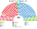
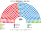
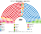
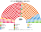
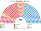
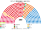

# 近期大選重算

> **這檔是什麼**：近期大選得票**怎麼**套進本夾選制（方法、假設、對照）。席次一覽與圖見 [`估計結果.md`](估計結果.md) §1、[`席次圖.md`](席次圖.md)。

2023、2019-11、2019-04、2016-06、2015-12 套新制

**方法**：[`生態模型.py`](生態模型.py)。第一偏好是內政部 infoelectoral 的**逐市鎮**得票（[`資料/`](資料/)，約 8,100 市鎮；國外選民不含）；偏好排序是假設（[`12`](12-預期政治生態.md) §2）。只用當時民意。

## 1 一覽

| | 實際（350） | 實際政府 | **新制全院 350** | **首長** | **組閣陣營** |
|---|---|---|---|---|---|
| 2023-07 | PP 137、PSOE 121、VOX 33、SUMAR 31、ERC 7、JUNTS 7 … | 桑切斯（PSOE＋SUMAR，授權 179） | **PP 168**、PSOE 134、SUMAR 18、VOX 18 … | **PP** | PP＋VOX 186 |
| 2019-11 | PSOE 120、PP 89、VOX 52、UP 35 … | 桑切斯（PSOE＋UP，授權 167:165） | **PSOE 139**、PP 128、SUMAR 22、VOX 22、ERC 14、Cs 11 … | **PSOE** | PSOE＋SUMAR＋地方＋CC＋BNG＋ERC 180 |
| 2019-04 | PSOE 123、PP 66、Cs 57、UP 43 … | 授權失敗 → 2019-11 重選 | PSOE 145、Cs 113、PP 35、SUMAR 22 … | **PSOE** | PSOE 145＋SUMAR 22＋CC 1＋ERC 11＝179 |
| 2016-06 | PP 137、PSOE 85、UP 71、Cs 32 … | 拉霍伊（PSOE 棄權後授權） | PP 149、PSOE 99、SUMAR 44、Cs 36 … | **Cs** | Cs 36＋PP 149＝185 |
| 2015-12 | PP 123、PSOE 90、Podemos 系 71、Cs 40 … | 無人過授權 → 2016-06 重選 | PSOE 132、PP 95、SUMAR 53、Cs 48 … | **PSOE** | PSOE 132＋SUMAR 53＝185 |

## 2 2023-07
| 政黨 | 得票% | 實際 | 單一 210 | 複數 140 | **新制** |
|---|--:|--:|--:|--:|--:|
| PP | 33.3 | 137 | 122 | 46 | **168** |
| PSOE | 32.0 | 121 | 87 | 47 | **134** |
| SUMAR | 12.4 | 31 | 0 | 18 | **18** |
| VOX | 12.5 | 33 | 0 | 18 | **18** |
| ERC | 1.9 | 7 | 1 | 3 | **4** |
| BILDU | 1.4 | 6 | 0 | 2 | **2** |
| JUNTS | 1.6 | 7 | 0 | 2 | **2** |
| PNV | 1.1 | 5 | 0 | 2 | **2** |
| BNG | 0.6 | 1 | 0 | 1 | **1** |
| CC | 0.5 | 1 | 0 | 1 | **1** |

| 區（單一） | 結果 |
|---|---|
| 安達魯西亞一（19）、二（19） | PP 12＋17、PSOE 7＋2 |
| 馬德里一（14）、二（15） | PP 14＋10、PSOE 0＋5 |
| 加泰隆尼亞＋巴利亞利一（19）、二（19） | PSOE 18＋16、ERC 1、PP 3 |
| 瓦倫西亞＋穆爾西亞一（14）、二（14） | PP 13＋8、PSOE 1＋6 |
| 加利西亞＋阿斯圖里亞斯（18） | PP 9、PSOE 9 |
| 卡斯提亞-萊昂＋坎塔布里亞＋埃斯特雷馬杜拉（19） | PP 19 |
| 巴斯克＋納瓦拉＋拉里奧哈（15） | PSOE 13、PP 2 |
| 卡斯提亞-拉曼查＋亞拉岡（15） | PP 15 |
| 加那利（10） | PSOE 10 |

- 決選三人：PP／PSOE／VOX 98 區、PP／PSOE／SUMAR 75 區、Bildu／PNV／PSOE 10 區、ERC／JUNTS／PSOE 7 區。**沒有循環**。
- 只有 3 區的當選者第一偏好過半；當選者第一偏好中位數 37%。

## 3 2019-11
| 政黨 | 得票% | 實際 | 單一 210 | 複數 140 | **新制** |
|---|--:|--:|--:|--:|--:|
| PSOE | 28.3 | 120 | 100 | 39 | **139** |
| PP | 21.0 | 89 | 98 | 30 | **128** |
| SUMAR | 15.4 | 38 | 0 | 22 | **22** |
| VOX | 15.2 | 52 | 0 | 22 | **22** |
| ERC | 3.6 | 13 | 9 | 5 | **14** |
| Cs | 6.9 | 10 | 0 | 11 | **11** |
| PNV | 1.6 | 6 | 1 | 2 | **3** |
| BILDU | 1.2 | 5 | 0 | 2 | **2** |
| CUP | 1.0 | 2 | 0 | 2 | **2** |
| JUNTS | 2.2 | 8 | 0 | 2 | **2** |
| 地方 | 0.4 | 2 | 2 | 0 | **2** |
| BNG | 0.5 | 1 | 0 | 1 | **1** |
| CC | 0.5 | 2 | 0 | 1 | **1** |
| UPN | 0.4 | 2 | 0 | 1 | **1** |

- **PSOE 單一 100、PP 98**：PSOE 拿下加利西亞＋阿斯圖里亞斯 16／18、安達魯西亞一 13；PP 拿下馬德里 23／29、卡斯提亞-拉曼查＋亞拉岡 15／15。
- **ERC 單一 9**：那年 ERC 3.6%，在「ERC／PSOE／SUMAR」的 23 區有一部分是孔多賽贏家。
- 首長 PSOE（對 PP 189:161）；組閣陣營由近到遠擴展要納入 ERC 才過 176。
- 2 區循環。

## 4 2019-04

| 政黨 | 單一 210 | 複數 140 | **新制** |
|---|--:|--:|--:|
| PSOE | 104 | 41 | **145** |
| Cs | 89 | 24 | **113** |
| PP | 10 | 25 | **35** |
| SUMAR | 0 | 22 | **22** |
| VOX | 0 | 15 | **15** |
| ERC | 6 | 5 | **11** |
| PNV | 1 | 2 | **3** |
| BILDU | 0 | 2 | **2** |
| JUNTS | 0 | 2 | **2** |
| CC | 0 | 1 | **1** |
| UPN | 0 | 1 | **1** |

- **Cs 單一 89**：那年 Cs 16% 是 PSOE 與 PP 選民共同的第二偏好，拿下馬德里 26／29、卡斯提亞-萊昂＋坎塔布里亞＋埃斯特雷馬杜拉 17／19、卡斯提亞-拉曼查＋亞拉岡 13／15。**PP 只剩單一 6**。現實中這一年授權失敗、半年後重選；本夾 30 日內由 PSOE 組閣（179）。
- 首長 PSOE（對 Cs、PP 皆 186:164）；組閣陣營 PSOE 145＋SUMAR 22＋CC 1＋ERC 11＝179。

## 5 2016-06

| 政黨 | 單一 210 | 複數 140 | **新制** |
|---|--:|--:|--:|
| PP | 102 | 47 | **149** |
| PSOE | 66 | 33 | **99** |
| SUMAR | 13 | 31 | **44** |
| Cs | 18 | 18 | **36** |
| ERC | 9 | 4 | **13** |
| BILDU | 2 | 1 | **3** |
| JUNTS | 0 | 3 | **3** |
| PNV | 0 | 2 | **2** |
| CC | 0 | 1 | **1** |

- **首長是 Cs（全院 36 席）**：PP 149 不過半，PSOE、SUMAR、地方黨議員都把 Cs 排在 PP 前，PP 議員把 Cs 排在 PSOE 前；Cs 是全院的孔多賽贏家，與 PP 組閣 185。**SUMAR 單一 13**：巴斯克＋納瓦拉＋拉里奧哈 6、加泰隆尼亞 7。
- 首長 Cs（對 PP 195:155、對 PSOE 185:165）；組閣陣營 Cs 36＋PP 149＝185。

## 6 2015-12

| 政黨 | 單一 210 | 複數 140 | **新制** |
|---|--:|--:|--:|
| PSOE | 101 | 31 | **132** |
| PP | 53 | 42 | **95** |
| SUMAR | 18 | 35 | **53** |
| Cs | 27 | 21 | **48** |
| ERC | 8 | 4 | **12** |
| BILDU | 3 | 1 | **4** |
| JUNTS | 0 | 3 | **3** |
| PNV | 0 | 2 | **2** |
| CC | 0 | 1 | **1** |

- **PSOE 單一 101**：PP 得票第一（28.9%），但在安達魯西亞、加泰隆尼亞、加利西亞、加那利，Podemos 系選民把 PSOE 排第二；Cs 拿下馬德里 20。現實中這一年**沒有政府、半年後重選**；本夾 30 日內由 PSOE＋SUMAR 組閣（184）。
- 首長 PSOE（對 PP、Cs 皆 207:143）；組閣陣營 PSOE 132＋SUMAR 53＝185。

## 7 敏感度

見 [`12`](12-預期政治生態.md) §6。

## 8 限制

- 第一偏好用政黨票；候選人個人因素沒有反映。
- 國外選民（CERA）不在逐市鎮資料內。
- 新選區沿市鎮座標的 Hilbert 序切；選舉人超過半席的市鎮（馬德里、巴塞隆納等）等分成數塊，假設市鎮內組成相同。
- 2019-11 的 Podemos 系、En Comú、Más País、Compromís 合成一格「SUMAR」；Navarra Suma 計為 UPN。2015、2016 的 Podemos 系（含 En Comú、En Marea、Compromís、IU）同樣計為「SUMAR」；CDC／DL 計為 JUNTS；Front Republicà 計為 CUP。2015、2016 的 UPN 與 PP 聯合參選，計在 PP。
- 2016 年起 Cerdedo 併入 Cerdedo-Cotobade，該市鎮的 2015、2016 票缺座標未計（約 1,500 票）。

## 來源

- 內政部 infoelectoral「市鎮」結果檔（03 候選名單、05 市鎮、06 市鎮得票），2019-11、2019-04、2016-06、2015-12 取自 GitHub `JaimeObregon/infoelectoral`、2023-07 取自 `alexandregz/infoelectoral_private`（官方下載頁有 Cloudflare 驗證，未嘗試繞過）。
- 市鎮座標：Wikidata（INE 市鎮代碼 P772 的 P625）。
- 實際席次：內政部公告。
