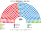
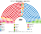
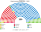
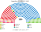
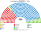
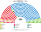

# 估計結果

> **這檔是什麼**：民意套本夾選制的席次**表**（如組閣聯盟／多數派政府）——§1 近期大選、§2 民調（若有）、§3 長期。圖庫見 [`席次圖.md`](席次圖.md)；大選算法細節見本夾重算檔。朝野互動見「預期政治生態」。

選制摘要：全院 **350＝單一 210（top-3 孔多賽）＋複數 140（聖拉古、無法定門檻）**。詳 [`01`](01-國會與選制.md)。

## 1 近期大選

用逐市鎮得票套本夾。細節見 [`14-近期大選重算.md`](14-近期大選重算.md)。

| | 實際 | **本夾全院 350** | 首長 |
|---|---|---|---|
| 2023-07 | PP 137、PSOE 121、VOX 33、SUMAR 31 … | **PP 168**、PSOE 134、SUMAR 18、VOX 18 … | PP |
| 2019-11 | PSOE 120、PP 89、VOX 52 … | **PSOE 139**、PP 128、SUMAR 22、VOX 22 … | PSOE |
| 2019-04 | PSOE 123、PP 66、Cs 57、UP 43 … | **PSOE 145**、Cs 113、PP 35、SUMAR 22 … | PSOE（PSOE 145＋SUMAR 22＋CC 1＋ERC 11＝179） |
| 2016-06 | PP 137、PSOE 85、UP 71、Cs 32 … | **PP 149**、PSOE 99、SUMAR 44、Cs 36 … | Cs（Cs 36＋PP 149＝185） |
| 2015-12 | PP 123、PSOE 90、Podemos 系 71、Cs 40 … | **PSOE 132**、PP 95、SUMAR 53、Cs 48 … | PSOE（PSOE 132＋SUMAR 53＝185） |

### 2023-07 單一／複數

| 政黨 | 單一 210 | 複數 140 | **全院** |
|---|--:|--:|--:|
| PP | 122 | 46 | **168** |
| PSOE | 87 | 47 | **134** |
| SUMAR | 0 | 18 | **18** |
| VOX | 0 | 18 | **18** |
| ERC | 1 | 3 | **4** |
| BILDU | 0 | 2 | **2** |
| JUNTS | 0 | 2 | **2** |
| PNV | 0 | 2 | **2** |
| BNG | 0 | 1 | **1** |
| CC | 0 | 1 | **1** |

**組閣聯盟／多數派政府**：首長 **PP**；執政多數 PP＋VOX＝**186**（過半 176）；PP 單獨 168 差 8。

### 2019-11 單一／複數

| 政黨 | 單一 210 | 複數 140 | **全院** |
|---|--:|--:|--:|
| PSOE | 100 | 39 | **139** |
| PP | 98 | 30 | **128** |
| SUMAR | 0 | 22 | **22** |
| VOX | 0 | 22 | **22** |
| ERC | 9 | 5 | **14** |
| Cs | 0 | 11 | **11** |
| PNV | 1 | 2 | **3** |
| BILDU | 0 | 2 | **2** |
| CUP | 0 | 2 | **2** |
| JUNTS | 0 | 2 | **2** |
| 地方 | 2 | 0 | **2** |
| BNG | 0 | 1 | **1** |
| CC | 0 | 1 | **1** |
| UPN | 0 | 1 | **1** |

**組閣聯盟／多數派政府**：首長 **PSOE**；PSOE 139＜過半 176，須聯立／外援（如 PSOE＋SUMAR＝161 仍差，要地方黨）。

## 2 民調

> 2026-11-04：本節數字改由 [`民調推估.py`](民調推估.py) 重算（輸入 [`資料/polls.csv`](資料/polls.csv)）。原數字沒有留下可重跑的程式；新黨沿用母黨的政策位置與地理（見程式開頭）。

民調與得票摘自 parliament_condorcet 研究抽取／維基等彙整之 CSV（`parliament_condorcet/<country>/data/`），非本倉內建資料。得票推估來自 `spain/data/input_vote_shares.csv`。方法：以 **2023-07 逐市鎮** 為地理基底，按民調得票率縮放後跑本夾——**單一 210** top-3 孔多賽、**複數 140** 聖拉古（不是全國比例拆單一）。FA／SUMAR＝廣泛陣線；PODE／SALF／FV／ADEL 以近緣名單為地理種。

### EM-Analytics／Electomanía（2026-10-15..17，n＝3141）

得票推估

| 政黨 | 得票推估% | 單一 210 | 複數 140 | 全院 350 |
|---|--:|--:|--:|--:|
| PP | 31.8% | 156 | 50 | **206** |
| PSOE | 27.1% | 53 | 42 | **95** |
| VOX | 18.9% | 0 | 28 | **28** |
| SUMAR | 4.9% | 0 | 8 | **8** |
| ERC | 2.1% | 0 | 4 | **4** |
| BILDU | 1.4% | 1 | 2 | **3** |
| JUNTS | 1.2% | 0 | 2 | **2** |
| PNV | 1% | 0 | 2 | **2** |
| BNG | 1% | 0 | 1 | **1** |
| CC | 0.3% | 0 | 1 | **1** |
| ADEL | 1.1% | 0 | 0 | **0** |
| FV | 1.3% | 0 | 0 | **0** |
| PODE | 2% | 0 | 0 | **0** |
| SALF | 1.7% | 0 | 0 | **0** |

### Sigma Dos／El Mundo（2026-10-01..14，n＝3007）

得票推估（未列 SALF、UPN）

| 政黨 | 得票推估% | 單一 210 | 複數 140 | 全院 350 |
|---|--:|--:|--:|--:|
| PP | 31.5% | 157 | 45 | **202** |
| PSOE | 25.3% | 51 | 40 | **91** |
| VOX | 19.5% | 0 | 30 | **30** |
| SUMAR | 7.2% | 0 | 13 | **13** |
| ERC | 2.5% | 1 | 4 | **5** |
| BILDU | 1.2% | 0 | 2 | **2** |
| CC | 0.5% | 1 | 1 | **2** |
| JUNTS | 1.2% | 0 | 2 | **2** |
| PNV | 0.9% | 0 | 2 | **2** |
| BNG | 0.8% | 0 | 1 | **1** |
| ADEL | 0.8% | 0 | 0 | **0** |
| FV | 0.9% | 0 | 0 | **0** |
| PODE | 2.8% | 0 | 0 | **0** |

### SocioMétrica／El Español（2026-10-10..11）

得票推估

| 政黨 | 得票推估% | 單一 210 | 複數 140 | 全院 350 |
|---|--:|--:|--:|--:|
| PP | 32.5% | 158 | 51 | **209** |
| PSOE | 26% | 48 | 41 | **89** |
| VOX | 18.5% | 0 | 28 | **28** |
| SUMAR | 4.6% | 0 | 8 | **8** |
| CC | 0.5% | 3 | 1 | **4** |
| ERC | 1.9% | 0 | 4 | **4** |
| BILDU | 1.4% | 1 | 2 | **3** |
| JUNTS | 1.4% | 0 | 2 | **2** |
| BNG | 0.8% | 0 | 1 | **1** |
| PNV | 0.8% | 0 | 1 | **1** |
| UPN | 0.3% | 0 | 1 | **1** |
| ADEL | 0.8% | 0 | 0 | **0** |
| FV | 1.1% | 0 | 0 | **0** |
| PODE | 2.8% | 0 | 0 | **0** |
| SALF | 2.2% | 0 | 0 | **0** |

### GAD3／Vocento（2026-10-06..08）

得票推估

| 政黨 | 得票推估% | 單一 210 | 複數 140 | 全院 350 |
|---|--:|--:|--:|--:|
| PP | 31.2% | 157 | 48 | **205** |
| PSOE | 26.3% | 49 | 42 | **91** |
| VOX | 18.3% | 0 | 27 | **27** |
| SUMAR | 6.3% | 0 | 11 | **11** |
| ERC | 2.7% | 2 | 5 | **7** |
| BILDU | 1.4% | 1 | 2 | **3** |
| CC | 0.5% | 1 | 1 | **2** |
| JUNTS | 1.4% | 0 | 2 | **2** |
| BNG | 0.8% | 0 | 1 | **1** |
| PNV | 0.8% | 0 | 1 | **1** |
| ADEL | 0.8% | 0 | 0 | **0** |
| FV | 1.1% | 0 | 0 | **0** |
| PODE | 2.2% | 0 | 0 | **0** |
| SALF | 1.9% | 0 | 0 | **0** |

### IMOP／El Confidencial（2026-10-05..07）

得票推估

| 政黨 | 得票推估% | 單一 210 | 複數 140 | 全院 350 |
|---|--:|--:|--:|--:|
| PP | 30.5% | 153 | 47 | **200** |
| PSOE | 26.6% | 55 | 41 | **96** |
| VOX | 19.2% | 0 | 29 | **29** |
| SUMAR | 6.3% | 0 | 11 | **11** |
| ERC | 2.2% | 0 | 4 | **4** |
| BILDU | 1.4% | 1 | 2 | **3** |
| BNG | 1.1% | 0 | 2 | **2** |
| CC | 0.5% | 1 | 1 | **2** |
| JUNTS | 1.1% | 0 | 2 | **2** |
| PNV | 0.8% | 0 | 1 | **1** |
| ADEL | 0.8% | 0 | 0 | **0** |
| FV | 1.1% | 0 | 0 | **0** |
| PODE | 2.2% | 0 | 0 | **0** |
| SALF | 1.9% | 0 | 0 | **0** |
| UPN | 0.3% | 0 | 0 | **0** |

## 3 長期運行假設下

生態以 **2023 得票套新制** 為第 3 屆示意（[`12-預期政治生態.md`](12-預期政治生態.md) §3）。

| 政黨 | 單一 210 | 複數 140 | **全院 350** |
|---|--:|--:|--:|
| PP | 122 | 46 | **168** |
| PSOE | 87 | 47 | **134** |
| SUMAR | 0 | 18 | **18** |
| VOX | 0 | 18 | **18** |
| ERC | 1 | 3 | **4** |
| BILDU | 0 | 2 | **2** |
| JUNTS | 0 | 2 | **2** |
| PNV | 0 | 2 | **2** |
| BNG | 0 | 1 | **1** |
| CC | 0 | 1 | **1** |

朝野互動與候選人行為見 [`12-預期政治生態.md`](12-預期政治生態.md)。
