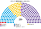
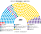

# 14 近期大選重算

## 1 方法

| 項目 | 做法 |
|---|---|
| 2023 票源 | 內政部選務局（DINE）**逐投票桌**暫定開票（datos.gob.ar「Resultados provisionales de las Elecciones 2023」的 `2023_generales_1.zip`），取國會眾議員有效票，彙整到 **5,752 個選舉區（circuito）**：[`資料/_build_circ.py`](資料/_build_circ.py) → [`資料/circ-2023.csv`](資料/circ-2023.csv)。全國：祖國聯盟 36.3%、變革聯盟 26.2%、自由前進 23.7%、工人左翼 3.3%、為我國做事 2.8% |
| 聯盟歸併 | 各省的聯盟改名併回全國聯盟（例：Cambia Mendoza、Juntos por Entre Ríos、ECO+Vamos Corrientes → 變革聯盟；Frente Cívico por Santiago、Más para Entre Ríos → 祖國聯盟）。本省得票 ≥5% 的省級政黨保留原名，只在本省參選；其餘零星名單併入「其他」 |
| 2025 票源 | 2025 逐桌檔（datos.mininterior.gob.ar）本機連線逾時，**尚未換入**。改用：各省總數＝[`資料/votes-2025.csv`](資料/votes-2025.csv)（全國總數對齊維基、各省推估），省內分布＝2023 選舉區的對應聯盟票（自由前進 ← 2023 自由前進＋變革聯盟；祖國力量 ← 祖國聯盟；聯合省分 ← 為我國做事＋變革聯盟；聯邦革新 ← 省級政黨） |
| 單一 150 | 各省依人口最大餘數（每省至少 1）；省內依選舉區編號（相鄰）連續切成有效票相等的選區 |
| 參選方層 | 每個政黨可推人；場外小黨互併、場內黨為場外黨退讓或共推、場內黨單純退選，雙方都偏好整合後的勝者（席次圖產生器，withdraw） |
| 制度層 | 單一：前 3 名，全體選民完整排序兩兩對決，循環用 Ranked Pairs。複數 100：10 區（布省依選舉區切 3 區；門多薩併入庫約），每區 6–14 席，聖拉古、無門檻；「其他」拆成 5 份小名單 |
| 驗證 | `python 生態模型.py`、`--projection`、`--sweep` |

## 2 2025-10

| 政黨 | 單一 150 | 複數 100 | **全院 250** |
|---|--:|--:|--:|
| 自由前進 | 73 | 46 | **119** |
| 祖國力量 | 31 | 39 | **70** |
| 聯合省分 | 44 | 10 | **54** |
| 工人左翼 | 0 | 4 | **4** |
| 聯邦革新 | 2 | 1 | **3** |

首長 **聯合省分**（全院兩兩對決全勝）；組閣 聯合省分＋聯邦革新＋祖國力量＝127。

- 布宜諾斯艾利斯省 49 席：祖國力量 21（郊區工業帶）、自由前進 17、聯合省分 11。
- 自治市、科多瓦、門多薩、聖大非幾乎全是自由前進。
- 內陸小省多半是聯合省分：自由前進與祖國力量兩翼對決時，居中的聯合省分是兩邊共同的第二偏好。
- 聖地亞哥-德埃斯特羅 4 席全是祖國力量。

## 3 2023-10

| 政黨 | 單一 150 | 複數 100 | **全院 250** |
|---|--:|--:|--:|
| 變革聯盟 | 103 | 26 | **129** |
| 祖國聯盟 | 28 | 36 | **64** |
| 自由前進 | 1 | 26 | **27** |
| 省級政黨（9 黨） | 18 | 7 | **25** |
| 工人左翼 | 0 | 3 | **3** |
| 為我國做事 | 0 | 2 | **2** |

省級政黨：Ahora Patria（薩爾塔）5、Renovador de la Concordia（米西奧內斯）5、Renovador Federal（胡胡伊）4、Fe（里奧內格羅）4、Arriba Neuquén（內烏肯）4、Por Santa Cruz 1、La Fuerza de Santa Fe 1、Fuerza Republicana（圖庫曼）1。

首長 **變革聯盟**，單獨 129 過半。祖國聯盟 36% 的第一偏好主要在布省郊區與北部，單一只拿 28 席；變革聯盟在祖國聯盟與自由前進之間，是兩邊共同的第二偏好。

## 4 民調

PolitPro 2026-11 趨勢約自由前進 40.7、祖國力量 33.7、聯合省分 7.7，與 2025 開票接近；以 2025 地理重跑與 2025 同階（[`估計結果.md`](估計結果.md)）。

## 5 敏感度

`python 生態模型.py --sweep`：自由前進各省 ×1.05 → 自由前進全院 131、**首長變自由前進**；祖國力量 ×1.05 → 祖國力量 73、首長仍是聯合省分。2025 年的首長取決於自由前進能不能在單一選區之外再多幾個百分點。

## 6 限制

- 2025 的各省總數是推估，省內分布借用 2023；換入官方 2025 逐桌檔後要重跑。
- 選區依選舉區編號連續切，編號大致相鄰，但不是實際地圖劃界。
- 省級政黨的立場多半用同一個中間偏右座標（農民左翼、庇隆派、右翼幾黨另設），同省第二個以後的地方黨往外錯開。
