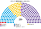
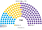
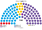
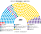
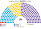
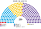

# 估計結果

> 近期大選與民調的民意套進本夾後的席次、首長、組閣與朝野互動。2023 用官方逐投票桌票；2025 用各省推估總數 × 2023 選舉區分布（官方 2025 逐桌檔尚下載不到）。方法細節見 [`14`](14-近期大選重算.md)。

## 計算方式

| 層 | 本夾的做法 |
|---|---|
| 民意層 | 2023：DINE 逐投票桌眾議員有效票 → 5,752 個選舉區；2025：各省推估總數，省內依 2023 選舉區的對應聯盟票分配 |
| 參選方層 | 每個政黨可推人；省級政黨只在本省；場外小黨互併、場內黨為場外黨退讓或共推、場內黨單純退選——都要雙方偏好整合後的勝者 |
| 單一 150 | 各省依人口配席（至少 1）；省內依選舉區編號切成有效票相等的選區；前 3 名、全體選民完整排序兩兩對決，循環用 Ranked Pairs |
| 複數 100 | 10 區（布省 3 區），每區 6–14 席，聖拉古、無門檻；零星名單拆成 5 份小名單 |
| 首長／組閣 | 全院記名排名，兩兩對決全勝者；組閣由首長往外依政策距離加黨到 ≥126 |
| 民調 | 以 2025 地理依民調的全國比例縮放 |

程式：[`生態模型.py`](生態模型.py)；共同算法：[`選舉結果計算方式`](../../../notes/算法/選舉結果計算方式.md)。

## 2025-10

| 政黨 | 單一 150 | 複數 100 | **全院 250** |
|---|--:|--:|--:|
| 自由前進 | 73 | 46 | **119** |
| 祖國力量 | 31 | 39 | **70** |
| 聯合省分 | 44 | 10 | **54** |
| 工人左翼 | 0 | 4 | **4** |
| 聯邦革新 | 2 | 1 | **3** |
| **合計** | **150** | **100** | **250** |

首長：**聯合省分**。組閣：聯合省分＋聯邦革新＋祖國力量＝127。

## 2023-10

| 政黨 | 單一 150 | 複數 100 | **全院 250** |
|---|--:|--:|--:|
| 變革聯盟 | 103 | 26 | **129** |
| 祖國聯盟 | 28 | 36 | **64** |
| 自由前進 | 1 | 26 | **27** |
| 省級政黨（9 黨） | 18 | 7 | **25** |
| 工人左翼 | 0 | 3 | **3** |
| 為我國做事 | 0 | 2 | **2** |
| **合計** | **150** | **100** | **250** |

首長：**變革聯盟**（單獨 129 過半）。省級政黨分列見 [`14`](14-近期大選重算.md) §3。

## 民調

2026-11 PolitPro 趨勢（自由前進約 41、祖國力量約 34、聯合省分約 8）與 2025 開票接近；以 2025 地理重跑與 2025 同階，首長仍是聯合省分。

## 推估第 3 屆

| 政黨 | 單一 150 | 複數 100 | **全院 250** |
|---|--:|--:|--:|
| 自由前進 | 66 | 45 | **111** |
| 祖國力量 | 31 | 39 | **70** |
| 聯合省分 | 51 | 11 | **62** |
| 工人左翼 | 0 | 4 | **4** |
| 聯邦革新 | 2 | 1 | **3** |

自由前進各省少 3%（移給祖國力量、聯合省分）。首長聯合省分；組閣 聯合省分＋聯邦革新＋祖國力量＝135。

## 朝野互動

| 民意 | 政府 | 在野 | 互動 |
|---|---|---|---|
| 2025-10 | 聯合省分＋聯邦革新＋祖國力量 127 | 自由前進 119、工人左翼 4 | 最大黨在野；執政多數只多 1 席，自由前進拉 7 席就能提建設性更新。改規則要全院 150 且複數 60，任何兩大黨都得合作 |
| 2023-10 | 變革聯盟單獨 129 | 祖國聯盟 64、自由前進 27、省級政黨 25 | 單黨政府；組織法要複數 60，變革聯盟複數只有 26，必須拉祖國聯盟或自由前進 |
| 第 3 屆 | 聯合省分＋聯邦革新＋祖國力量 135 | 自由前進 111 | 同 2025，多數較穩 |
