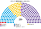
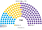
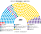
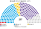
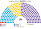
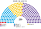
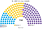

# 席次圖

## 近期大選重算

### 2025-10 全院

<!-- 席次表 -->

| 政黨 | 單一 | 複數 | 全院 | 占比 |
|---|--:|--:|--:|--:|
| 工人左翼 | 0 | 4 | **4** | 1.6% |
| 祖國力量 | 31 | 39 | **70** | 28.0% |
| 聯合省分 | 44 | 10 | **54** | 21.6% |
| 聯邦革新 | 2 | 1 | **3** | 1.2% |
| 自由前進 | 73 | 46 | **119** | 47.6% |
| **合計** | **150** | **100** | **250** | 100% |

<!-- /席次表 -->

### 2025-10 單一

### 2025-10 複數

### 2023-10 全院

<!-- 席次表 -->

| 政黨 | 席次 | 占比 |
|---|--:|--:|
| 工人左翼 | 3 | 1.2% |
| 祖國聯盟 | 64 | 25.6% |
| 為我國做事 | 2 | 0.8% |
| 地方:Renovador De La Concordia | 5 | 2.0% |
| 地方:Renovador Federal | 4 | 1.6% |
| 地方:Ahora Patria | 5 | 2.0% |
| 地方:Fe | 4 | 1.6% |
| 地方:Arriba Neuquen | 4 | 1.6% |
| 地方:Por Santa Cruz | 1 | 0.4% |
| 地方:La Fuerza De Santa Fe | 1 | 0.4% |
| 變革聯盟 | 129 | 51.6% |
| 自由前進 | 27 | 10.8% |
| 地方:Fuerza Republicana | 1 | 0.4% |
| **合計** | **250** | 100% |

<!-- /席次表 -->

## 現行

### 2025-10 後全院約

<!-- 席次表 -->

| 政黨 | 席次 | 占比 |
|---|--:|--:|
| 工人左翼 | 4 | 1.6% |
| 祖國力量 | 100 | 38.9% |
| 聯合省分 | 21 | 8.2% |
| 自由前進 | 95 | 37.0% |
| 其他 | 37 | 14.4% |
| **合計** | **257** | 100% |

<!-- /席次表 -->

## 民調

### PolitPro

<!-- 席次表 -->

| 政黨 | 席次 | 占比 |
|---|--:|--:|
| 工人左翼 | 4 | 1.6% |
| 祖國力量 | 70 | 28.0% |
| 聯合省分 | 54 | 21.6% |
| 聯邦革新 | 3 | 1.2% |
| 自由前進 | 119 | 47.6% |
| **合計** | **250** | 100% |

<!-- /席次表 -->

## 推估

### 第 3 屆全院

<!-- 席次表 -->

| 政黨 | 單一 | 複數 | 全院 | 占比 |
|---|--:|--:|--:|--:|
| 工人左翼 | 0 | 4 | **4** | 1.6% |
| 祖國力量 | 31 | 39 | **70** | 28.0% |
| 聯合省分 | 51 | 11 | **62** | 24.8% |
| 聯邦革新 | 2 | 1 | **3** | 1.2% |
| 自由前進 | 66 | 45 | **111** | 44.4% |
| **合計** | **150** | **100** | **250** | 100% |

<!-- /席次表 -->

### 單一

### 複數

